# IoT Sensor Monitor

[](https://github.com/enginertugrul/iot-sensor-monitor/actions/workflows/ci.yml)

IoT Sensor Monitor collects temperature, humidity, and motion readings from microcontroller boards (MCUs) on a local network. ESP32 and Arduino Nano boards send each reading over HTTP to a Spring Boot application, which stores it in PostgreSQL 17. Sensor owners watch new readings live on a web dashboard, explore the history in charts, and receive an email when an alert rule triggers. Without hardware, the console program `McuSimulator` sends the same requests, so you can run the full system on one computer.

## Key Features

- **One ingestion API.** The ESP32, the Arduino Nano, and `McuSimulator` send form `POST` requests with a per-sensor ingestion token. Only the SHA-256 hash of the token is stored.
- **Live dashboard.** The 10 latest readings of a sensor update through Server-Sent Events (SSE), without a page reload.
- **Tiered storage.** Raw readings stay for 30 days, hourly summaries for 90 days, and daily summaries of sensor-local days for 730 days. Readings up to 6 hours late are accepted, and the server rebuilds the summaries that they change.
- **Statistics and CSV export.** Charts use the finest tier that fits into 400 points and add readings that are not summarized yet. Summaries store sums and sample counts instead of averages, so averages stay correct across hours, days, and months. Table rows open a finer view, and a CSV text cell that could start a spreadsheet formula gets a leading `'`.
- **Email alerts.** Threshold and motion rules with cooldowns are checked in the ingestion transaction. Emails leave after the commit, with retries for temporary SMTP failures.
- **Accounts and sign-in.** Login uses sessions with CSRF protection and BCrypt password hashes, and email verification is mandatory. One-time codes are stored as HMAC-SHA256 digests, with attempt and rate limits.
- **Languages and units.** Pages and emails are in English or Turkish, and each user chooses Celsius, Fahrenheit, or Kelvin and a time zone.

Retention periods, time windows, and limits are defaults that the [configuration](docs/SETUP.md#configuration-reference) can change.

## Tech Stack

| Area                 | Technologies and versions                                                                                                                       |
|----------------------|-------------------------------------------------------------------------------------------------------------------------------------------------|
| Backend              | Java 21, Spring Boot 4.1.2 (Spring Framework 7): Spring MVC, Spring Security, Spring Data JPA (Hibernate), Bean Validation, Spring Mail; Lombok |
| Database             | PostgreSQL 17, Flyway migrations `V1` to `V15`                                                                                                  |
| Web UI               | Thymeleaf, plain JavaScript, Chart.js 4.5.0, `EventSource` for SSE                                                                              |
| Build and containers | Maven 3.9.16 (Maven Wrapper), multi-stage Docker build (`eclipse-temurin:21-jdk-noble`, `eclipse-temurin:21-jre-noble`), Docker Compose         |
| Tests and CI/CD      | JUnit Jupiter, Mockito, Testcontainers (PostgreSQL 17), GitHub Actions                                                                          |
| MCU clients          | Arduino sketches (C++), tested with Arduino IDE 2.3.10 ([libraries](docs/SETUP.md#arduino-ide-setup)); `McuSimulator` 1.0.0 (Java 21, JDK only) |

## Architecture Overview

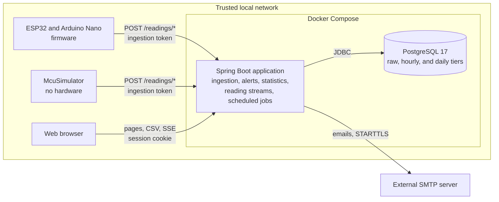

The application saves each reading and evaluates the alert rules in one database transaction, and alert emails leave only after the commit. Scheduled jobs build the summaries, and each open dashboard gets new readings through its reading stream, which checks the database about every 2 seconds. [Architecture](docs/ARCHITECTURE.md) describes the components and the data flow, and [Key Design Decisions and Trade-offs](docs/ARCHITECTURE.md#key-design-decisions-and-trade-offs) explains the reason and the cost of each choice.

## Screenshots

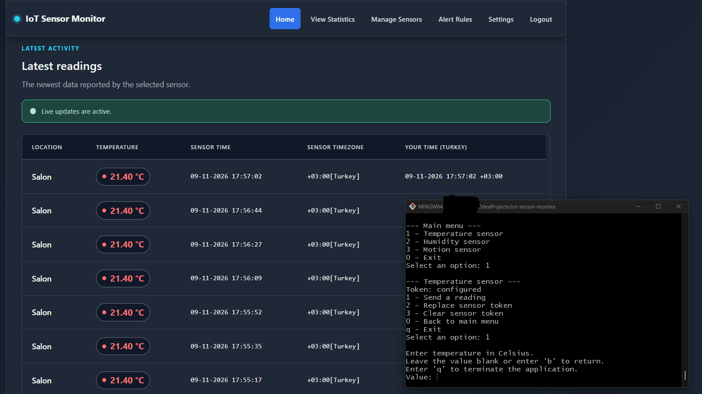

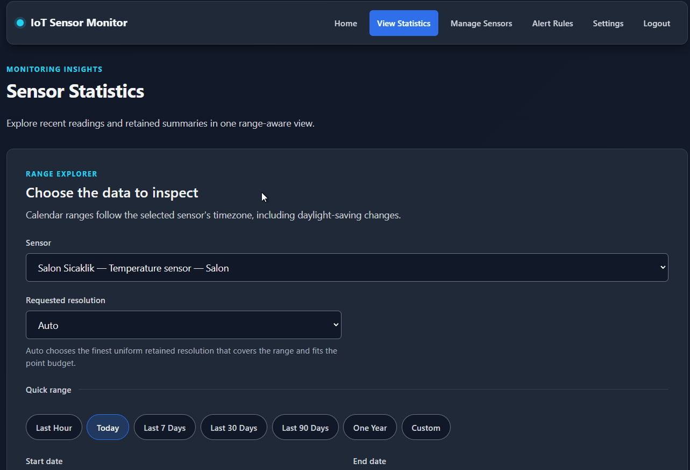

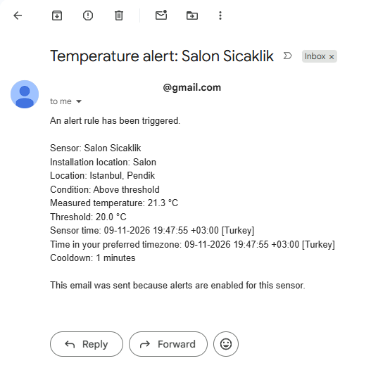

<details>
<summary>More screenshots: motion statistics, sensors, alert rules, and the Turkish interface</summary>

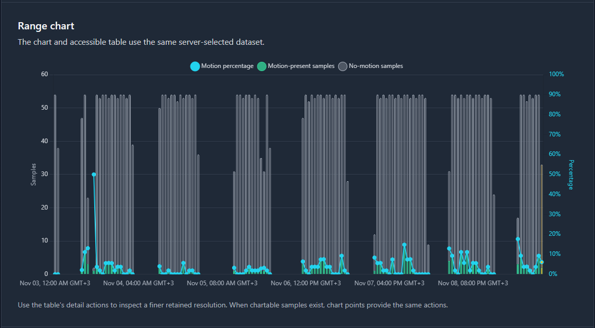

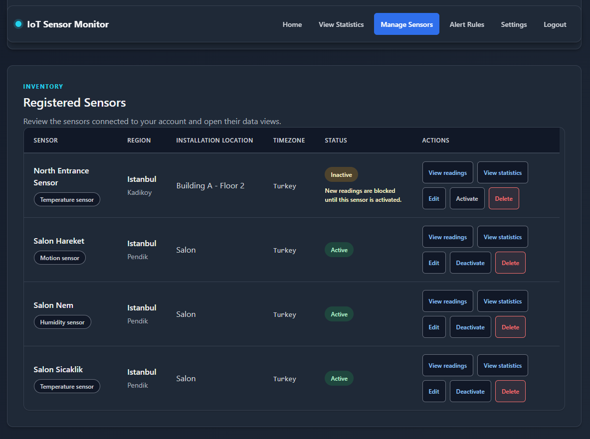

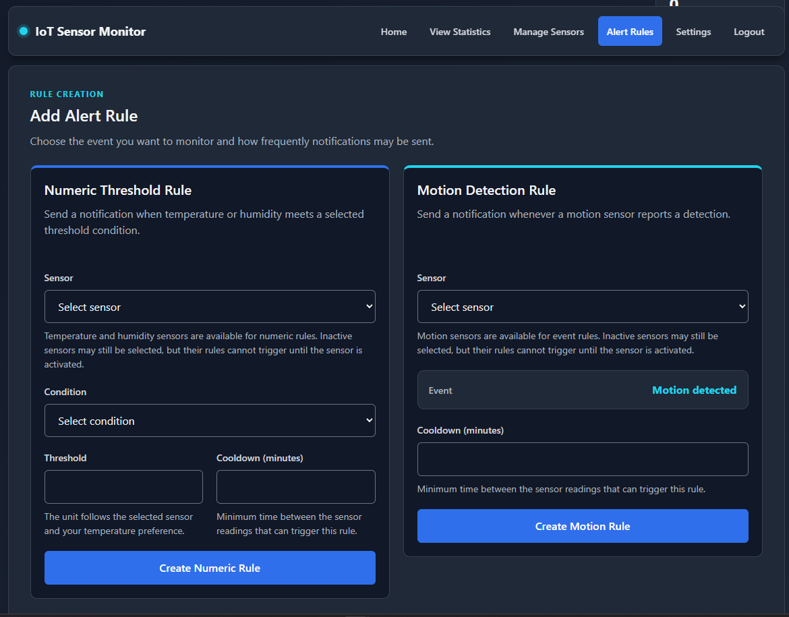

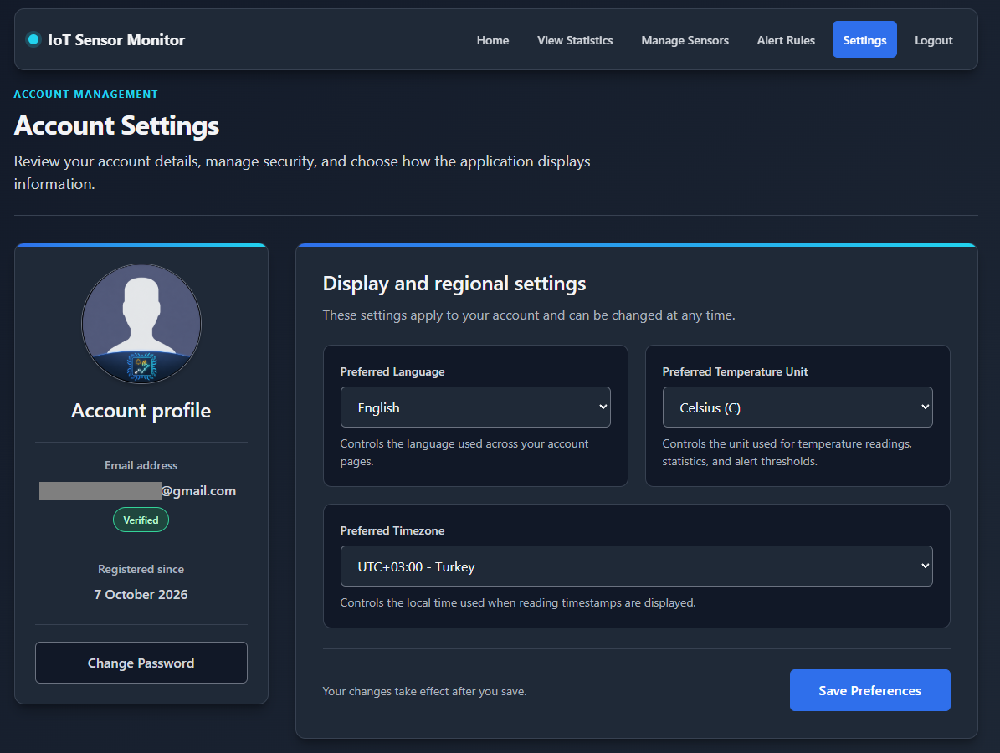

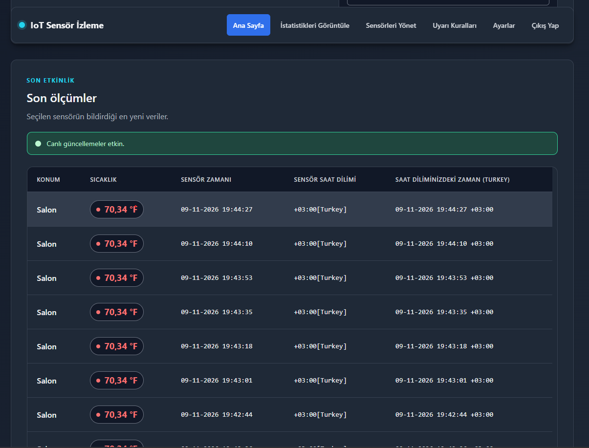

</details>

## Quick Start

This path runs the full system on one computer without hardware. You need Git, Docker with Docker Compose v2, JDK 21, and an SMTP account with STARTTLS, because a new account must verify its email address. Run the commands in Bash (Linux, macOS, or Git Bash on Windows). The [Setup Guide](docs/SETUP.md#quick-start-with-docker-and-account-onboarding) explains each step and shows the PowerShell commands.

1. **Create the `.env` file and two HMAC secrets.**

   ```bash
   git clone https://github.com/enginertugrul/iot-sensor-monitor.git
   cd iot-sensor-monitor
   cp .env.example .env
   openssl rand -base64 32
   openssl rand -base64 32
   ```

   Set the empty values in `.env`. With `127.0.0.1`, only this computer can open the application. [Example: Gmail](docs/SETUP.md#example-gmail) shows the SMTP values for Gmail.

   ```properties
   APP_BIND_ADDRESS=127.0.0.1
   DB_PASSWORD=<a long random password>
   SMTP_HOST=<host name of your SMTP server>
   SMTP_USERNAME=<your SMTP login>
   SMTP_PASSWORD=<your SMTP password>
   EMAIL_VERIFICATION_HMAC_SECRET_BASE64=<first generated secret>
   PASSWORD_RECOVERY_HMAC_SECRET_BASE64=<second generated secret>
   ```

2. **Start the stack** and follow the log until it shows `Started IotSensorMonitorApplication`. Press `Ctrl+C` to stop following the log.

   ```bash
   docker compose up -d --build
   docker compose logs -f app
   ```

3. **Create an account and a sensor.** Open `http://localhost:8080`, select **Create Account**, and register. Enter the 8-digit code from the verification email, and log in. On **Manage Sensors**, add a **Temperature sensor** and select **Copy token**. The page shows the token only once.

4. **Send readings with `McuSimulator`.** Build and start it:

   ```bash
   sh ./mvnw -f mcu-simulator/pom.xml clean package
   java -jar mcu-simulator/target/mcu-simulator-1.0.0.jar http://localhost:8080
   ```

   Enter `1` (temperature sensor), then `2` (configure the token), and paste the token. Enter `1` (send a reading) and a value such as `22.5`. On **Home**, choose the sensor in **Select sensor**: each new reading appears in the **Latest readings** table within 2 to 3 seconds, without a page reload.

To receive an alert email, follow [Test an Alert with McuSimulator](docs/SETUP.md#test-an-alert-with-mcusimulator). To stop the stack, run `docker compose stop`.

## Hardware Options

Two firmware sketches use the same ingestion endpoints as `McuSimulator`:

| Sketch                                                                                 | Board and sensors                                           | Network           | Setup                                                                             |
|----------------------------------------------------------------------------------------|-------------------------------------------------------------|-------------------|-----------------------------------------------------------------------------------|
| [`esp32-dht22-pir.ino`](firmware/esp32/esp32-dht22-pir.ino)                            | ESP32, DHT22 (temperature, humidity), HC-SR501 PIR (motion) | Wi-Fi             | [ESP32 setup](docs/SETUP.md#esp32-with-dht22-and-pir-motion-sensor)               |
| [`arduino-nano-enc28j60-ntc.ino`](firmware/arduino-nano/arduino-nano-enc28j60-ntc.ino) | Arduino Nano, NTC thermistor (temperature)                  | ENC28J60 Ethernet | [Arduino Nano setup](docs/SETUP.md#arduino-nano-with-enc28j60-and-ntc-thermistor) |

The ESP32 retries a request only when the request did not reach the server, so a retry cannot store a reading twice. The Nano sketch runs in 2 KB of SRAM and avoids heap allocations.

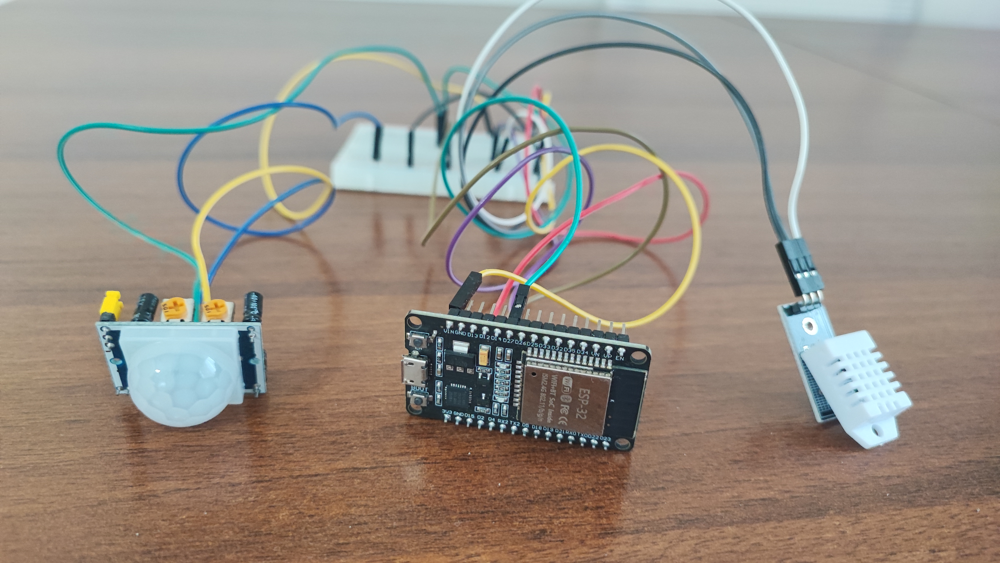

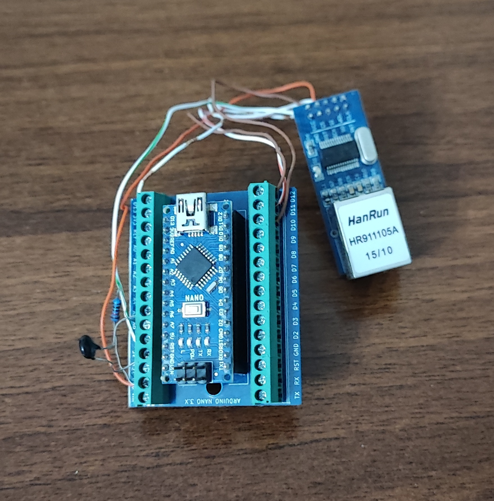

An MCU cannot reach `127.0.0.1` of the computer that runs Docker, so set `APP_BIND_ADDRESS` to the LAN address of that computer ([Hardware Path](docs/SETUP.md#hardware-path-esp32-and-arduino-nano)).

## Deployment Scope

IoT Sensor Monitor is designed for one application instance on a [trusted local network](docs/ARCHITECTURE.md#deployment-scope-and-security-assumptions), such as a home or lab network. This is a deliberate scope: plain HTTP lets an 8-bit Arduino Nano send readings directly, so do not expose the application to the internet.

## Documentation

- [Architecture](docs/ARCHITECTURE.md): terminology, components, data flow, database schema, tiered storage, concurrency, live streaming, alerts, security, design decisions, limitations, and CI/CD.
- [API Reference](docs/API.md): ingestion endpoints, the reading stream, statistics and CSV endpoints, error codes, and page routes.
- [Setup Guide](docs/SETUP.md): Docker setup, `McuSimulator`, ESP32 and Arduino Nano setup, configuration reference, email alerts, development setup, tests, troubleshooting, and cleanup.

## Contributing

- [Contributor Development Setup and Running Tests](docs/SETUP.md#contributor-development-setup-and-running-tests) shows how to run the application from source and how to run the unit tests and the PostgreSQL 17 integration tests.
- [Code Structure and Conventions](docs/ARCHITECTURE.md#code-structure-and-conventions) describes the package layout and the code conventions.
- Pull requests to `master` run the `Backend CI` workflow: unit tests, integration tests, and a Docker build for `linux/amd64` and `linux/arm64`.
- A published GitHub release runs the same CI first. Then it pushes `linux/amd64` and `linux/arm64` images to Docker Hub, with an SBOM and build provenance.

## License

The project is licensed under the [MIT License](LICENSE).
