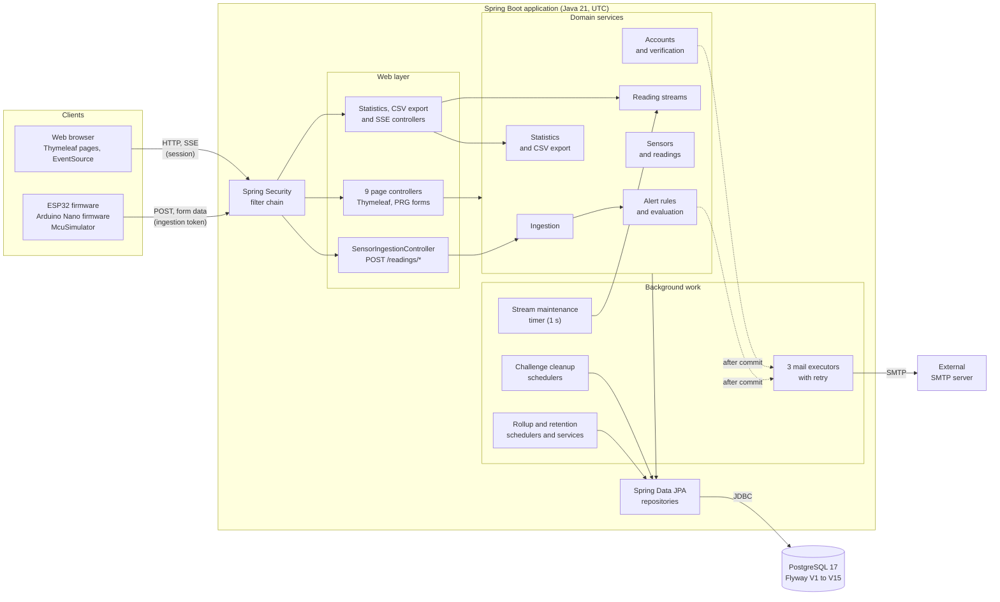
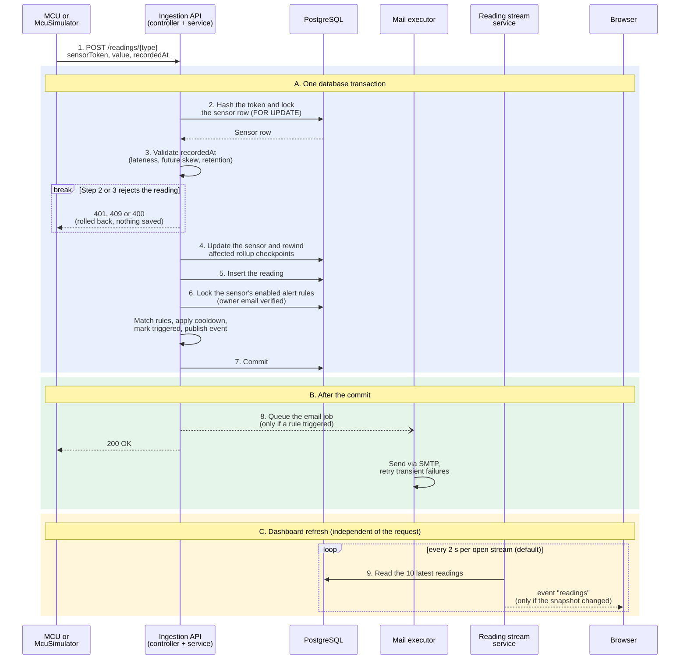
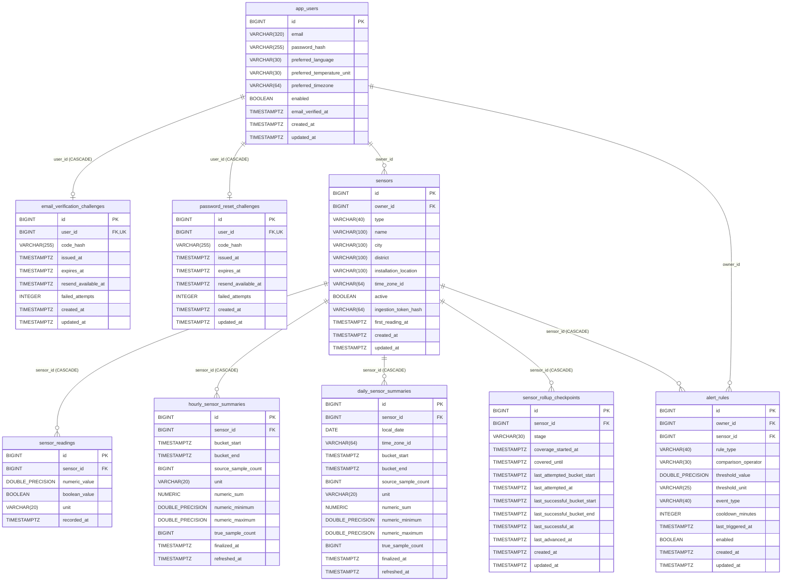
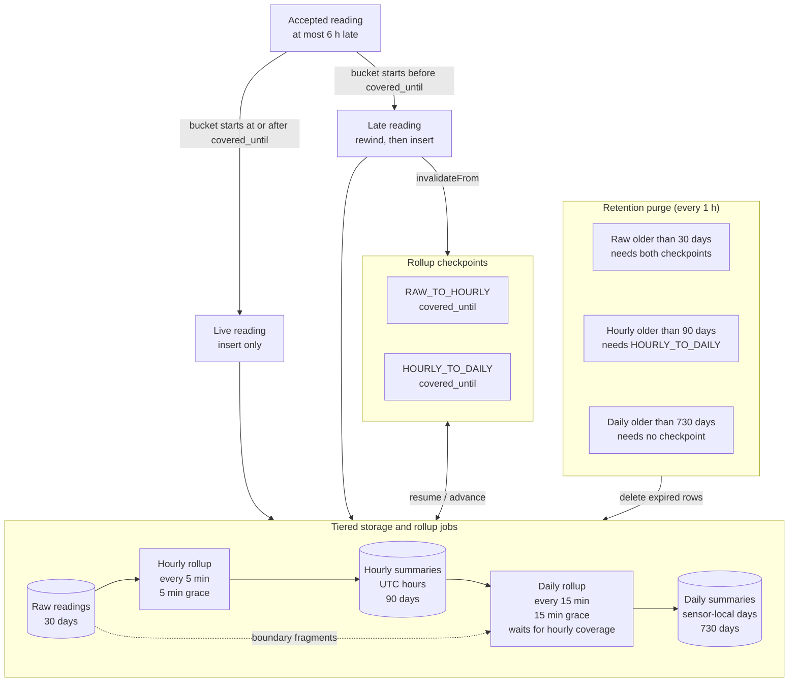
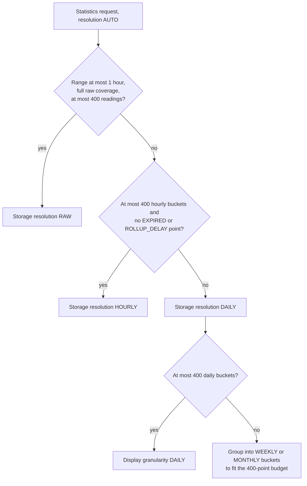
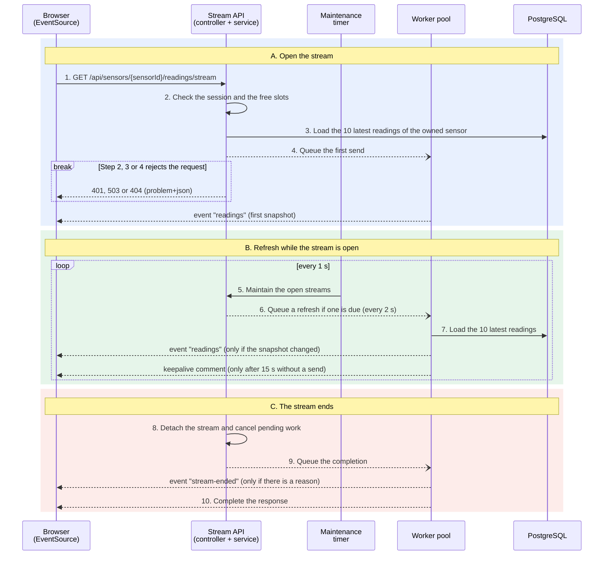

# Architecture

Setup steps are in the [Setup Guide](SETUP.md). Endpoints, request formats, and error codes are in the [API Reference](API.md).

## Table of Contents

- [Terminology and Domain Model](#terminology-and-domain-model)
- [System Overview and Components](#system-overview-and-components)
- [End-to-End Data Flow](#end-to-end-data-flow)
- [Database Schema and Flyway Migrations](#database-schema-and-flyway-migrations)
- [Tiered Historical Storage and Rollup Checkpoints](#tiered-historical-storage-and-rollup-checkpoints)
- [Concurrency, Lock Ordering, and Transaction Boundaries](#concurrency-lock-ordering-and-transaction-boundaries)
- [Statistics Resolution, Coverage, and CSV Export](#statistics-resolution-coverage-and-csv-export)
- [Live Dashboard Streaming (SSE)](#live-dashboard-streaming-sse)
- [Alert Evaluation and Notification Pipeline](#alert-evaluation-and-notification-pipeline)
- [Authentication, Account Flows, and Ingestion Security](#authentication-account-flows-and-ingestion-security)
- [Localization, Time Zones, and Measurement Units](#localization-time-zones-and-measurement-units)
- [MCU Firmware and Simulator Design](#mcu-firmware-and-simulator-design)
- [Code Structure and Conventions](#code-structure-and-conventions)
- [Key Design Decisions and Trade-offs](#key-design-decisions-and-trade-offs)
- [Deployment Scope and Security Assumptions](#deployment-scope-and-security-assumptions)
- [Known Limitations and Future Work](#known-limitations-and-future-work)
- [CI/CD Pipeline](#cicd-pipeline)

---

## Terminology and Domain Model

All four documents use these terms.

| Term                    | Meaning                                                                                                                                                                                                                                                                               |
|-------------------------|---------------------------------------------------------------------------------------------------------------------------------------------------------------------------------------------------------------------------------------------------------------------------------------|
| MCU                     | A microcontroller board with sensors attached. Its sensors measure values, and the MCU sends them over HTTP. The project supports an ESP32 and an Arduino Nano. `McuSimulator` takes the place of an MCU for readers without hardware. One MCU can send readings for several sensors. |
| Owner                   | The registered user (`AppUser`) who owns a sensor and its alert rules.                                                                                                                                                                                                                |
| Sensor                  | One registered measurement source with a fixed `SensorType` (`TEMPERATURE`, `HUMIDITY`, or `MOTION`) and its own ingestion token. It has one owner, location fields (`city`, `district`, `installation_location`), and an IANA time zone (`time_zone_id`).                            |
| Reading                 | One measurement of one sensor, with its sampling time `recordedAt` (stored as `TIMESTAMPTZ`). It holds a number in a canonical unit (`C` or `PERCENT`) or a boolean (motion).                                                                                                         |
| Ingestion token         | A random secret for one sensor. The MCU sends it with every reading. The database stores only its SHA-256 hash.                                                                                                                                                                       |
| Tier                    | One of three storage levels: raw readings, hourly summaries, and daily summaries.                                                                                                                                                                                                     |
| Bucket                  | The time interval of one summary: one UTC hour or one sensor-local calendar day. A bucket includes its start and excludes its end: `[start, end)`.                                                                                                                                    |
| Summary                 | An aggregate row for one sensor and one bucket. Every summary stores `source_sample_count`. Temperature and humidity summaries also store `numeric_sum`, `numeric_minimum`, and `numeric_maximum`. Motion summaries store `true_sample_count`.                                        |
| Hourly summary          | A summary of one UTC hour (`hourly_sensor_summaries`).                                                                                                                                                                                                                                |
| Daily summary           | A summary of one calendar day in the sensor's time zone, from local midnight to the next local midnight (`daily_sensor_summaries`).                                                                                                                                                   |
| Rollup                  | A scheduled job that builds summaries. Stage `RAW_TO_HOURLY` builds hourly summaries from raw readings. Stage `HOURLY_TO_DAILY` builds daily summaries from hourly summaries and from raw readings at the day boundaries.                                                             |
| Rollup checkpoint       | One row per sensor and stage (`SensorRollupCheckpoint`). It records the contiguous range `[coverage_started_at, covered_until)` in which the summaries of that stage are complete.                                                                                                    |
| Retention purge         | The scheduled deletion of expired rows in small batches (`SensorDataRetentionService`).                                                                                                                                                                                               |
| Storage resolution      | The tier that a statistics query requests or uses: `RAW`, `HOURLY`, or `DAILY`. The request value `AUTO` lets the server choose the finest tier that fits the point or row budget.                                                                                                    |
| Display granularity     | The bucket size of the points that the user sees: `RAW`, `HOURLY`, `DAILY`, `WEEKLY`, or `MONTHLY`.                                                                                                                                                                                   |
| Alert rule              | A condition on the readings of one sensor: `NUMERIC_THRESHOLD` with `ABOVE` or `BELOW`, or `EVENT_DETECTED` with `MOTION_DETECTED`. It has a cooldown and an enabled flag. When a reading triggers it, the owner receives an email.                                                   |
| Reading stream          | A Server-Sent Events (SSE) connection that sends the 10 latest readings of one sensor to the dashboard (`SensorReadingStreamService`).                                                                                                                                                |
| One-time code challenge | A row in `email_verification_challenges` or `password_reset_challenges` for one user. It stores an 8-digit code as an HMAC-SHA256 digest (`code_hash`), with an expiry (15 minutes by default), a resend cooldown, and a failed-attempt counter.                                      |

---

## System Overview and Components

IoT Sensor Monitor is a single Spring Boot 4.1.2 application running on Java 21. It receives readings from MCUs over HTTP, stores them in PostgreSQL 17, and serves a server-rendered web interface to the owners of the sensors. Emails leave the application through an external SMTP server.

The application has two kinds of clients, and each kind authenticates in its own way:

- **MCU clients** (the ESP32 firmware, the Arduino Nano firmware, and `McuSimulator`) have no user interface. They send readings with HTTP `POST` requests and identify themselves with a per-sensor ingestion token instead of a login session.
- **Browsers** log in with a form and keep an HTTP session. They load Thymeleaf pages, open a reading stream (SSE) on the dashboard, and download CSV files.

### Architecture Diagram



Solid arrows show calls that happen while a request or a job is running. Dotted arrows show work that starts only after the database transaction has committed. Three paths are important:

1. **MCU to database.** A reading passes the security filter chain and `SensorIngestionController`. The ingestion service checks the token and the timestamp, saves the reading, and calls alert evaluation in the same transaction.
2. **Browser to database.** Page controllers render HTML. The REST controllers return statistics as JSON, CSV downloads, and reading streams. Both kinds of controller call the domain services.
3. **Background work.** Schedulers summarize and purge data and delete expired one-time code challenges. A separate timer maintains the open reading streams. After-commit listeners pass emails to three separate mail executors.

For the complete life of one reading, see [End-to-End Data Flow](#end-to-end-data-flow).

### Component Overview

| Component             | Location                                 | Responsibility                                                                                                                                                                                                                                                                                                                                                            | Details                                                                                                         |
|-----------------------|------------------------------------------|---------------------------------------------------------------------------------------------------------------------------------------------------------------------------------------------------------------------------------------------------------------------------------------------------------------------------------------------------------------------------|-----------------------------------------------------------------------------------------------------------------|
| ESP32 firmware        | `firmware/esp32`                         | Board with a DHT22 temperature and humidity sensor and a PIR motion sensor. It sends readings as form `POST` requests over Wi-Fi.                                                                                                                                                                                                                                         | [MCU Firmware and Simulator Design](#mcu-firmware-and-simulator-design)                                         |
| Arduino Nano firmware | `firmware/arduino-nano`                  | ATmega328P board (2 KB SRAM) with an ENC28J60 Ethernet module and an NTC thermistor. It sends the same form requests over plain HTTP.                                                                                                                                                                                                                                     | [MCU Firmware and Simulator Design](#mcu-firmware-and-simulator-design)                                         |
| `McuSimulator`        | `mcu-simulator` (separate Maven project) | Interactive console program for readers without hardware. You enter an ingestion token and a value, and it sends the reading in the same format as the firmware. It uses only the JDK HTTP client and targets `http://localhost:8080` unless you pass another URL.                                                                                                        | [MCU Firmware and Simulator Design](#mcu-firmware-and-simulator-design)                                         |
| Browser UI            | Thymeleaf templates and page JavaScript  | Server-rendered pages. Chart.js draws the statistics chart from a JSON payload that the page embeds, and the browser's `EventSource` receives live dashboard updates.                                                                                                                                                                                                     | [Live Dashboard Streaming (SSE)](#live-dashboard-streaming-sse)                                                 |
| Security filter chain | `SecurityConfig`                         | Form login with HTTP sessions, CSRF protection, and the role `ROLE_USER`. The three `POST /readings/*` endpoints need no session and no CSRF token; the ingestion service checks the ingestion token instead. `SecurityConfig` also creates the `SessionRegistry` for the reading streams.                                                                                | [Authentication, Account Flows, and Ingestion Security](#authentication-account-flows-and-ingestion-security)   |
| Page controllers      | `controller`                             | Nine `@Controller` classes render the Thymeleaf pages, from the dashboard (`/`) to the public login and recovery pages. Forms use the Post/Redirect/Get (PRG) pattern.                                                                                                                                                                                                    | [Page routes](API.md#browser-pages-and-html-form-routes-appendix)                                               |
| REST controllers      | `controller`                             | Four `@RestController` classes: `SensorIngestionController` (`POST /readings/temperature`, `/humidity`, `/motion`), `SensorReadingStreamController` (`GET /api/sensors/{sensorId}/readings/stream`), `StatisticsApiController` (`GET /api/sensors/{sensorId}/statistics/series`), and `StatisticsExportController` (`GET /api/sensors/{sensorId}/statistics/export.csv`). | [API Reference](API.md)                                                                                         |
| Error handlers        | `controller.advice`                      | `ApiExceptionHandler`, `ApiSecurityExceptionHandler`, and `ApiMediaTypeExceptionHandler` return RFC 9457 `application/problem+json` responses for the API endpoints. `PageExceptionHandler` renders the `error/404` page when the sensor or alert rule pages cannot find a sensor or a rule.                                                                              | [Conventions](#conventions)                                                                                     |
| Domain services       | `service`                                | Business rules and transaction boundaries. The sub-packages are `reading.ingestion` (token check, timestamp policy, saving readings), `reading.lifecycle` (rollups and retention), `reading.statistics` (resolution choice, tier stitching, CSV), `reading.stream` (reading streams), `alert`, `notification`, `sensor`, and `user`.                                      | [Tiered Historical Storage and Rollup Checkpoints](#tiered-historical-storage-and-rollup-checkpoints)           |
| Schedulers            | `scheduler`                              | Six classes that run the periodic jobs listed in [Scheduled Jobs](#scheduled-jobs).                                                                                                                                                                                                                                                                                       | [Concurrency, Lock Ordering, and Transaction Boundaries](#concurrency-lock-ordering-and-transaction-boundaries) |
| Mail executors        | `config`, `service.notification`         | Three bounded `ThreadPoolTaskExecutor` beans, one for each email type. After-commit event listeners submit email work to them, and `EmailDeliveryRetryService` retries transient SMTP failures.                                                                                                                                                                           | [Alert Evaluation and Notification Pipeline](#alert-evaluation-and-notification-pipeline)                       |
| Persistence           | `repository`, `entity`, `db/migration`   | Spring Data JPA repositories. Where concurrent work touches the same rows, they take pessimistic row locks. Flyway migrations `V1` to `V15` define the schema.                                                                                                                                                                                                            | [Database Schema and Flyway Migrations](#database-schema-and-flyway-migrations)                                 |
| PostgreSQL 17         | `db` container                           | Stores users, sensors, raw readings, hourly and daily summaries, rollup checkpoints, alert rules, and one-time code challenges. SQL `CHECK` constraints protect the domain rules inside the database.                                                                                                                                                                     | [Database Schema and Flyway Migrations](#database-schema-and-flyway-migrations)                                 |
| SMTP server           | External                                 | Delivers alert, verification, and password reset emails. The `docker` profile requires STARTTLS, and the default port is 587.                                                                                                                                                                                                                                             | [Alert Evaluation and Notification Pipeline](#alert-evaluation-and-notification-pipeline)                       |

### Scheduled Jobs

Five jobs are `@Scheduled` methods with a fixed delay. Each interval starts when the previous run ends, so a job never overlaps its own previous run. The project does not configure a scheduler thread pool, so Spring Boot's default scheduler runs these five jobs on one thread, one after another. A long run of one job therefore delays the start of the others. The sixth job, `SensorReadingStreamScheduler`, runs on its own daemon timer thread. The intervals of these five jobs are defaults, and properties can change them. The 1-second interval of `SensorReadingStreamScheduler` is fixed in the code.

| Scheduler                                    | Default interval | Work                                                                                                           |
|----------------------------------------------|------------------|----------------------------------------------------------------------------------------------------------------|
| `HourlySensorRollupScheduler`                | 5 minutes        | Rolls raw readings up into hourly summaries.                                                                   |
| `DailySensorRollupScheduler`                 | 15 minutes       | Rolls hourly summaries up into daily summaries.                                                                |
| `SensorDataRetentionScheduler`               | 1 hour           | Deletes expired rows in small, bounded batches.                                                                |
| `EmailVerificationChallengeCleanupScheduler` | 1 hour           | Deletes expired email verification challenges.                                                                 |
| `PasswordResetChallengeCleanupScheduler`     | 1 hour           | Deletes expired password reset challenges.                                                                     |
| `SensorReadingStreamScheduler`               | 1 second         | Maintains the open reading streams: it closes ended or expired streams and queues refresh work for the others. |

`SchedulingConfig` turns on all six jobs only when `app.scheduling.enabled` is `true`, which is the default. With `false`, as in the test profile, no rollup, purge, or cleanup runs, and an open reading stream sends only its first snapshot.

### Docker Deployment Topology

Both Compose files, `compose.yml` and `compose.dist.yml`, define the same two services, `db` and `app`. `compose.yml` builds the image from the local `Dockerfile` (`iot-sensor-monitor:local`). `compose.dist.yml` pulls `enginertugrul/iot-sensor-monitor:latest` from Docker Hub (see [CI/CD Pipeline](#cicd-pipeline)). The two files use different Compose project names (`iot-sensor-monitor` and `iot-sensor-monitor-dist`), so their `postgres-data` volumes stay separate.

| Service | Image                           | Behavior                                                                                                                                                                                                             |
|---------|---------------------------------|----------------------------------------------------------------------------------------------------------------------------------------------------------------------------------------------------------------------|
| `db`    | `postgres:17`                   | Keeps its data in the named volume `postgres-data`. A `pg_isready` health check tells Compose when the database is ready. Compose publishes no host port for the database, so only the `app` container can reach it. |
| `app`   | Local build or Docker Hub image | Starts only after `db` is healthy and runs with the `docker` Spring profile. Compose publishes container port `8080` on `${APP_BIND_ADDRESS}:${APP_PORT:-8080}`. `APP_BIND_ADDRESS` has no default and must be set.  |

The database password, the SMTP settings, and the two HMAC secrets reach the application as environment variables from the `.env` file. Compose stops with an error when a required value is missing. The [Setup Guide](SETUP.md) lists all variables.

The `Dockerfile` has two stages. The build stage (`eclipse-temurin:21-jdk-noble`) compiles `src/main` and repackages the Spring Boot JAR. It does not run tests, because the CI workflow runs them (see [CI/CD Pipeline](#cicd-pipeline)). The runtime stage (`eclipse-temurin:21-jre-noble`) runs the JAR as the non-root user `ism` with `-Duser.timezone=UTC`, so the JVM runs in UTC.

---

## End-to-End Data Flow

This section follows one reading from the moment an MCU sends it until it appears on the dashboard and, if an alert rule triggers, in the owner's inbox. The work is split into two parts. All database changes for the reading happen in a single transaction. Side effects, such as sending an email, start only after that transaction has committed. The live dashboard does not take part in the request: it reads the database on its own schedule.

### Ingestion Sequence Diagram



Solid arrows are calls, dashed arrows are replies, and the dashed arrow with an open head is an asynchronous hand-off. The numbers match the [walkthrough](#step-by-step-walkthrough) below. `{type}` is `temperature`, `humidity`, or `motion`. `Ingestion API` stands for `SensorIngestionController` together with `SensorReadingIngestionService`. The three colored bands show where each part of the work runs:

- **Blue: the request.** Steps 2 to 7 run in one database transaction. If any step fails, the whole transaction rolls back and the reading leaves no trace.
- **Green: after the commit.** The email job is queued only after a successful commit. Then the MCU receives its answer.
- **Yellow: the dashboard.** Open reading streams poll the database every 2 seconds by default. Nothing in the request path notifies them.

### Step-by-Step Walkthrough

1. **The MCU sends a reading.** The MCU or `McuSimulator` sends a form `POST` (`application/x-www-form-urlencoded`) to the endpoint of its sensor type: `/readings/temperature`, `/readings/humidity`, or `/readings/motion`. The body contains `sensorToken`, the measured value, and `recordedAt` in Unix epoch milliseconds. These requests need no login session and no CSRF token. `SensorIngestionController` binds the body to a request record and runs Bean Validation before any database work starts. The [API Reference](API.md) describes the fields and their limits.

2. **The service authenticates the sensor.** The ingestion methods of `SensorReadingIngestionService` are `@Transactional`, so the transaction starts here. `SensorIngestionAccessService` hashes the token with SHA-256 and loads the matching sensor with a `PESSIMISTIC_WRITE` lock (`findByIngestionTokenHashForUpdate`). It rejects the reading if no sensor matches, if the sensor is inactive, or if the sensor type does not match the endpoint.

3. **The service validates the timestamp and builds the reading.** `SensorReadingIngestionPolicy` first truncates `recordedAt` to microseconds, the resolution of a PostgreSQL `timestamptz`. It then rejects the reading in four cases:
    - `recordedAt` is earlier than the creation time of the sensor.
    - `recordedAt` is more than 6 hours before the time of arrival (`maximum-lateness`, default `PT6H`).
    - `recordedAt` is more than 2 minutes in the future (`maximum-future-skew`, default `PT2M`). This margin tolerates small clock drift.
    - Rebuilding the reading's local day later would need raw data that is older than the raw retention boundary (`raw-retention`, default `P30D`). The check uses the UTC hour in which the local day starts, or the creation hour of the sensor if that is later. With the default values this case cannot happen, because a local day starts less than two days before any accepted reading. It protects configurations with a short raw retention.

   Then a static factory such as `SensorReading.temperature(...)` builds the reading in canonical units. It rejects a value that breaks the domain rules.

4. **The service updates the sensor and the rollup checkpoints.** If this is the earliest reading of the sensor so far, the service stores its time as `first_reading_at`. From then on, the time zone of the sensor is locked. Next, the service locks the sensor's rollup checkpoints, if they exist yet, in a fixed order: `RAW_TO_HOURLY`, then `HOURLY_TO_DAILY`. The bucket of the reading is its UTC hour for the first stage and its sensor-local day for the second. If the bucket starts before the checkpoint's `covered_until`, `invalidateFrom` moves the checkpoint back to the start of that bucket, and a later rollup run recomputes it. If the bucket starts at or after `covered_until`, the checkpoint does not change. See [Tiered Historical Storage and Rollup Checkpoints](#tiered-historical-storage-and-rollup-checkpoints).

5. **The service inserts the reading.** The new row is not visible to other transactions until the commit.

6. **Alert evaluation runs in the same transaction.** `AlertEvaluationServiceImpl` loads the enabled alert rules of the sensor in ID order and locks them with `PESSIMISTIC_WRITE`. It loads only rules whose owner has a verified email address. For each rule that the reading triggers, the service checks the cooldown against the reading's `recordedAt`, not against the time of arrival. If the cooldown allows it, the service marks the rule as triggered and publishes an `AlertTriggeredEvent`. This immutable record carries everything the email needs: the recipient, the language, the temperature unit, both time zones, the sensor details, and the trigger values. The mail thread therefore never queries the database. If no rule triggers, nothing is published.

7. **The transaction commits.** The reading, the first-reading time, the checkpoint rewinds, and the rule cooldowns become visible together, and all locks are released. Without a triggered rule, `SensorIngestionController` now returns `200 OK` with an empty body.

8. **The email leaves after the commit.** Spring passes the `AlertTriggeredEvent` to `EmailAlertNotificationListener` only in the `AFTER_COMMIT` phase, so a rolled-back reading never sends an email. The listener runs in the request thread. It submits the job to `emailAlertMailExecutor` and returns at once. After that, `SensorIngestionController` returns `200 OK`. A thread of the mail pool calls `EmailDeliveryRetryService`, which sends the message through SMTP and retries transient failures. See [Alert Evaluation and Notification Pipeline](#alert-evaluation-and-notification-pipeline).

9. **The dashboard refreshes on its own.** When the owner has the dashboard open for the sensor, the browser holds a reading stream (`GET /api/sensors/{sensorId}/readings/stream`). `SensorReadingStreamService` reloads the 10 latest readings of each open stream every 2 seconds by default and compares them with the last snapshot. It pushes a `readings` event only when the snapshot has changed. After 15 seconds without output, it sends a `keepalive` comment instead. Because the stream polls the database, a new reading appears at the next refresh after the commit. See [Live Dashboard Streaming (SSE)](#live-dashboard-streaming-sse).

**Related tests:**

- `SensorIngestionApiIT`: accepted and rejected readings over HTTP.
- `SensorReadingIngestionIT`: commit and rollback of the reading, the first-reading time, and the checkpoint rewinds.
- `AlertEvaluationIT`: cooldown and event publishing.
- `SensorReadingStreamIT`: snapshots and keepalive comments.

### Rejected Readings

A rejected reading is not stored: it creates no reading, rewinds no checkpoint, and triggers no alert. The response is an RFC 9457 `application/problem+json` document. The table shows which component rejects each case, and the [API Reference](API.md#status-codes) lists the status code and the error code of each case.

| Cause                                                                     | Detected by                                                              |
|---------------------------------------------------------------------------|--------------------------------------------------------------------------|
| Body is not `application/x-www-form-urlencoded`                           | Spring MVC (`consumes` on the endpoint)                                  |
| Missing or too long token, missing or invalid value, missing `recordedAt` | Bean Validation in `SensorIngestionController`, before any database work |
| Unknown token                                                             | `SensorIngestionAccessService`                                           |
| Inactive sensor                                                           | `SensorIngestionAccessService`                                           |
| Reading type does not match the sensor type                               | `SensorIngestionAccessService`                                           |
| `recordedAt` outside the accepted window                                  | `SensorReadingIngestionPolicy`                                           |
| Value rejected by the domain rules                                        | `SensorReading` factory methods                                          |

### Late Readings

The backend accepts late readings on purpose. By default, step 3 allows a delay of up to 6 hours. If a late reading falls into a bucket that a rollup has already covered, step 4 rewinds the checkpoint. The next rollup run then recomputes that bucket and the buckets after it, not the whole history. Alert cooldowns also use `recordedAt`, so a late reading is judged at the time it was measured. On the dashboard, a late reading appears only if its `recordedAt` is among the 10 latest, because the snapshot is ordered by `recordedAt`.

Today, no client sends old readings. The firmware and `McuSimulator` do not buffer readings, and they do not resend a reading after a failed `POST`. The only retry is in the ESP32 firmware: when the connection fails before the request is sent, it tries once more with the original `recordedAt`. The 6-hour window therefore prepares the backend for MCUs that buffer readings and resend them after a failed `POST`. Such buffering is listed under [Future Work](#future-work).

---

## Database Schema and Flyway Migrations

Flyway migrations `V1` to `V15` (`src/main/resources/db/migration`) define the schema. Hibernate only validates the mapping against it (`ddl-auto=validate`). The diagram shows the nine tables of the current schema.



### Migration History

| Version | Change                                                    |
|---------|-----------------------------------------------------------|
| `V1`    | Initial setup with the `sensor_data` table                |
| `V2`    | `app_users`                                               |
| `V3`    | `sensors`                                                 |
| `V4`    | `sensor_readings` (replaces `sensor_data`)                |
| `V5`    | Sensor ingestion token hash and `last_seen_at`            |
| `V6`    | `alert_rules`, and removal of the old `sensor_data` table |
| `V7`    | Alert rule cooldown and `last_triggered_at`               |
| `V8`    | Unit and value-shape constraints for readings             |
| `V9`    | Threshold invariants for alert rules                      |
| `V10`   | Cascade delete for sensor-owned data                      |
| `V11`   | Email verification (`email_verified_at`, challenge table) |
| `V12`   | Password reset challenges                                 |
| `V13`   | Tiered summary storage and rollup checkpoints             |
| `V14`   | `last_seen_at` replaced by `first_reading_at`             |
| `V15`   | `home_location` renamed to `installation_location`        |

All 15 migrations change only the schema (DDL). None of them fills new columns for existing rows. For example, `V14` adds `first_reading_at` without a value for existing sensors; the next accepted reading sets it.

**Related test:** `DatabaseMigrationIT` applies and validates every migration on PostgreSQL 17 through Testcontainers. It checks that the current schema exists and that superseded objects are gone. It validates the migrated schema against all current entity mappings. It also runs the migration a second time to confirm that Flyway applies nothing and leaves the history unchanged.

### Database-Level Rules

PostgreSQL enforces the main domain rules. Java code checks the same rules first, and the database checks them again, also for native queries and manual SQL.

| Rule                        | Examples                                                                                                                                                                                                   |
|-----------------------------|------------------------------------------------------------------------------------------------------------------------------------------------------------------------------------------------------------|
| Case-insensitive uniqueness | `uk_app_users_email_lower`, `uk_sensors_owner_name_lower`                                                                                                                                                  |
| Unique token hash           | Partial unique index `uk_sensors_ingestion_token_hash`                                                                                                                                                     |
| One row per bucket          | `UNIQUE (sensor_id, bucket_start)` on both summary tables, `UNIQUE (sensor_id, local_date, time_zone_id)` on daily summaries                                                                               |
| One checkpoint per stage    | `UNIQUE (sensor_id, stage)`                                                                                                                                                                                |
| One challenge per user      | Unique index on `user_id` in both challenge tables                                                                                                                                                         |
| Value shape                 | Numeric columns plus a unit, or boolean columns, never a mix (`ck_sensor_readings_value_shape`, `ck_hourly_sensor_summaries_value_shape`, `ck_daily_sensor_summaries_value_shape`, `ck_alert_rules_shape`) |
| Finite numbers              | `NaN`, `Infinity`, and `-Infinity` are rejected (`V8`, `V9`, `V13`)                                                                                                                                        |
| Physical bounds             | Temperatures are at least `-273.15` in Celsius, and humidity is between `0` and `100` percent. Summary sums must stay inside these bounds for their `source_sample_count`.                                 |
| Checkpoint state            | Constraints such as `ck_sensor_rollup_checkpoints_raw_hour_boundaries`, `..._attempt_shape`, and `..._success_shape`                                                                                       |
| Cascade delete              | Sensor-owned tables use `ON DELETE CASCADE` (`V10`, `V13`). Deleting a sensor removes its readings, summaries, checkpoints, and alert rules in the same statement.                                         |

---

## Tiered Historical Storage and Rollup Checkpoints

Sensors send readings all the time, so a single raw table would grow without limit. The application keeps raw readings for a short time and summaries for much longer. `SensorDataLifecyclePolicy` holds the defaults for the three tiers:

| Tier   | Table                     | Bucket                        | Default retention  | Built by                 |
|--------|---------------------------|-------------------------------|--------------------|--------------------------|
| Raw    | `sensor_readings`         | One reading                   | 30 days (`P30D`)   | Ingestion                |
| Hourly | `hourly_sensor_summaries` | One UTC hour                  | 90 days (`P90D`)   | `RAW_TO_HOURLY` rollup   |
| Daily  | `daily_sensor_summaries`  | One sensor-local calendar day | 730 days (`P730D`) | `HOURLY_TO_DAILY` rollup |

Every value in this section is a default, and a property under `app.sensor-data.lifecycle` can change it. The application does not start unless `raw-retention < hourly-retention < daily-retention`, the hourly grace period is shorter than one hour, and the daily grace period is shorter than one day. `SensorReadingIngestionPolicy` also requires `maximum-lateness` to be shorter than `raw-retention`.

### Lifecycle Flowchart



The two lanes at the top separate the two kinds of accepted readings. The bucket of a reading is its UTC hour for `RAW_TO_HOURLY` and its sensor-local day for `HOURLY_TO_DAILY`.

- **Live reading.** Its bucket starts at or after `covered_until`, so the reading is only inserted. This includes a delayed reading whose bucket the rollup has not reached yet.
- **Late reading.** Its bucket starts before `covered_until`. `invalidateFrom` moves that checkpoint back, and then the reading is inserted.
- **Rollup jobs and checkpoints.** The jobs resume from `covered_until` and advance it. The dotted arrow shows that the daily rollup also reads raw readings directly, for the parts of a local day that full hourly summaries do not cover (see [Local-Day Aggregation](#local-day-aggregation)).
- **Retention purge.** It deletes only rows that the checkpoints show as already used by the next stage. Daily summaries are the last tier, so they expire by age only.

### Rollup Stages and Grace Periods

Each sensor has one `SensorRollupCheckpoint` row for each of the two stages. Only sensors with a first reading take part in rollups and purges.

- **`RAW_TO_HOURLY`** builds UTC hourly summaries. `HourlySensorRollupScheduler` runs it every 5 minutes (`hourly-rollup-interval`). An hour is eligible when its end is at least 5 minutes in the past (`hourly-rollup-grace`).
- **`HOURLY_TO_DAILY`** builds sensor-local daily summaries. `DailySensorRollupScheduler` runs it every 15 minutes (`daily-rollup-interval`). A local day is eligible when its end is at least 15 minutes in the past (`daily-rollup-grace`).

A grace period gives slightly delayed readings time to arrive before a bucket is summarized. It does not close the bucket: a later reading is still accepted and rewinds the checkpoint (see [Late-Reading Checkpoint Rewind](#late-reading-checkpoint-rewind)).

Each run has a budget of 500 buckets (`maximum-buckets-per-run`). `HourlySensorRollupService` and `DailySensorRollupService` advance every sensor with pending work by one bucket per pass, in round-robin order, until all sensors are up to date or the budget is spent. A sensor with a long backlog therefore cannot use the whole budget. A failed bucket uses budget and stops that sensor for the current run, but the buckets committed before it stay.

### Rollup Checkpoints

`SensorRollupCheckpoint` records one contiguous range for each sensor and stage: `[coverage_started_at, covered_until)`. The summaries inside this range are complete. The first rollup run for a sensor creates the checkpoint. Coverage starts at the UTC hour (hourly stage) or at the sensor-local day (daily stage) of the first reading.

- **No gaps.** `HourlySensorRollupBucketProcessor` and `DailySensorRollupBucketProcessor` may attempt and advance only the bucket that starts at `covered_until`. The checkpoint records the attempt (`recordAttempt`) before it advances (`advanceContiguously`). An hour or day without readings still gets a summary with `source_sample_count = 0`, so the range stays contiguous.
- **One transaction per bucket.** The processor writes or refreshes the summary and moves `covered_until` in the same transaction (`Propagation.REQUIRES_NEW`). A failure leaves all earlier buckets committed.
- **UTC hour boundaries.** For `RAW_TO_HOURLY`, `coverage_started_at` and `covered_until` must lie on a UTC hour. The entity and the database check `ck_sensor_rollup_checkpoints_raw_hour_boundaries` both enforce this.
- **Progress data.** The checkpoint also keeps the last attempt and the last success. The statistics engine reads `covered_until` to report tier coverage and rollup lag (see [Statistics Resolution, Coverage, and CSV Export](#statistics-resolution-coverage-and-csv-export)).

### Late-Reading Checkpoint Rewind

`SensorReadingIngestionService` handles a late reading in the same transaction as the insert. It locks the `RAW_TO_HOURLY` checkpoint and then the `HOURLY_TO_DAILY` checkpoint. It calls `invalidateFrom(bucketStart, acceptedAt)` on each checkpoint whose `covered_until` is later than the start of the reading's bucket.

1. `invalidateFrom` moves `covered_until` back to the start of the affected UTC hour or local day. If that bucket starts before `coverage_started_at`, the coverage start moves back too. It also clears the last-attempt and last-success fields.
2. The existing summary rows stay, but they no longer count as covered.
3. On the next run, the bucket processors start at the rewound boundary and rebuild each bucket from there. They update an existing summary in place (`summary.refresh(...)` sets a new `refreshed_at`), so repeating a run gives the same result. The service never rebuilds the whole history.

The daily stage depends on the hourly stage. Until the `RAW_TO_HOURLY` checkpoint covers the end of a local day, rounded up to the next full UTC hour, `DailySensorRollupBucketProcessor` returns `WAITING_FOR_HOURLY` and does not advance. A rewound hourly checkpoint therefore delays the matching daily rebuild.

The raw data for a rebuild still exists. `maximum-lateness` (6 hours) is shorter than `raw-retention` (30 days). The ingestion policy rejects a reading whose local day would need raw data outside raw retention. The purge never deletes raw rows that the daily stage has not covered yet (see [Checkpoint-Gated Retention Purge](#checkpoint-gated-retention-purge)).

### Local-Day Aggregation

A daily bucket runs from `localDate.atStartOfDay(timeZone)` to the start of the next local date. On a daylight saving change, a day can last 23 or 25 hours. A local midnight can also fall inside a UTC hour, for example in a time zone with a half-hour offset such as `Asia/Kolkata` (UTC+05:30). In that case, the daily rollup cannot simply add 24 hourly summaries, so `DailySensorRollupBucketProcessor` combines up to three parts with `SensorSummaryAggregator.combine(...)`:

```text
sensor-local day:  |-- leading fragment --|====== full UTC hours ======|-- trailing fragment --|
data source:          raw readings            hourly summaries            raw readings
```

1. **Leading fragment.** Raw readings from the start of the local day to the first full UTC hour.
2. **Full UTC hours.** The hourly summaries inside the day.
3. **Trailing fragment.** Raw readings from the end of the last full UTC hour to the end of the local day.

The hourly part starts no earlier than `coverage_started_at` of the hourly checkpoint. When the first reading falls in the middle of a local day, the hours before it have no hourly summaries, and the leading raw fragment covers them instead. If no full hour is available, the processor aggregates the whole day from raw readings. If an hourly summary is missing inside the range, the bucket fails and the daily checkpoint does not advance.

Summaries store sums and counts, not averages. A numeric summary has `source_sample_count`, `numeric_sum`, `numeric_minimum`, and `numeric_maximum`. A motion summary has `source_sample_count` and `true_sample_count`. `SensorSummaryAggregator` adds the sums and counts and takes the lowest minimum and the highest maximum, so combined buckets keep the correct weight of every sample.

Changing the time zone after the first reading would move the boundaries of the existing daily summaries. `Sensor.updateDetails(...)` therefore throws `SensorTimezoneLockedException` when the sensor has a first reading and the new time zone differs from the stored one.

### Checkpoint-Gated Retention Purge

`SensorDataRetentionScheduler` runs every hour (`purge-interval`) and calls `SensorDataRetentionService.purgeExpiredData(...)`. The service purges the tiers in this order: raw, hourly, daily. The raw and hourly boundaries are `now` minus the retention period, truncated to a UTC hour. The daily boundary is `now` minus the daily retention period, without truncation.

The raw and hourly delete queries join `sensor_rollup_checkpoints` , so age alone never deletes these rows. Daily summaries are the last tier, so they expire by age only:

| Tier   | Expired when                                     | Checkpoint gate                                                                                                             |
|--------|--------------------------------------------------|-----------------------------------------------------------------------------------------------------------------------------|
| Raw    | `recorded_at` is before the raw boundary         | `recorded_at` is before `RAW_TO_HOURLY.covered_until` and before `HOURLY_TO_DAILY.covered_until` rounded down to a UTC hour |
| Hourly | `bucket_end` is at or before the hourly boundary | `bucket_end` is at or before `HOURLY_TO_DAILY.covered_until` rounded down to a UTC hour                                     |
| Daily  | `bucket_end` is at or before the daily boundary  | None; no later tier needs these rows                                                                                        |

The gates follow the data dependencies. The daily rollup reads raw boundary fragments and hourly summaries, so both tiers keep their rows until the daily stage has used them.

- **Batches.** A batch deletes the oldest eligible rows of one sensor, up to 1,000 (`delete-batch-size`). Each tier runs at most 10 delete batches per run (`maximum-delete-batches-per-tier-per-run`), shared by all sensors.
- **Fair rotation.** `rotateSensorIds` chooses the first sensor from the run slot (epoch second divided by the purge interval) and the tier number, so the starting sensor changes from run to run. A sensor that still has eligible rows after a batch goes to the end of the queue. One busy sensor cannot use the whole budget.
- **Concurrency.** Each batch runs in its own transaction (`Propagation.REQUIRES_NEW`), and its `DELETE` selects rows with `FOR UPDATE ... SKIP LOCKED`. See [Concurrency, Lock Ordering, and Transaction Boundaries](#concurrency-lock-ordering-and-transaction-boundaries).
- **Result states.** The result for one sensor and tier is `DELETED`, `NO_EXPIRED_ROWS`, `WAITING_FOR_COVERAGE`, or `DEFERRED_BY_CONCURRENT_WORK`. If rollups are behind or a late reading has rewound a checkpoint, the expired rows stay, and the result for that sensor is `WAITING_FOR_COVERAGE`. The scheduler logs one `key=value` summary line for each tier.

The retention periods are targets, not hard deadlines. Delayed rollups, a rewound checkpoint, or the batch limits can keep expired rows for longer.

**Related tests:**

- `SensorDataLifecyclePolicyTest`: configuration limits.
- `SensorRollupCheckpointTest`: contiguous advance and invalidation.
- `HourlySensorRollupBucketProcessorIT` and `DailySensorRollupBucketProcessorIT`: one bucket per call, empty buckets, DST days, boundary fragments, and waiting for hourly coverage.
- `SensorDataPurgeBatchProcessorIT`: checkpoint gates, batch limit, and skipped locked rows.
- `SensorDataLifecycleIT`: history through all three tiers, and late history that is rebuilt before expired sources are deleted.

---

## Concurrency, Lock Ordering, and Transaction Boundaries

HTTP ingestion runs at the same time as the rollup and retention jobs, and all of them touch the same sensors, checkpoints, readings, and summaries. Account flows also run at the same time as the email work on the mail threads. PostgreSQL row locks coordinate this work.

### Locks

| Lock                                               | Used by                                                                                                            | Purpose                                                     |
|----------------------------------------------------|--------------------------------------------------------------------------------------------------------------------|-------------------------------------------------------------|
| `Sensor` row, `PESSIMISTIC_WRITE`                  | Ingestion (by token hash), hourly and daily bucket processors (by ID), sensor update, activation, and deactivation | Serialize the work on one sensor                            |
| `SensorRollupCheckpoint` rows, `PESSIMISTIC_WRITE` | Ingestion (both stages), hourly processor (`RAW_TO_HOURLY`), daily processor (both stages)                         | Protect `covered_until`                                     |
| `AlertRule` rows, `PESSIMISTIC_WRITE`              | Alert evaluation during ingestion                                                                                  | Make cooldown checks and `last_triggered_at` updates atomic |
| `AppUser` and challenge rows, `PESSIMISTIC_WRITE`  | Verification, recovery, and password change services, and the `canDeliverCode(...)` check on the mail threads      | Protect attempt counters and code replacement               |
| `FOR UPDATE ... SKIP LOCKED`                       | Retention batches                                                                                                  | Skip rows that other transactions hold                      |

### Lock Order and Per-Sensor Serialization

Every transaction that needs several of these rows takes them in one fixed order:

1. `Sensor`
2. `RAW_TO_HOURLY` checkpoint
3. `HOURLY_TO_DAILY` checkpoint

Account flows use the order `AppUser`, then `EmailVerificationChallenge` or `PasswordResetChallenge`.

| Operation                                                         | Locked entities (`SELECT ... FOR UPDATE`)                           | Lock acquisition order                                                                                                                                                                                                                  |
|-------------------------------------------------------------------|---------------------------------------------------------------------|-----------------------------------------------------------------------------------------------------------------------------------------------------------------------------------------------------------------------------------------|
| **Sensor reading ingestion** (`SensorReadingIngestionService`)    | `Sensor`, `SensorRollupCheckpoint`, `AlertRule`                     | 1. `Sensor` (`findByIngestionTokenHashForUpdate`)<br/>2. `SensorRollupCheckpoint` (`RAW_TO_HOURLY`)<br/>3. `SensorRollupCheckpoint` (`HOURLY_TO_DAILY`)<br/>4. `AlertRule` (`findEnabledForEvaluationBySensorId`, ordered by `rule.id`) |
| **Hourly rollup bucket** (`HourlySensorRollupBucketProcessor`)    | `Sensor`, `SensorRollupCheckpoint`                                  | 1. `Sensor` (`findByIdForUpdate`)<br/>2. `SensorRollupCheckpoint` (`RAW_TO_HOURLY`)                                                                                                                                                     |
| **Daily rollup bucket** (`DailySensorRollupBucketProcessor`)      | `Sensor`, `SensorRollupCheckpoint`                                  | 1. `Sensor` (`findByIdForUpdate`)<br/>2. `SensorRollupCheckpoint` (`RAW_TO_HOURLY`)<br/>3. `SensorRollupCheckpoint` (`HOURLY_TO_DAILY`)                                                                                                 |
| **Sensor update, activation, deactivation** (`SensorServiceImpl`) | `Sensor`                                                            | 1. `Sensor` (`findByIdAndOwnerIdForUpdate`)                                                                                                                                                                                             |
| **Email verification, password recovery, password change**        | `AppUser`, `EmailVerificationChallenge` or `PasswordResetChallenge` | 1. `AppUser` (`findByIdForUpdate` or `findByEmailForUpdate`)<br/>2. Challenge row (`findByUserIdForUpdate`)                                                                                                                             |

Ingestion, the hourly processor, and the daily processor all lock the `Sensor` row first. This fixed order prevents lock cycles (deadlocks) between these three paths. The `Sensor` lock also works as a per-sensor mutex for them:

- A rollup bucket holds the `Sensor` lock while it reads the raw readings and writes the summary. An ingestion transaction for the same sensor waits, so no reading can enter a bucket while that bucket is being summarized.
- An ingestion transaction holds the `Sensor` lock from the token lookup until the commit. A rollup bucket for the same sensor waits, so it always sees the committed reading and the committed checkpoint rewind.
- Readings of different sensors do not wait for each other's `Sensor` or checkpoint locks.

### Transaction Boundaries

| Operation              | Transaction boundary                                                                                                                                                                                                                                                         |
|------------------------|------------------------------------------------------------------------------------------------------------------------------------------------------------------------------------------------------------------------------------------------------------------------------|
| Ingestion              | The reading, the first-reading time, the checkpoint invalidation, and the alert evaluation commit together. The transaction holds the sensor lock until the commit.                                                                                                          |
| Hourly or daily rollup | One bucket uses `Propagation.REQUIRES_NEW`; the summary and the checkpoint advance together. A lock lasts for one bucket only, and a failure does not undo earlier buckets.                                                                                                  |
| Retention              | One delete batch uses `Propagation.REQUIRES_NEW`. The purge takes no `Sensor` lock and reads the checkpoints without a lock. Its `DELETE` locks only the rows it deletes, with `SKIP LOCKED`. If eligible rows stay locked, the batch reports `DEFERRED_BY_CONCURRENT_WORK`. |
| Statistics             | A read-only `REPEATABLE_READ` transaction keeps related queries on one snapshot.                                                                                                                                                                                             |
| Email delivery         | An after-commit listener submits work to a separate executor.                                                                                                                                                                                                                |

**Why the purge needs no `Sensor` lock.** The checkpoint gates keep the purge away from the rows that rollups still need. Raw rows go only after both stages have covered them, and hourly rows only after the daily stage has covered them. A late reading can rewind a checkpoint only inside the ingestion window. With the default values, this window covers only the last 6 hours, but every retention boundary is at least 30 days in the past. The startup rule `maximum-lateness` < `raw-retention` keeps the window inside raw retention for every configuration. `SKIP LOCKED` means that a purge batch never waits for another transaction, for example a sensor deletion that cascades to the same rows.

---

## Statistics Resolution, Coverage, and CSV Export

The statistics workflow (`StatisticsQueryServiceImpl`, `StatisticsSeriesMaterializer`, `StatisticsIntervalResolver`, and `StatisticsAvailabilityResolver`) serves three callers. `StatisticsPageController` renders the result into an inline `<script id="statistics-page-data">` block on the `/statistics` page, and Chart.js draws it; the page does not call the JSON endpoint. `StatisticsApiController` returns the same `SensorStatisticsSeriesDTO` as JSON, and `StatisticsExportController` returns CSV.

### Resolution Choice

With `AUTO`, `StatisticsSeriesMaterializer` picks the finest tier that fits the budget.



A client can also request `RAW`, `HOURLY`, or `DAILY` directly. `StatisticsResolutionPolicy` and `StatisticsQueryPolicy` check the choice and the limits. A forced `RAW` or `HOURLY` request over the budget, or a range longer than 1,095 days, gets `400`. Weeks start on Monday. `AUTO` tries raw data only for ranges up to `auto-raw-maximum-range` (`PT1H`).

### Tier Stitching and Status

Summaries do not exist yet for the open hour or day, or for buckets inside the grace period. `StatisticsIntervalResolver` uses summary rows for covered buckets. It uses raw aggregates for buckets that are not due for rollup yet and for partial buckets at the edges of the range. All queries for one response read the checkpoints, summaries, and raw rows in one `REPEATABLE_READ` snapshot. The response marks every point and the whole range with a status.

| Status              | Meaning                                                                                                                                                                                    |
|---------------------|--------------------------------------------------------------------------------------------------------------------------------------------------------------------------------------------|
| `COMPLETE`          | All data for the point is available, and it has samples.                                                                                                                                   |
| `NO_SAMPLES`        | All data for the point is available, and it has no samples.                                                                                                                                |
| `PARTIAL`           | The bucket is not due for rollup yet (still open or inside the grace period), so its values can change. A weekly or monthly point is also `PARTIAL` when some of its days are unavailable. |
| `ROLLUP_DELAY`      | The bucket is due, but its rollup has not covered it yet, so its data is not available.                                                                                                    |
| `EXPIRED`           | The tier covered the bucket, but retention has already removed its rows.                                                                                                                   |
| `PARTIALLY_EXPIRED` | A range status only: some points of the range have expired.                                                                                                                                |

The response also reports rollup progress and lag for the hourly and daily tiers (`StatisticsRollupProgressDTO`). The [API Reference](API.md) lists the response fields.

### Exact Averages and Units

`SensorSummaryAggregator.combine(...)` adds the `BigDecimal` sums and the sample counts. Raw sums come from `SUM(CAST(numeric_value AS NUMERIC))`, so each `double` is converted to `NUMERIC` once, and every later addition is exact. `StatisticsResponseMapper` divides only when it builds a point, with `MathContext.DECIMAL128`. Weekly and monthly averages therefore give every sample the same weight.

Summaries store temperatures in Celsius, and a summary sum converts to the user's unit in constant time (see [Units](#units)).

### CSV Export

The CSV export endpoint is described in the [API Reference](API.md), including its response headers and columns. Its design rules are:

- **Summary tiers only.** A raw export is rejected with `400`. `AUTO` picks `HOURLY` when the rows fit the limit and no row is `EXPIRED` or `ROLLUP_DELAY`. Otherwise it picks `DAILY`.
- **Row limit.** An export has at most 2,500 rows by default (`csv-export-row-limit`, at most 10,000). The service builds the whole document in memory, so the limit protects the heap.
- **Formula safety.** `StatisticsCsvWriter.neutralizeSpreadsheetFormula` adds a single quote in front of every text cell that starts with `=`, `+`, `-`, or `@`, also after leading whitespace. It does the same for text cells that start with a tab, a carriage return, or a line feed, and it replaces null characters with `U+FFFD`. Numeric cells are written directly, so negative values stay numbers.
- **Plain numbers.** The writer prints `BigDecimal` values without scientific notation (`stripTrailingZeros().toPlainString()`).

---

## Live Dashboard Streaming (SSE)

The dashboard (`GET /`) renders the 10 latest readings of the selected sensor on the server. The browser then opens a reading stream with `EventSource` (`GET /api/sensors/{sensorId}/readings/stream`) to keep the table current. `SensorReadingStreamService` keeps one *subscription* for each open reading stream: the `SseEmitter` of the response, the last snapshot, and the timers of the stream.

The stream sends snapshots, not one message per reading. A message holds the 10 latest readings and is sent only when they have changed. The stream is therefore not an event log, and it does not guarantee that every reading reaches the browser.

### Stream Sequence Diagram



`Stream API` is `SensorReadingStreamController` plus `SensorReadingStreamService`, `Maintenance timer` is `SensorReadingStreamScheduler`, and `Worker pool` is `sensorReadingStreamExecutor`. The dashed arrow with an open head is an asynchronous hand-off.

- **Blue: open.** The service loads the first snapshot before the response starts, so an unknown or foreign sensor gets a normal `404` and not an empty stream.
- **Green: refresh.** A refresh is due 2 seconds after the previous one has finished, and a subscription never has more than one task queued or running. The timer only decides what is due; refresh queries and socket writes run on the workers.
- **Red: end.** [How a Stream Ends](#how-a-stream-ends) lists every cause.

### Limits and Defaults

`SensorReadingStreamPolicy` holds the defaults below and rejects out-of-range values at startup. The [Setup Guide](SETUP.md#reading-stream-sensorreadingstreampolicy) lists the property names and the allowed ranges.

| Limit                       | Default                         |
|-----------------------------|---------------------------------|
| Open subscriptions          | 100                             |
| Worker threads, queue size  | 4, 100 tasks                    |
| Refresh interval per stream | 2 seconds                       |
| Keepalive comment           | After 15 seconds without a send |
| Connection lifetime         | 5 minutes                       |
| Work timeout of one task    | 15 seconds                      |

When no slot is free or the worker queue is full, a new request gets `503` with the code `STREAM_UNAVAILABLE`. If `AbortPolicy` rejects the refresh task of an open stream, the service closes that stream. The service measures all its intervals with an injected `LongSupplier` (`System::nanoTime`), so a change of the wall clock cannot shorten or extend a stream.

### How a Stream Ends

Every subscription is bound to one HTTP session and one owner.

| Cause                                       | Detected by                                                                                                                                    | Terminal event     | Browser    |
|---------------------------------------------|------------------------------------------------------------------------------------------------------------------------------------------------|--------------------|------------|
| Logout or other session destruction         | `SensorReadingStreamSessionListener` handles `SessionDestroyedEvent`                                                                           | `SESSION_EXPIRED`  | Stops      |
| Password change or reset                    | `PasswordChangedSessionExpirationListener` expires all sessions of the user after the commit. The next maintenance tick or refresh notices it. | `SESSION_EXPIRED`  | Stops      |
| Sensor deleted                              | The refresh query throws `SensorNotFoundException`                                                                                             | `SENSOR_NOT_FOUND` | Stops      |
| Connection lifetime or work timeout reached | Maintenance tick or worker                                                                                                                     | None               | Reconnects |
| Page closed or connection lost              | `SseEmitter` callbacks (`onCompletion`, `onTimeout`, `onError`)                                                                                | None               | —          |

In every case, the service detaches the subscription: it clears its snapshots, frees its slot, and cancels queued work. When the application ends the stream, a worker then sends the terminal event (`stream-ended` with the reason), if there is one, and completes the response. This is best effort. If the connection is already broken, the stream closes without a terminal event. If the worker queue is full, the close waits for the emitter timeout (the connection lifetime).

`dashboard.js` does not reconnect by itself, because `EventSource` does it. The page stops and shows an unavailable status in three cases:

- after `stream-ended`;
- after a permanent connection failure;
- when no `readings` event arrives within 60 seconds after a connection attempt or an error.

A reconnect starts with a fresh snapshot, so the dashboard shows the current state and not the events it missed. The [API Reference](API.md) describes the event payloads and the response headers.

**Related tests:**

- `SensorReadingStreamPolicyTest`: limits.
- `SensorReadingStreamServiceTest`: capacity, timing, keepalive, timeouts, and termination.
- `SensorReadingStreamControllerWebMvcTest`: endpoint contract.
- `SensorReadingStreamIT`: snapshots, keepalive, session end, sensor deletion, and capacity over HTTP.
- `SensorReadingStreamLifecycleIT`: scheduled maintenance and shutdown.
- `PasswordChangedSessionExpirationListenerTest`: session expiry.

---

## Alert Evaluation and Notification Pipeline

An alert rule watches one sensor. There are two rule types:

- **Numeric threshold.** The rule compares a temperature or humidity reading with a threshold, using `ABOVE` (strictly greater) or `BELOW` (strictly less). The threshold is stored in the canonical unit. A temperature threshold that the user enters in Fahrenheit or Kelvin is converted to Celsius first.
- **Motion event.** The rule triggers on a motion reading with `motionDetected=true` (`EVENT_DETECTED` with `MOTION_DETECTED`).

### Evaluation

`AlertEvaluationServiceImpl` runs inside the ingestion transaction.

1. `AlertRuleRepository.findEnabledForEvaluationBySensorId` loads the enabled rules of the sensor with `PESSIMISTIC_WRITE`, in ID order. The query includes only rules whose owner has a verified email (`owner.emailVerifiedAt IS NOT NULL`).
2. For each rule, `isTriggeredBy(...)` checks the match, and `canTriggerAt(...)` checks the cooldown. The cooldown check uses the reading's `recordedAt`, not the server time. The owner sets the cooldown when the rule is created, from 1 to 10,080 minutes (7 days).
3. If the rule triggers, the service calls `markTriggered(...)` and publishes an `AlertTriggeredEvent`. `AlertTriggeredEventFactory` fills the event with immutable snapshots of the recipient and the sensor, so the mail thread needs no database access.

### Delivery

- `EmailAlertNotificationListener` handles the event with `@TransactionalEventListener(phase = AFTER_COMMIT)`. A rolled-back reading never sends an email.
- The listener passes the event to the dedicated pool `emailAlertMailExecutor`. The pool has 1 core thread, at most 2 threads, and a queue of 100 tasks (`AbortPolicy`). The second thread starts only when the queue is full. A rejected task is logged and dropped. At shutdown, the pool waits up to 10 seconds for queued tasks.
- `EmailAlertNotificationSender` implements `AlertNotificationDispatcher`. It builds a plain-text message (`SimpleMailMessage`) in the owner's language and converts temperatures to the owner's unit. It prints the reading time twice: in the sensor's time zone and in the owner's time zone. The From address is `spring.mail.username`. With `app.mail.alerts.enabled=false`, the sender skips the email.

Email verification and password reset use the same pattern with their own pools, `emailVerificationMailExecutor` and `passwordRecoveryMailExecutor`. Each email type has its own queue, so a burst of alert emails cannot block account emails.

### Retry

`EmailDeliveryRetryService` uses the Spring Framework 7 `RetryTemplate` with exponential backoff and jitter. The defaults are 3 attempts, a 1-second initial delay, a multiplier of 2.0, a 5-second maximum delay, and 0.2 seconds of jitter (`app.mail.retry.*`, `EmailRetryPolicy`).

`EmailRetryFailureClassifier` decides which failures to retry. It retries only a `MailSendException`, and only if no exception in its cause chain or in its per-message exceptions (`getMessageExceptions()`) is permanent. It remembers the exceptions it has visited, so a cyclic cause chain cannot loop. Permanent errors are SMTP 5xx replies, invalid recipients, partly sent messages, authentication errors, TLS handshake errors (`SSLHandshakeException`), and mail parse or preparation errors.

---

## Authentication, Account Flows, and Ingestion Security

`SecurityConfig` separates browser security from MCU ingestion security. The application implements registration, email verification, and password recovery itself, without an external identity provider. This section describes only protections that exist in the code, and it assumes a trusted network (see [Deployment Scope and Security Assumptions](#deployment-scope-and-security-assumptions)).

| Client                | Endpoints                                                              | Authentication                                                      | CSRF protection                           |
|-----------------------|------------------------------------------------------------------------|---------------------------------------------------------------------|-------------------------------------------|
| Browser               | Pages and `/api/**`                                                    | Form login and HTTP session (`JSESSIONID` cookie), role `ROLE_USER` | Required for browser `POST` forms         |
| MCU or `McuSimulator` | `POST /readings/temperature`, `/readings/humidity`, `/readings/motion` | `sensorToken` form field                                            | Turned off for these three endpoints only |

Cross-site request forgery (CSRF) is an attack in which another web page makes the browser send a request with the user's session cookie. MCUs do not use cookies, so ingestion does not need a CSRF token.

### Browser Sessions

- `SecurityConfig` configures form login at `/login` and logout at `/logout`. Logout invalidates the session and deletes the `JSESSIONID` cookie. Passwords are hashed with BCrypt (`PasswordConfig`). They need at least 8 characters and at most 72 UTF-8 bytes, the BCrypt input limit (`@MaxUtf8Bytes`).
- An in-memory `SessionRegistryImpl` tracks all sessions of each user, with no limit on their number. The application uses it to expire sessions after a password change and to check sessions for reading streams.
- **Email verification gate.** Registration sends the first code (`AppUserServiceImpl.createUser` calls `issueInitialCode`). After a successful login, `EmailVerificationAuthenticationSuccessHandler` checks the email status. An unverified user is logged out again, a `PendingEmailVerificationSession` starts, and the browser goes to `/verify-email?verificationRequired=true`. Only verified users can use the application.
- Requests under `/api/**` get problem details from `ApiSecurityExceptionHandler` instead of a redirect to the login page: `401 AUTHENTICATION_REQUIRED`, `403 ACCESS_DENIED`, or `401 SESSION_EXPIRED`. An expired session on a page redirects to `/login?sessionExpired`.
- Every query that serves a logged-in user includes the owner ID, for example `findByIdAndOwnerId(...)`. Another user's sensor looks exactly like a missing sensor.

### Sensor Ingestion Tokens

- `SecureRandomSensorIngestionTokenGenerator` creates 32 random bytes with `SecureRandom` and encodes them as 43 characters of URL-safe Base64 without padding. The token carries 256 bits of entropy.
- The application shows the raw token once, right after the sensor is created (flash attribute `createdSensorToken`). It stores only the SHA-256 hex digest (64 characters) in `sensors.ingestion_token_hash`.
- For every reading, `SensorIngestionAccessService` hashes the submitted token and finds the sensor by an equality match on the column of the partial unique index `uk_sensors_ingestion_token_hash`. The lookup locks the sensor row (see [step 2 of the walkthrough](#step-by-step-walkthrough) and [Rejected Readings](#rejected-readings)).

### One-Time Codes

Email verification and password reset use the same building blocks:

- `SecureRandomNumericOneTimeCodeGenerator` creates 8-digit codes with `SecureRandom`.
- The database stores `HMAC-SHA256(secret, purpose + "\0" + userId + ":" + code)` as hex. HMAC is a hash that needs a secret key. Without the key, an attacker who has the hash cannot test the 100 million possible codes.
- The purpose is `email-verification-code` or `password-reset-code`, and each flow has its own secret (`EMAIL_VERIFICATION_HMAC_SECRET_BASE64`, `PASSWORD_RECOVERY_HMAC_SECRET_BASE64`). A code never matches for another purpose or another user (`OneTimeCodePurposeIsolationTest`).
- `MessageDigest.isEqual(...)` compares digests in constant time. The comparison takes the same time wherever the first difference is, so response times do not reveal partial matches.
- Each user has at most one open challenge per flow (unique `user_id`). A challenge expires after 15 minutes, allows a new code after 1 minute, and locks after 5 failed attempts. Cleanup schedulers delete expired challenges every hour.
- Before the mail thread sends a code, `canDeliverCode(...)` checks the challenge again under a lock. A replaced, expired, or locked-out code is not sent.
- A password change deletes any open reset challenge of the user (`PasswordChangeServiceImpl`).

### Rate Limiting

`OneTimeCodeRateLimiter` counts requests in fixed 15-minute windows. A window starts with the first request for a key, and its counter resets when the window ends. Each flow has its own limiter (`EmailVerificationRateLimiter`, `PasswordRecoveryRateLimiter`).

| Limit                                  | Default per window |
|----------------------------------------|--------------------|
| Code requests per email address        | 5                  |
| Code requests per client IP address    | 20                 |
| Code submissions per client IP address | 30                 |

- The client key is `request.getRemoteAddr()`.
- The counters live in a synchronized `LinkedHashMap` in access order. Expired windows are removed first. When the map reaches its size limit (`maximum-tracked-rate-limit-keys`, default 100), the least recently used key is removed. Memory use therefore has a fixed upper limit.
- The map keys are HMAC digests of the address or the IP address, so the map never holds raw email addresses or IP addresses.

### Session and Data Hygiene

- **Session fixation.** In a session fixation attack, an attacker makes the victim use a session ID that the attacker already knows. `PendingEmailVerificationSession` calls `request.changeSessionId()` when it starts and when it clears the pending state. `PendingPasswordRecoverySession` calls it when it starts. A successful password reset logs the session out, which invalidates it.
- **Code requests reveal no accounts.** The code request and resend endpoints of both flows show the same response whether the address exists, is already verified, is in cooldown, or is rate-limited. The pending pages show only a masked address (`EmailMasker`). Registration behaves differently; see [Limitations](#limitations).
- **Password change.** After the change commits, `PasswordChangedSessionExpirationListener` marks every session of the user as expired. `PasswordChangeController` logs out the current session and keeps the language with `PublicLocaleSession`. Other sessions are rejected on their next request, and their reading streams end within about one second.
- **Redacted `toString()`.** A Java `record` prints all its fields in `toString()` by default, so a token could appear in a log or an exception message. Eight types override it and print `[REDACTED]` instead: `GeneratedSensorIngestionToken`, `GeneratedOneTimeCode`, `CreatedSensorDTO`, `TemperatureReadingRequest`, `HumidityReadingRequest`, `MotionReadingRequest`, `EmailVerificationCodeDelivery`, and `PasswordRecoveryCodeDelivery` (`SensitiveValueContractTest`).
- **Clean flash attributes.** `EmailVerificationController`, `PasswordRecoveryController`, and `PasswordChangeController` use the Post/Redirect/Get pattern. After a form `POST`, the server redirects, and validation errors travel to the next page as flash attributes in the session. Each error normally keeps the rejected value, such as a mistyped password. `BindingResultSanitizer.copyWithoutRejectedValues(...)` copies the errors without these values, and the forms clear their secret fields. Passwords and codes therefore never stay in the session (`BindingResultSanitizerTest`).

---

## Localization, Time Zones, and Measurement Units

### Time

- All instants are stored as `TIMESTAMPTZ`. In the container, the JVM runs with `-Duser.timezone=UTC`, and Hibernate uses `hibernate.jdbc.time_zone=UTC`.
- `ClockConfig` provides one `Clock` bean (`Clock.systemUTC()`). Ingestion, rollups, retention, statistics, challenges, and the time zone catalog read the time from it. Tests can use the fixed clock from `TestRuntimeConfiguration` to check expiry, retention, and DST cases without waiting.

### Two Kinds of Time Zone

| Time zone        | Stored in                      | Used for                                                                                                                 |
|------------------|--------------------------------|--------------------------------------------------------------------------------------------------------------------------|
| Sensor time zone | `sensors.time_zone_id`         | Daily buckets, local dates in statistics, reading times on the dashboard, and the sensor-local time in alert emails      |
| User time zone   | `app_users.preferred_timezone` | A second reading time on the dashboard, the user's local time in alert emails, and the default time zone of a new sensor |

Both columns store IANA time zone IDs: the standard names from the tz database, such as `Europe/Istanbul`. `TimezoneCatalog` lists all IDs that Java knows, together with their current UTC offset, and `@ValidZoneId` validates submitted values.

### Units

- Storage uses only the canonical units `C` and `PERCENT` (`SensorMeasurementPolicy`). MCUs send Celsius (`celsiusValue`) and percent (`humidityPercentage`).
- Users choose `CELSIUS`, `FAHRENHEIT`, or `KELVIN` (`TemperatureUnit`). `TemperatureUnitConverter` converts values for pages, CSV files, reading streams, and emails. It also converts temperature thresholds to Celsius before they are stored.
- The conversion is linear, so a summary sum can be converted directly. `convertSumFromCelsius` computes `sum × 1.8 + 32 × count` for Fahrenheit and `sum + 273.15 × count` for Kelvin.

### Languages

- The UI and the emails support English and Turkish (`PreferredLanguage.ENGLISH`, `PreferredLanguage.TURKISH`) with `messages.properties` and `messages_tr.properties`.
- `UserPreferenceLocaleResolver`, registered in `I18nConfig`, chooses the locale for each request:
    1. For a signed-in user: `preferred_language` from the database.
    2. Otherwise: the language that `PublicLocaleSession` stored in the HTTP session.
    3. Otherwise: English.
- `PublicLocaleSession` keeps the language on public pages after the user is logged out, for example after a password change, or when an unverified login goes to email verification.
- Language, temperature unit, and time zone are stored on `AppUser`. Background emails therefore use the same preferences as the web pages.

---

## MCU Firmware and Simulator Design

Three clients use the same ingestion contract. Wiring, libraries, and flashing steps are in the [Setup Guide](SETUP.md#hardware-path-esp32-and-arduino-nano).

|               | Arduino Nano                                                               | ESP32                                                                          | `McuSimulator`              |
|---------------|----------------------------------------------------------------------------|--------------------------------------------------------------------------------|-----------------------------|
| Source        | `firmware/arduino-nano/arduino-nano-enc28j60-ntc.ino`                      | `firmware/esp32/esp32-dht22-pir.ino`                                           | `mcu-simulator/`            |
| Network       | ENC28J60 Ethernet module on the SPI bus (`UIPEthernet`), static IP address | Wi-Fi (`WiFi.h`, `HTTPClient`)                                                 | JDK `HttpClient`            |
| Sensors       | NTC thermistor on pin `A5`                                                 | DHT22 on GPIO 4, PIR motion sensor on GPIO 27                                  | Values typed in the console |
| Time source   | NTP over UDP, synchronized every hour                                      | SNTP (`pool.ntp.org`, `time.nist.gov`, `time.google.com`)                      | `Instant.now()`             |
| Readings sent | Temperature about every 10 seconds                                         | Temperature and humidity about every 17 seconds, motion about every 67 seconds | One reading per menu action |
| Retry         | None                                                                       | At most one safe retry per batch                                               | None                        |

### Arduino Nano: Working Inside 2 KB of SRAM

The ATmega328P on the Nano has 2 KB of SRAM, its working memory. It cannot run TLS, and it has no room for a JSON library. The sketch therefore:

- stores the ingestion token in flash memory (`PROGMEM`) and prints constant strings with the `F(...)` macro;
- shares one 48-byte `union ScratchBuffer` between the NTP packet and the 13-digit epoch-millisecond text, because the two are never needed at the same time;
- keeps the clock as `uint32_t` seconds plus `uint16_t` milliseconds, so it needs no 64-bit arithmetic on the 8-bit CPU, and formats numbers without `String` heap allocations;
- handles the NTP era rollover in February 2036 (`NTP_ERA_1_UNIX_OFFSET`) and rejects NTP times before 2024-01-01;
- sends nothing until the first NTP synchronization succeeds (`clockValid`), and skips non-finite temperatures and values below -273.15 °C;
- converts the 10-bit ADC (analog-to-digital converter) value to Celsius with the Steinhart–Hart equation;
- writes the form body directly to the TCP connection and sends `Connection: close`.

### ESP32: Motion Survives Outages, and Retries Cannot Duplicate a Reading

- One DHT22 sample produces a temperature reading and a humidity reading with the same `recordedAt`. Both requests can reuse one HTTP connection (`setReuse(true)`), and the sketch closes the connection at the end of each loop pass.
- The PIR sensor has three states: `WARMING_UP` (60 seconds), then `WAITING_FOR_LOW` (until the sensor output is low), then `MONITORING`. In `MONITORING`, an interrupt on each `RISING` edge increments the counter `volatile uint32_t pirRisingEdgeCount`.
- Every 67 seconds, the sketch posts `motionDetected=true` if new edges arrived since the last accepted report, and `false` otherwise. `lastReportedPirRisingEdgeCount` moves forward only after a `2xx` response. Motion during an outage is therefore reported in a later window, as long as the board keeps running. Several edges in one window produce one `true` report.
- `isSafelyRetryable(...)` allows a retry only when the request did not reach the server. This is the case when Wi-Fi is unavailable, the connection is refused, or the headers could not be sent. Read timeouts and lost connections are not retried, because the server may already have stored the reading.
- A batch is one pass of the main loop: the temperature, humidity, and motion posts that are due together. `SAFE_RETRIES_PER_BATCH = 1` allows one retry per batch. When it is used up, the rest of the batch is skipped.

### `McuSimulator`

- A separate Maven project (`mcu-simulator/pom.xml`) for Java 21, with no dependencies outside the JDK.
- A console menu stores one token per sensor type and sends readings to the same three endpoints with `recordedAt = Instant.now().toEpochMilli()`. It prints the HTTP status code and the response body, including the problem details of rejected readings.
- It checks each value before sending (a finite number, at least -273.15 °C, humidity between 0 and 100), so it cannot send an out-of-range value. Server-side cases such as an inactive sensor (`409`) or a token of the wrong sensor type (`400`) can still be tested.
- The default server address is `http://localhost:8080`, and a command-line argument changes it.
- It uses the real ingestion contract, so it tests the same code path as the hardware. Build and run steps are in the [Setup Guide](SETUP.md#no-hardware-path-using-mcusimulator).

---

## Code Structure and Conventions

### Package Layout

| Package             | Content                                                                                                                                                                 |
|---------------------|-------------------------------------------------------------------------------------------------------------------------------------------------------------------------|
| `config`            | Spring configuration: security, clock, scheduling, i18n, executors, password encoder                                                                                    |
| `controller`        | MVC controllers for pages, ingestion, statistics, and the reading stream                                                                                                |
| `controller.advice` | `ApiExceptionHandler`, `ApiSecurityExceptionHandler`, `ApiMediaTypeExceptionHandler`, `ApiProblemDetails`, `PageExceptionHandler`                                       |
| `dto`               | Form objects, ingestion requests, and response records, grouped by feature (`alert`, `auth`, `reading`, `sensor`, `statistics`, `user`)                                 |
| `entity`            | JPA entities, `DomainChecks`, and fixed domain rules (`AlertCooldownPolicy`, `SensorMeasurementPolicy`)                                                                 |
| `exception`         | Domain exceptions that the handlers map to responses                                                                                                                    |
| `repository`        | Spring Data JPA repositories, including native SQL for aggregates and batch deletes                                                                                     |
| `scheduler`         | Background jobs and the stream maintenance timer                                                                                                                        |
| `security`          | `AuthenticatedUser`, the user details service, the login success handler, session listeners, token and code generators, HMAC, one-time code policies, and rate limiters |
| `service`           | Business logic by feature: `alert`, `notification`, `reading` (ingestion, lifecycle, statistics, stream), `sensor`, `user`                                              |
| `support`           | Helpers: temperature conversion, time zone catalog, locale resolver, session helpers, email masking, `BindingResultSanitizer`                                           |
| `validation`        | Custom Bean Validation annotations: `@IsFiniteDouble`, `@MaxUtf8Bytes`, `@PasswordsMatch`, `@ValidZoneId`                                                               |

### Conventions

1. **Entities protect their own rules.** Entities have no setters. Static factories and constructors validate their input, for example `SensorReading.temperature(...)`, `AlertRule.numericThreshold(...)`, and `HourlySensorSummary.create(...)`. State changes go through named methods such as `Sensor.deactivate(...)` and `SensorRollupCheckpoint.advanceContiguously(...)`. Every entity except `SensorReading`, which never changes after it is created, checks its state again in `@PrePersist` and `@PreUpdate` methods.
2. **Fail-fast policy beans.** Operational settings are read with `@Value` into immutable policy beans that check ranges and relations in their constructors ([decision](#decision-fail-fast-policy-beans)). The policy beans are `SensorDataLifecyclePolicy`, `SensorReadingIngestionPolicy`, `SensorReadingStreamPolicy`, `StatisticsQueryPolicy`, `EmailRetryPolicy`, `EmailVerificationPolicy`, and `PasswordRecoveryPolicy`. `EmailVerificationHmac` and `PasswordRecoveryHmac` check the HMAC secrets in the same way. Simple on/off switches, such as `app.mail.alerts.enabled`, are read where they are used. Fixed rules stay as constants in the class that owns them. Examples are the cooldown range in `AlertCooldownPolicy` and the value ranges in `SensorMeasurementPolicy`. The 32-byte token length (`SecureRandomSensorIngestionTokenGenerator`) and the 8-digit code range (`SecureRandomNumericOneTimeCodeGenerator`) are constants too.
3. **One injected clock.** Time-dependent code reads the `Clock` bean instead of the system time. The only exception is the `timestamp` of API error responses, which `ApiProblemDetails` sets with `Instant.now()`.
4. **Service interfaces.** The account, sensor, alert, reading, and statistics query services have an interface and one implementation, for example `SensorService` and `SensorServiceImpl`. The ingestion, lifecycle, stream, CSV export, and retry services are concrete classes. `AlertNotificationDispatcher` separates the alert logic from the email transport.
5. **Two error styles.** The four API controllers (`SensorIngestionController`, `StatisticsApiController`, `StatisticsExportController`, `SensorReadingStreamController`) return RFC 9457 problem details, the IETF standard JSON format for HTTP errors (`application/problem+json`). `ApiProblemDetails` adds a stable `code` and a `timestamp`, and every API error response has `Cache-Control: no-store`. When the response is already committed or the client has disconnected (`DisconnectedClientHelper`), `ApiExceptionHandler` writes nothing and logs no error, so closed dashboard tabs do not create false error logs. Page controllers use HTML error pages instead. `PageExceptionHandler` maps `SensorNotFoundException` and `AlertRuleNotFoundException` to `error/404`, and Spring Boot shows `templates/error/400.html`, `404.html`, or `500.html` for other errors. The error codes are listed in the [API Reference](API.md#error-handling-rfc-9457-problem-details).
6. **Secrets stay out of logs.** Types that carry secrets redact `toString()`. Log lines use `key=value` pairs with IDs, and email failures log only the exception class name.
7. **Database changes.** Every schema change is a new Flyway migration. The project does not use Hibernate schema generation.

### Tests

|              | Unit tests                                                                                                       | Integration tests                                                                                        |
|--------------|------------------------------------------------------------------------------------------------------------------|----------------------------------------------------------------------------------------------------------|
| File names   | `*Test.java`                                                                                                     | `*IT.java`                                                                                               |
| Maven plugin | `maven-surefire-plugin`                                                                                          | `maven-failsafe-plugin`                                                                                  |
| Database     | None                                                                                                             | PostgreSQL 17 in Docker through Testcontainers (`PostgresTestConfiguration` with `@ServiceConnection`)   |
| Examples     | `SensorRollupCheckpointTest`, `HmacSha256Test`, `StatisticsCsvWriterTest`, `SensorIngestionControllerWebMvcTest` | `RepositoryConcurrencyIT`, `SensorDataLifecycleIT`, `NotificationTransactionIT`, `SensorReadingStreamIT` |

Testcontainers is a library that starts real services in Docker containers while the tests run. Both test types use `src/test/resources/application-test.properties`, which turns off scheduling and email and contains public, test-only HMAC keys. `TestRuntimeConfiguration` provides a fixed `Clock` and a mock `JavaMailSender`. The test commands are in the [Setup Guide](SETUP.md#contributor-development-setup-and-running-tests).

---

## Key Design Decisions and Trade-offs

Each decision below follows the same pattern: **Decision**, **Reason**, and **Trade-off**. The linked sections describe how each mechanism works; this section explains why it was chosen and what it costs. Most decisions follow from the [deployment scope](#deployment-scope-and-security-assumptions): one application instance and one PostgreSQL database on a trusted local network.

| Decision                                                                                                       | Instead of                                                 | Main cost                                        |
|----------------------------------------------------------------------------------------------------------------|------------------------------------------------------------|--------------------------------------------------|
| [Plain HTTP form ingestion](#decision-plain-http-form-ingestion)                                               | HTTPS with JSON, an MQTT broker, CoAP                      | Trusted network only                             |
| [SHA-256 hashes for ingestion tokens](#decision-sha-256-hashes-for-ingestion-tokens)                           | Plaintext tokens, BCrypt, JWTs, client certificates        | A lost token cannot be shown again               |
| [Tiered storage in PostgreSQL](#decision-tiered-storage-in-postgresql)                                         | Keeping all raw data, a time-series database               | Old detail is deleted; own rollup code           |
| [Rollup checkpoints that rewind for late readings](#decision-rollup-checkpoints-that-rewind-for-late-readings) | Rejecting late readings, full rebuilds                     | 6-hour limit; recomputation after a late reading |
| [Exact sums in canonical units](#decision-exact-sums-in-canonical-units)                                       | Stored averages, values in the user's unit                 | Conversion at display time                       |
| [Daily buckets in the sensor time zone](#decision-daily-buckets-in-the-sensor-time-zone)                       | UTC days, editable time zones                              | Time zone is fixed after the first reading       |
| [Point-budgeted statistics with tier stitching](#decision-point-budgeted-statistics-with-tier-stitching)       | Unlimited points, one table per query                      | A more complex query path                        |
| [Row locks in PostgreSQL](#decision-row-locks-in-postgresql)                                                   | Optimistic locking, job-level locks                        | Writers to one sensor wait for each other        |
| [SSE with database polling](#decision-sse-with-database-polling)                                               | WebSockets, client polling, WebFlux                        | Database reads grow with open tabs               |
| [Email alerts over SMTP](#decision-email-alerts-over-smtp)                                                     | SMS, Web Push, chat webhooks                               | An SMTP account is required                      |
| [After-commit events and separate mail pools](#decision-after-commit-events-and-separate-mail-pools)           | Sending inside the transaction, one shared pool, an outbox | Queued emails are lost on a crash                |
| [HMAC-SHA256 one-time codes](#decision-hmac-sha256-one-time-codes)                                             | Plain SHA-256 hashes, magic links, Redis                   | Rate limits are local to one JVM                 |
| [Server-side rendering with sessions](#decision-server-side-rendering-with-sessions)                           | A single-page app with JWTs, an external identity provider | Full page loads; sessions in one JVM             |
| [Flyway migrations with database constraints](#decision-flyway-migrations-with-database-constraints)           | `ddl-auto=update`, Java validation only                    | Rules kept in two places                         |
| [Fail-fast policy beans](#decision-fail-fast-policy-beans)                                                     | Constants in services, scattered `@Value` fields           | A restart for every setting change               |
| [Fixed upper bounds on shared resources](#decision-fixed-upper-bounds-on-shared-resources)                     | Unbounded queues and result sets                           | Work is rejected or delayed at a limit           |
| [PostgreSQL 17 in integration tests](#decision-postgresql-17-in-integration-tests)                             | H2, a shared local PostgreSQL                              | Integration tests need Docker                    |

### Decision: Plain HTTP Form Ingestion

**Decision:** MCUs send each reading as a form `POST` (`application/x-www-form-urlencoded`) over plain HTTP, to one endpoint per sensor type.

**Reason:** The contract must fit the smallest board. The Arduino Nano has 2 KB of SRAM. That leaves no room for a TLS stack or a JSON library, but the board can write a short form body directly to a TCP connection. With one shared contract, the Nano, the ESP32, and `McuSimulator` use the same endpoints, and no MQTT broker or TLS gateway has to run next to the application. CoAP would need a custom UDP server and manual retry handling. One endpoint per type keeps each request record small and fixed. An ingestion token of one sensor type cannot write to the endpoint of another type.

**Trade-off:** Ingestion tokens and readings travel unencrypted, so the endpoints are safe only on a trusted network. Each request carries exactly one reading.

**Details:** [End-to-End Data Flow](#end-to-end-data-flow), [MCU Firmware and Simulator Design](#mcu-firmware-and-simulator-design)

### Decision: SHA-256 Hashes for Ingestion Tokens

**Decision:** Generate a random 256-bit ingestion token for each sensor, show it once, and store only its SHA-256 digest.

**Reason:** MCUs have no user interface, so they cannot use a login form or CSRF-protected session cookies. Each sensor needs its own secret instead. A plaintext token in the database would let anyone with a database copy send readings for every sensor. Slow, salted hashes such as BCrypt protect weak passwords, but a 256-bit random value cannot be guessed from its hash, so a fast hash is enough. A deterministic hash also allows a direct lookup on a unique index. With BCrypt, every row has its own salt, so the server could not find the sensor by its hash, and every `POST` would pay for a slow hash. JWTs would need a refresh flow on the MCU, and client certificates need TLS, which the Nano cannot run.

**Trade-off:** A lost token cannot be shown again. There is no rotation: a new token requires deleting and recreating the sensor, which also deletes its history.

**Details:** [Sensor ingestion tokens](#sensor-ingestion-tokens)

### Decision: Tiered Storage in PostgreSQL

**Decision:** Keep readings in three tiers in ordinary PostgreSQL 17 tables: raw readings for 30 days, hourly summaries for 90 days, and daily summaries for 730 days. Scheduled rollups build the summaries, and a batched purge deletes old rows only after the next tier covers them.

**Reason:** A Nano that posts every 10 seconds creates about 8,640 raw rows per day. Second-level detail loses its value after a few weeks, but long-term trends do not. Summaries keep storage bounded, and a one-year chart reads about 365 daily rows instead of millions of raw rows. TimescaleDB and InfluxDB offer built-in downsampling, but they add an extension or a second data store. They also give less control over late readings, sensor-local days, and purges that wait for rollup coverage. Materialized views would refresh as a whole, not only the buckets that changed.

**Trade-off:** Raw detail older than 30 days and hourly detail older than 90 days are deleted permanently. The project maintains its own rollup, checkpoint, and purge code instead of a ready-made feature.

**Details:** [Tiered Historical Storage and Rollup Checkpoints](#tiered-historical-storage-and-rollup-checkpoints)

### Decision: Rollup Checkpoints That Rewind for Late Readings

**Decision:** Accept readings up to 6 hours late and up to 2 minutes in the future. Track rollup progress per sensor and stage in a contiguous checkpoint. When a late reading falls into a bucket that is already summarized, move the checkpoint back to that bucket. Commit each rollup bucket in its own transaction.

**Reason:** Wi-Fi connections drop, routers restart, and MCU clocks drift. Rejecting every delayed reading would lose valid data. Accepting readings of any age could change summaries whose raw data is already deleted. A 6-hour window that is shorter than raw retention avoids both problems. A rewind recomputes only the buckets from the late reading forward, never the whole history. One transaction per bucket keeps locks short, and a failed bucket does not undo the buckets before it.

**Trade-off:** An MCU that is offline for more than 6 hours cannot deliver its older readings, and a late reading in a summarized bucket causes recomputation. Today only the backend side exists; buffering on the MCUs is future work (see [Future Work](#future-work)).

**Details:** [Late-Reading Checkpoint Rewind](#late-reading-checkpoint-rewind), [Late Readings](#late-readings)

### Decision: Exact Sums in Canonical Units

**Decision:** Store every temperature in Celsius and every humidity value in percent. Summaries store a sample count and a `NUMERIC` sum (`BigDecimal` in Java) instead of an average.

**Reason:** An average of averages is wrong when buckets have different sample counts: an hour with one reading would count as much as an hour with 360 readings. Sums and counts combine correctly across hours, days, weeks, and months, and the division happens only when the response is built. Canonical units also mean that a change from Celsius to Fahrenheit or Kelvin needs no data migration. Readings, summaries, and alert thresholds stay in Celsius, and a summary sum converts in constant time.

**Trade-off:** `BigDecimal` arithmetic costs more than `double` arithmetic. Pages, CSV files, reading streams, and emails must convert values at display time.

**Details:** [Exact Averages and Units](#exact-averages-and-units), [Units](#units)

### Decision: Daily Buckets in the Sensor Time Zone

**Decision:** Align daily summaries to midnight in each sensor's IANA time zone instead of UTC midnight. Lock the time zone of a sensor after its first reading.

**Reason:** A calendar day belongs to the place where the sensor is installed. With UTC days, the highs and lows of one local day would be split across two summaries. A local day lasts 23 or 25 hours at a daylight saving change. In zones such as `Asia/Kolkata` (UTC+05:30), local midnight even falls inside a UTC hour. The daily rollup therefore combines full hourly summaries with raw readings for the partial hours at both ends of the day. A later time zone change would move the boundaries of every existing daily summary.

**Trade-off:** The daily rollup is more complex than summing 24 hourly rows, and it must wait until the hourly stage covers the whole local day. To change the time zone of a sensor that already has readings, the user must recreate the sensor and lose its history.

**Details:** [Local-Day Aggregation](#local-day-aggregation), [Two kinds of time zone](#two-kinds-of-time-zone)

### Decision: Point-Budgeted Statistics with Tier Stitching

**Decision:** Limit every chart series to 400 points, and let `AUTO` choose the finest tier that fits. Combine covered summary buckets with raw aggregates for the open hour or day. Run all queries for one response in one `REPEATABLE_READ` transaction.

**Reason:** A query range can be anything up to 1,095 days. Without a budget, a two-week raw series of a sensor that posts every 10 seconds has more than 120,000 points. Such a JSON response and chart would be very large. Summary tables alone would hide the readings that arrived after the last rollup, so the open part of the range comes from raw data. Under PostgreSQL's default `READ COMMITTED` isolation, a rollup or purge could commit between two queries and produce inconsistent bucket states in one response. `REPEATABLE_READ` gives all queries the same snapshot.

**Trade-off:** Choosing and stitching tiers is more complex than reading one table, and every point needs an explicit status. A forced `RAW` or `HOURLY` request over the budget is rejected with `400` instead of being downsampled.

**Details:** [Statistics Resolution, Coverage, and CSV Export](#statistics-resolution-coverage-and-csv-export)

### Decision: Row Locks in PostgreSQL

**Decision:** Coordinate ingestion, rollups, retention purges, and account flows inside PostgreSQL. Write paths take `PESSIMISTIC_WRITE` row locks in a fixed order, and purge batches use `FOR UPDATE ... SKIP LOCKED`.

**Reason:** HTTP ingestion runs at the same time as the rollup and retention jobs, and they work on the same sensors, checkpoints, readings, and summaries. The database already holds this state, so its row locks can coordinate the work without an extra lock service. The `Sensor` lock serializes ingestion and rollups per sensor, so a reading can never enter a bucket while that bucket is being summarized. Job-level locks such as ShedLock would only stop two jobs from overlapping; they would not coordinate jobs with live ingestion. With optimistic locking alone (`@Version`), the same races would become version conflicts that both the ingestion path and the rollup path must catch and retry. `SKIP LOCKED` lets a purge batch skip rows that another transaction holds, instead of waiting for them.

**Trade-off:** Concurrent writes to the same sensor wait for each other for the length of one short transaction. The lock order is a code convention, so new code that takes several of these locks must follow it.

**Details:** [Concurrency, Lock Ordering, and Transaction Boundaries](#concurrency-lock-ordering-and-transaction-boundaries)

**Related tests:** `RepositoryConcurrencyIT` runs these locks on PostgreSQL 17. It checks that write locks last until commit or rollback, that locked rows are skipped and deleted later, and that overlapping purge transactions delete disjoint batches.

### Decision: SSE with Database Polling

**Decision:** Push dashboard updates with Server-Sent Events (`SseEmitter`). Each open stream reloads the 10 latest readings from PostgreSQL every 2 seconds and sends a snapshot only when it has changed.

**Reason:** Live data flows only from the server to the browser. SSE is plain HTTP, it uses the existing session cookie and security rules, and the browser's `EventSource` reconnects by itself. WebSockets would add a two-way protocol, a separate handshake, and reconnection code for a one-way flow. Client-side polling would send a full HTTP request every few seconds, even without new readings. Spring WebFlux would replace the blocking Spring MVC, Spring Security, and JPA stack. Server-side polling also keeps ingestion independent of open streams: a slow browser never delays a sensor `POST`.

**Trade-off:** Database reads grow with the number of open tabs, not with incoming readings. At the default limit of 100 streams, that is up to 50 refreshes per second, even when no reading arrives. A new reading reaches the browser at the next refresh, not at its commit, and each tab reconnects every 5 minutes.

**Details:** [Live Dashboard Streaming (SSE)](#live-dashboard-streaming-sse)

### Decision: Email Alerts over SMTP

**Decision:** Deliver alerts as plain-text emails through a standard SMTP server.

**Reason:** Email needs no extra app, no paid service, and no vendor SDK. Every user who can log in already has a verified address. Each alternative adds a dependency. SMS costs money per message and needs phone verification. Web Push needs service workers, which browsers allow only on HTTPS or `localhost`. Chat webhooks require every user to configure a third-party integration first. In-app alerts alone would reach the user only while the web UI is open.

**Trade-off:** Every installation needs a working SMTP account, even for a test with `McuSimulator`, because login requires a verified address. Free SMTP providers limit the number of emails per day.

**Details:** [Alert Evaluation and Notification Pipeline](#alert-evaluation-and-notification-pipeline)

### Decision: After-Commit Events and Separate Mail Pools

**Decision:** Publish an event for each alert, verification, and password reset email inside the database transaction. Handle the events with `@TransactionalEventListener(phase = AFTER_COMMIT)`, and give each email type its own small thread pool: `emailAlertMailExecutor`, `emailVerificationMailExecutor`, and `passwordRecoveryMailExecutor`.

**Reason:** After the commit, a rolled-back transaction never sends an email, and a slow SMTP call never holds a database connection or a row lock. The separate pools work as bulkheads: an overload in one part cannot spread to the others. A burst of alert emails can fill only the alert queue, so verification and reset codes are still sent. With one shared `@Async` executor, many alert emails could delay or drop these account emails.

**Trade-off:** Queued emails exist only in memory. They are lost if the JVM stops before delivery or if the queue of their type is full. A transactional outbox or a message broker would survive a crash. An outbox is a table of outgoing messages that the same transaction writes. Both need more parts: a polling worker or another container.

**Details:** [Delivery](#delivery), [Retry](#retry)

**Related tests:** `NotificationTransactionIT` checks that emails are submitted only after a commit and never after a rollback.

### Decision: HMAC-SHA256 One-Time Codes

**Decision:** Use 8-digit numeric codes for email verification and password reset. Store each code as an HMAC-SHA256 digest with a server secret as the key, and protect both flows with fixed-window rate limits in memory.

**Reason:** An 8-digit code is easy to type on any device, but it has only 100 million possible values. With a plain SHA-256 hash, anyone with a database copy could test all of them offline very quickly. A keyed hash cannot be computed without the server secret. The digest also covers the purpose and the user ID, so a code never works for another flow or another user. The code request and resend endpoints give the same answer whether an account exists or not, so they do not reveal registered addresses. Magic links have two problems. They are awkward when you read the email on a phone but log in on a desktop. Also, mail scanners can open a link before the user does. A Redis rate limiter would add a container to a single-instance deployment.

**Trade-off:** Rate-limit counters live in one JVM and reset on restart. The client key is `request.getRemoteAddr()`, so clients behind one NAT router or proxy share a limit. The counter map holds at most 100 keys by default; when more keys are active, the least recently used counter is dropped early.

**Details:** [One-time codes](#one-time-codes), [Rate limiting](#rate-limiting)

### Decision: Server-Side Rendering with Sessions

**Decision:** Render the UI on the server with Thymeleaf, and authenticate browsers with Spring Security form login and HTTP sessions. Store language, temperature unit, and time zone on the user account.

**Reason:** One deployable JAR contains the backend and the UI, without a second build pipeline. Page scripts never store or send a session token, because the browser sends the session cookie itself. The server can end a session at once on logout or after a password change; stateless JWTs would need a server-side revocation store to do the same. Only the dashboard needs live updates, so plain Post/Redirect/Get forms serve all other pages. Preferences on the account follow the user across devices and also reach background alert emails. The application implements registration, email verification, and password recovery itself, so no external identity provider such as Keycloak has to run.

**Trade-off:** Forms cause full page loads. HTTP sessions and the `SessionRegistry` live in the memory of one JVM, so a restart logs every user out.

**Details:** [Browser sessions](#browser-sessions), [Languages](#languages)

### Decision: Flyway Migrations with Database Constraints

**Decision:** Manage the schema with versioned Flyway SQL migrations (`V1` to `V15`), and let Hibernate only validate the mapping (`ddl-auto=validate`). Enforce domain rules in PostgreSQL with `CHECK` constraints, partial and expression indexes, and `ON DELETE CASCADE`.

**Reason:** Constraints protect the data even when a bug, a native query, or a manual SQL statement bypasses Java validation. Hibernate's `ddl-auto=update` cannot create partial or expression indexes, such as `uk_sensors_ingestion_token_hash` or the index on `lower(email)`. It also never drops or renames columns, as `V14` and `V15` do. Liquibase supports plain SQL too, but its changelog layer adds nothing when every migration is PostgreSQL-specific.

**Trade-off:** Every schema change needs a new SQL file. The `CHECK` constraints and the Java validation rules must be kept in sync by hand.

**Details:** [Database Schema and Flyway Migrations](#database-schema-and-flyway-migrations)

### Decision: Fail-Fast Policy Beans

**Decision:** Read the operational settings with `@Value` into immutable policy beans. Each bean checks every value and the rules between values in its constructor, so an invalid configuration stops the application at startup.

**Reason:** Several settings are safe only together. If `maximum-lateness` were longer than `raw-retention`, a late reading could need raw data that the purge has already deleted. If the retention periods were not in the order raw, hourly, daily, a coarser tier would expire before a finer one. Such errors would appear much later, as silent data loss in a background job. A policy bean turns them into a startup failure. Constants in the services could not change per environment, and `@Value` fields spread across services cannot check rules that involve several properties.

**Trade-off:** Changing a setting requires a restart, and each new property needs validation code in its policy bean.

**Details:** [Conventions](#conventions)

### Decision: Fixed Upper Bounds on Shared Resources

**Decision:** Give every shared resource a fixed upper limit, most of them configurable, and define what happens when a limit is reached.

**Reason:** A single instance cannot move load to other nodes, so it must protect itself. Without limits, one source of load could use all threads, heap memory, or database time. Examples are many open dashboard tabs, a burst of alerts, a very long statistics range, or one sensor with a large backlog. Fixed limits cap the threads, queues, and result sizes that such load can use. The round-robin rollup order and the rotating purge order also share each budget fairly between sensors.

| Resource                               | Default limit                    | When the limit is reached                                                    |
|----------------------------------------|----------------------------------|------------------------------------------------------------------------------|
| Open reading streams                   | 100                              | A new stream gets `503 STREAM_UNAVAILABLE`                                   |
| Stream worker pool                     | 4 threads, 100 queued tasks      | A new stream gets `503`; an open stream closes                               |
| Mail pool, per email type              | 1 to 2 threads, 100 queued tasks | The email is logged and dropped                                              |
| Statistics range                       | 1,095 days                       | `400 INVALID_STATISTICS_QUERY`                                               |
| Points per chart series                | 400                              | `AUTO` chooses a coarser tier; a forced `RAW` or `HOURLY` request gets `400` |
| Rows per CSV export                    | 2,500                            | `400 INVALID_STATISTICS_QUERY`                                               |
| Rollup buckets per run                 | 500                              | The remaining buckets wait for the next run                                  |
| Purge batches per tier and run         | 10 batches of 1,000 rows         | The remaining rows wait for the next run                                     |
| Rate-limit keys per one-time code flow | 100                              | The least recently used counter is dropped                                   |

**Trade-off:** At a limit, the application rejects or delays work instead of becoming slow for every user. The defaults fit a small installation, and a larger one must raise them (see [Limitations](#limitations)).

### Decision: PostgreSQL 17 in Integration Tests

**Decision:** Split the tests into fast unit and slice tests (`*Test.java`, Surefire) and integration tests (`*IT.java`, Failsafe). The integration tests run against a real PostgreSQL 17 container that Testcontainers starts.

**Reason:** The persistence layer depends on PostgreSQL behavior that an in-memory database such as H2 does not reproduce:

- `FOR UPDATE ... SKIP LOCKED` in common table expressions (CTEs), and `PESSIMISTIC_WRITE` row locks;
- `date_trunc` with `AT TIME ZONE 'UTC'`, `COUNT(*) FILTER (WHERE ...)`, and `NUMERIC` casts;
- partial and expression indexes, and typed `CHECK` constraints.

A manually installed PostgreSQL would not be isolated or repeatable across developer machines and CI runners. For example, `DatabaseMigrationIT` applies every migration on PostgreSQL 17, and `RepositoryConcurrencyIT` holds row locks in one transaction and checks their effect from a second connection.

**Trade-off:** The integration tests need a Docker daemon, locally and in CI, and they run slower than the unit tests. The fast tier runs without Docker.

**Details:** [Tests](#tests), [CI/CD Pipeline](#cicd-pipeline)

---

## Deployment Scope and Security Assumptions

The project is designed for one application instance on a trusted local network, such as a home or lab network. This is a deliberate scope, not a missing feature. It allows an 8-bit Arduino Nano to send readings directly to the server, without a message broker or a TLS gateway.

### What the Code Protects

- User passwords as BCrypt hashes, sensor ingestion tokens as SHA-256 hashes, and one-time codes as HMAC-SHA256 digests.
- Session-based login, an email verification gate, and CSRF protection for browser forms.
- An owner check in every query that serves a logged-in user.
- Attempt limits, one-time code expiry, rate limits, and session expiry after a password change.
- Fixed upper limits on shared resources: reading streams, worker and mail queues, chart points, CSV rows, and delete batches.
- Database constraints for value shapes, ranges, and state consistency.

### What the Network Must Provide

- **Confidentiality.** Ingestion tokens, readings, and session cookies travel over plain HTTP. Anyone who can read the network traffic can read them.
- **Integrity.** Anyone who captures a token can send readings for that sensor. A captured request can also be sent again: within the 6-hour lateness window, the server stores it as a new reading.
- **Client identity.** Rate limits use `request.getRemoteAddr()`. If clients connect through one proxy or NAT router, they share one IP address and therefore one limit.
- **Access control.** The server listens on the host address in `APP_BIND_ADDRESS`. The network decides who can reach that address.

### Configuration Rules

- Set `APP_BIND_ADDRESS` to a loopback or local network address. Do not forward the port to the internet.
- Set a strong `DB_PASSWORD`, and generate new random secrets of at least 32 bytes for `EMAIL_VERIFICATION_HMAC_SECRET_BASE64` and `PASSWORD_RECOVERY_HMAC_SECRET_BASE64`. `.env.example` leaves these values empty on purpose. The [Setup Guide](SETUP.md#quick-start-with-docker-and-account-onboarding) shows how to generate them.
- Never reuse the HMAC keys from `src/test/resources/application-test.properties`. They are public and only for tests.
- Treat each ingestion token like a password.

---

## Known Limitations and Future Work

Most limits below follow from the deliberate [deployment scope](#deployment-scope-and-security-assumptions): one application instance on a trusted local network. The others are known gaps, and several of them have a planned change under [Future Work](#future-work).

### Limitations

#### Scope and Security

- **One instance only.** HTTP sessions, the `SessionRegistry`, the one-time code rate limiters, and the stream subscriptions live in JVM memory. A second instance would split the rate-limit counters, and a password change on one instance would not end sessions or streams on another. A restart logs every user out and closes every stream.
- **No TLS.** The login form, the session cookie, ingestion tokens, and readings all use plain HTTP. [What the network must provide](#what-the-network-must-provide) lists the protections that the network must give instead.
- **No login rate limiting or account lockout.** Only the one-time code flows have rate limits.
- **Registration reveals registered addresses.** The code request pages do not reveal whether an account exists, but `POST /register` answers "Email is already registered." when the address is taken.
- **No token rotation.** A leaked ingestion token cannot be replaced. Deactivating the sensor blocks the token, but reactivating it enables the same token again. A new token requires recreating the sensor, which deletes its history.

#### Ingestion and MCUs

- **Clients do not resend failed readings.** The backend accepts readings up to 6 hours late, but the Arduino Nano and `McuSimulator` never retry. The ESP32 retries once per batch, and only when the request could not be sent. A reading whose `POST` fails is lost.
- **No duplicate detection.** `sensor_readings` has no unique key on the sensor and the timestamp, so a request that arrives twice is stored twice. For this reason, the ESP32 does not retry after a read timeout.
- **Narrow ingestion window.** The backend rejects readings that are more than 6 hours late, more than 2 minutes in the future, or older than the sensor itself. There is no bulk import of historical data, and each request carries one reading.

#### Data, Statistics, and Live Updates

- **Purge capacity.** With the defaults, each hourly purge run deletes at most 10 batches of 1,000 rows per tier, or about 240,000 raw rows per day. That equals the output of about 28 sensors that post every 10 seconds. With more readings, the backlog of expired raw rows grows until `delete-batch-size` or `maximum-delete-batches-per-tier-per-run` is raised.
- **No archive and no corrections.** Raw readings expire after 30 days and hourly summaries after 90 days, and nothing archives them. No page deletes a single reading, so a wrong value that passed validation stays in the raw data and in the summaries.
- **CSV limits.** An export contains only `HOURLY` or `DAILY` data, with at most 2,500 rows by default (10,000 at most). The server builds the whole file in memory.
- **Database polling for SSE.** Each open stream reads the database every 2 seconds instead of receiving a push from ingestion. Only the dashboard is live: the statistics page shows the data from the moment it was loaded.

#### Alerts and Email

- **Best-effort email.** Queued emails live only in memory (see [After-commit events](#decision-after-commit-events-and-separate-mail-pools)). A lost or failed alert email still starts the cooldown of its rule, so the rule sends no new email until the cooldown ends.
- **No alert history.** A trigger is logged and emailed, but the database keeps only `last_triggered_at` for each rule.
- **Simple alert rules.** Each reading is checked alone against a strict `ABOVE` or `BELOW` threshold, or a motion event, with a cooldown. There are no duration windows, no multi-sensor rules, and no "sensor offline" alerts. There are also no hysteresis bands: a second value that a reading must cross before a rule can trigger again. A rule cannot be edited; it can only be enabled, disabled, deleted, and created again.
- **Cooldowns use MCU time.** The cooldown compares `recordedAt` values, so an MCU clock error shifts it, within the accepted range of 6 hours behind and 2 minutes ahead. A late reading whose `recordedAt` is before the last trigger never triggers, even if it breaches the threshold. This is intentional: a reading is evaluated at the moment it was measured.

#### Accounts

- **Email is mandatory.** A new account cannot log in until its address is verified, so even a test with `McuSimulator` needs a working SMTP account with STARTTLS. `app.mail.email-verification.enabled=false` stops the verification emails, but not the verification requirement.
- **Public pages default to English.** The login, registration, verification, and recovery pages have no language switch. They show Turkish only when the session already remembers it, for example after a password change.
- **One owner per sensor.** Each sensor belongs to one user, and accounts cannot share sensors. There is also no page to delete an account or to change the email address of a verified account.

#### Operations

- **No metrics endpoint.** The project has no Spring Boot Actuator or Micrometer. Rollup and retention runs write `key=value` summaries to the log, but queue sizes, stream counts, and purge results are not available as metrics.

### Future Work

- **MCU retries for failed readings.** Buffer readings in the firmware and in `McuSimulator`, and resend them after a failed `POST` with their original `recordedAt`. The backend side already exists: it accepts readings up to 6 hours late and rewinds the rollup checkpoints for them. Until `sensor_readings` has duplicate detection, a resend is safe only after failures that happen before the request is sent, as in the ESP32 today (see [Ingestion and MCUs](#ingestion-and-mcus)).
- **Event-driven SSE.** Publish an after-commit event, or a PostgreSQL `LISTEN/NOTIFY` message (the built-in notification channel of PostgreSQL), from `SensorReadingIngestionService`. Push new snapshots only to the matching streams, instead of polling every 2 seconds.
- **Token rotation and request signing.** Add a "Regenerate token" action that replaces `ingestion_token_hash` without deleting history. Add optional HMAC-SHA256 request signing over the token, the payload, and `recordedAt` for MCUs on plain HTTP.
- **Alert history and an outbox.** Add an `alert_occurrences` table for an in-app history, and a transactional outbox so that pending emails survive a restart.
- **Stateful alerts.** Add sustained-duration thresholds, hysteresis bands, and a scheduled check that alerts the owner when an active sensor stops reporting.
- **Streaming CSV and OpenAPI.** Stream large exports with `StreamingResponseBody` and keyset pagination, which pages by the last key instead of an offset. Publish an OpenAPI 3 description of `/readings/*` and `/api/**`.
- **Metrics and partitioning.** Export rollup lag, purge batch counts, stream subscription counts, and mail retries to Prometheus. Partition `sensor_readings` by time, so that the purge can drop a whole expired partition once the checkpoints cover it.
- **Sensor sharing.** Add a `sensor_memberships` table with `OWNER`, `MANAGER`, and `VIEWER` roles for shared dashboards and alerts.
- **Several instances (outside the current scope).** Moving HTTP sessions and the `SessionRegistry` to Spring Session (JDBC or Redis), and the rate-limit counters to Redis, would remove the state that ties the application to one JVM.

---

## CI/CD Pipeline

Two GitHub Actions workflows build, test, and publish the project.

### Backend CI (`.github/workflows/ci.yml`)

The workflow runs on pull requests to `master`, on pushes to `master`, on manual dispatch, and when another workflow calls it. Its three jobs run in parallel on `ubuntu-24.04`:

| Job                 | Command or action                                                                                      | Purpose                                                           |
|---------------------|--------------------------------------------------------------------------------------------------------|-------------------------------------------------------------------|
| `fast-tests`        | `sh ./mvnw --batch-mode --no-transfer-progress test`                                                   | Surefire tests on Temurin Java 21                                 |
| `integration-tests` | `sh ./mvnw --batch-mode --no-transfer-progress test-compile failsafe:integration-test failsafe:verify` | Failsafe `*IT` tests against PostgreSQL 17 through Testcontainers |
| `docker-build`      | `docker/build-push-action` with `push: false`                                                          | Builds the `Dockerfile` for `linux/amd64` and `linux/arm64`       |

- The integration job runs only the Failsafe goals, so the fast tests do not run twice.
- The Docker job uses QEMU to emulate the ARM64 CPU on the x86 runner and Buildx to build both images.
- Test reports are uploaded as artifacts only when a job fails, and they are kept for 14 days.
- The workflow has read-only access to the repository contents, and the checkout does not keep credentials (`persist-credentials: false`).
- A concurrency group cancels an older run when a new run starts for the same pull request or branch.

### Publish Docker image (`.github/workflows/release.yml`)

The workflow runs when a GitHub release is published:

1. The `verify` job calls `ci.yml`, so an image is published only after all three CI jobs pass.
2. The `publish` job checks its configuration: the `DOCKERHUB_IMAGE` and `DOCKERHUB_USERNAME` repository variables, the `DOCKERHUB_TOKEN` secret, and a release tag that is a valid Docker tag, such as `1.0.0`.
3. It builds the image for `linux/amd64` and `linux/arm64` and pushes it to Docker Hub with the release tag. A release that is not a pre-release also gets the `latest` tag.
4. The image gets standard OCI metadata labels (title, source, revision, version), an SBOM, and minimal build provenance. An SBOM (software bill of materials) lists the packages inside the image. Provenance records how the image was built and from which commit.

`compose.dist.yml` uses the image `enginertugrul/iot-sensor-monitor`, so the `DOCKERHUB_IMAGE` repository variable must have this value. The `latest` tag exists only after the first release that is not a pre-release.
