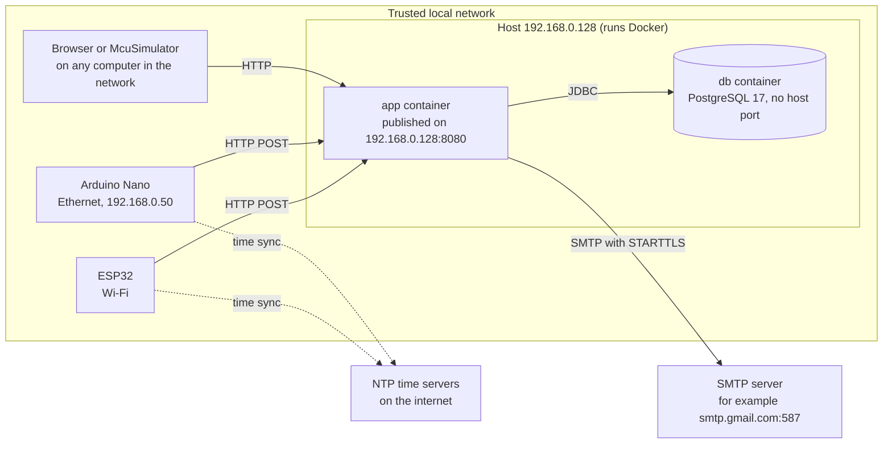
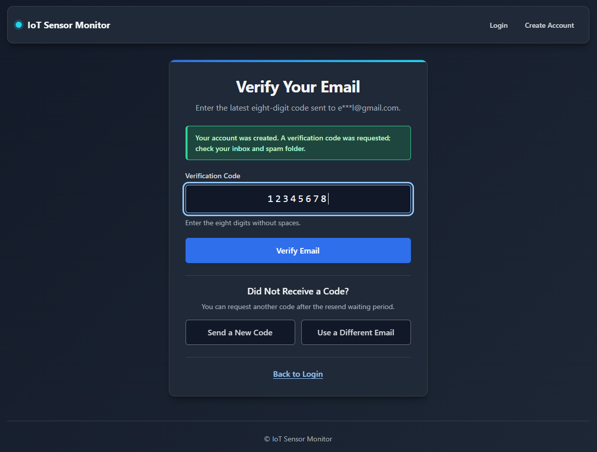
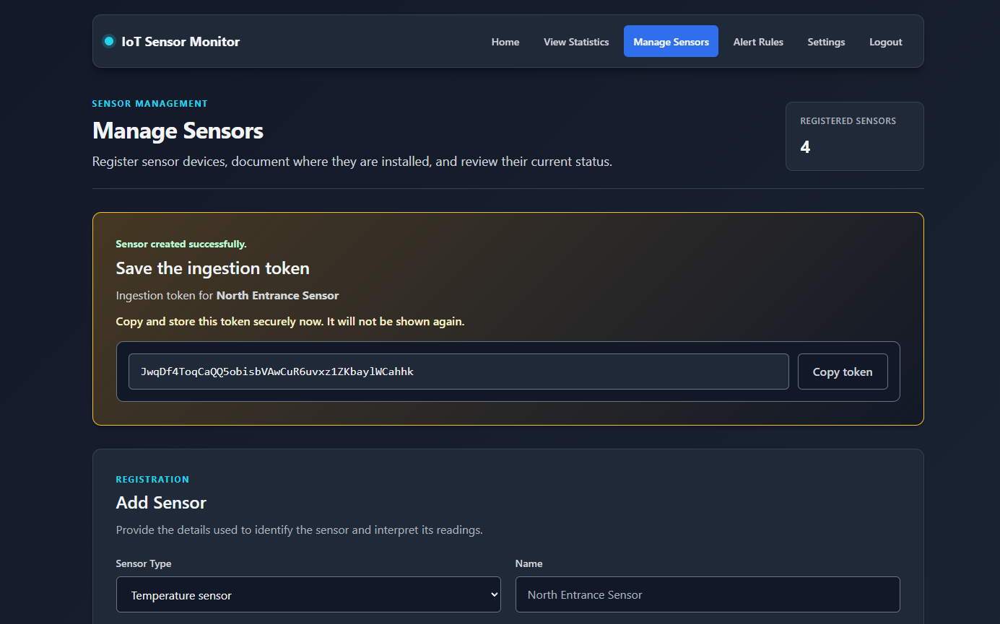
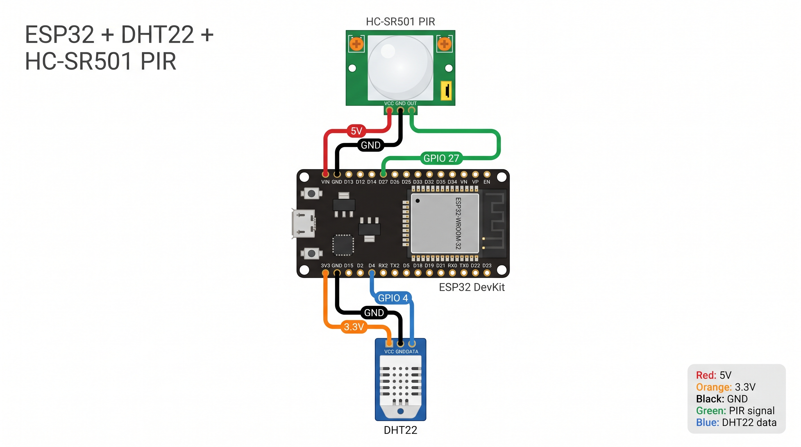
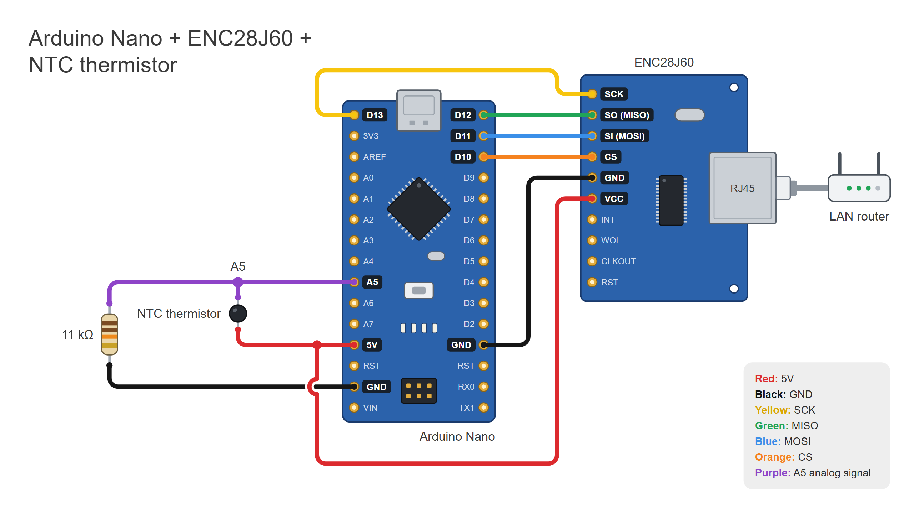

# Setup Guide

This guide shows how to run IoT Sensor Monitor on a local network, with or without hardware, and how to set up a development environment. Terms such as *MCU*, *sensor*, and *ingestion token* are defined in [Architecture](ARCHITECTURE.md#terminology-and-domain-model). Endpoints, request formats, and error codes are in the [API Reference](API.md).

| Goal                                 | You need                                            | Steps                                                                                                                             |
|--------------------------------------|-----------------------------------------------------|-----------------------------------------------------------------------------------------------------------------------------------|
| See the system work without hardware | Docker, an SMTP account, JDK 21                     | [Quick Start](#quick-start-with-docker-and-account-onboarding), then the [No-Hardware Path](#no-hardware-path-using-mcusimulator) |
| Connect an ESP32 or an Arduino Nano  | Docker, an SMTP account, Arduino IDE, the hardware  | [Quick Start](#quick-start-with-docker-and-account-onboarding), then the [Hardware Path](#hardware-path-esp32-and-arduino-nano)   |
| Change the code and run the tests    | JDK 21, Docker, and an SMTP account for a local run | [Contributor Development Setup and Running Tests](#contributor-development-setup-and-running-tests)                               |

Docker Compose can start the application in two ways. `compose.yml` builds the image from the source code, and `compose.dist.yml` pulls the prebuilt image `enginertugrul/iot-sensor-monitor:latest` from Docker Hub. Both start the application together with PostgreSQL 17.

The project is designed for one application instance on a trusted local network. All traffic uses plain HTTP, so do not expose the application to the internet. [Deployment Scope and Security Assumptions](ARCHITECTURE.md#deployment-scope-and-security-assumptions) explains this scope.

## Table of Contents

- [Prerequisites](#prerequisites)
- [Quick Start with Docker and Account Onboarding](#quick-start-with-docker-and-account-onboarding)
- [No-Hardware Path: Using McuSimulator](#no-hardware-path-using-mcusimulator)
- [Hardware Path: ESP32 and Arduino Nano](#hardware-path-esp32-and-arduino-nano)
- [Configuration Reference](#configuration-reference)
- [Email and Alert Configuration](#email-and-alert-configuration)
- [Contributor Development Setup and Running Tests](#contributor-development-setup-and-running-tests)
- [Troubleshooting](#troubleshooting)
- [Operations, Stopping, and Cleaning Up](#operations-stopping-and-cleaning-up)

---

## Prerequisites

### Software

| Tool                                                    | Version                   | Needed for                                                             | Notes                                                                                                                                                    |
|---------------------------------------------------------|---------------------------|------------------------------------------------------------------------|----------------------------------------------------------------------------------------------------------------------------------------------------------|
| Git                                                     | Any current version       | Cloning the repository                                                 |                                                                                                                                                          |
| Docker Engine or Docker Desktop, with Docker Compose v2 | Not pinned by the project | Running the stack, the development database, and the integration tests | Use the `docker compose` command; see the notes below the table.                                                                                         |
| JDK 21                                                  | 21                        | `McuSimulator`, local builds, tests                                    | The Maven Wrapper needs a full JDK (`java` and `javac`). The Docker image compiles the application itself, so the Docker stack alone needs no local JDK. |
| Maven                                                   | Not needed                |                                                                        | The Maven Wrapper (`mvnw`, `mvnw.cmd`) downloads Maven 3.9.16 on its first run.                                                                          |
| `openssl` or PowerShell                                 | Any current version       | Generating the secrets in [step 3](#3-generate-the-hmac-secrets)       | The guide shows a command for each.                                                                                                                      |
| PostgreSQL 17                                           | 17                        | Running the application without Docker                                 | No local installation is needed. Compose, the integration tests, and the [development setup](#start-postgresql-17) run PostgreSQL 17 in a container.     |
| Arduino IDE                                             | 2.3.10 (tested)           | Hardware path only                                                     | Board packages and libraries: see [Arduino IDE Setup](#arduino-ide-setup).                                                                               |

The `Dockerfile` uses a BuildKit cache mount, so the image build needs BuildKit. Current Docker versions use BuildKit by default. On Windows and macOS, start Docker Desktop before you run `docker compose`.

The commands in this guide are for Bash: Linux, macOS, and Git Bash on Windows. Where Windows PowerShell needs a different command, the guide shows it in a separate `powershell` block.

### SMTP Account

A new account cannot log in before its email address is verified, and the verification code arrives by email. You therefore need a working SMTP account before the first start, even for a test with `McuSimulator`. The SMTP server must support authentication and STARTTLS. [Example: Gmail](#example-gmail) shows example settings for one provider.

### Network

MCUs, browsers, and `McuSimulator` reach the application through an address of the *host*, the computer that runs Docker. Both firmware sketches expect the host at `192.168.0.128`, port `8080`.



- The host, the MCUs, and the browsers must be in the same local network.
- The first start needs internet access. Docker pulls the images, and a source build also downloads the Maven dependencies.
- The application needs outgoing access to the SMTP server.
- The MCUs need outgoing access to NTP time servers, because they send nothing before their clock is synchronized. The [Hardware Path](#network-and-time-requirements) lists the servers.
- Compose publishes no port for PostgreSQL, so only the application container can reach the database.

### Hardware (Hardware Path Only)

| Board                                           | Parts                                                             |
|-------------------------------------------------|-------------------------------------------------------------------|
| ESP32 (Arduino board setting: ESP32 Dev Module) | DHT22 temperature and humidity sensor, HC-SR501 PIR motion sensor |
| Arduino Nano (ATmega328P)                       | ENC28J60 Ethernet module, NTC thermistor, 11 kΩ resistor          |

---

## Quick Start with Docker and Account Onboarding

These steps start the stack, create your account, and register your first sensor. Run all commands from the root folder of the repository.

### 1. Clone the Repository

```bash
git clone https://github.com/enginertugrul/iot-sensor-monitor.git
cd iot-sensor-monitor
```

### 2. Create the `.env` File

Docker Compose reads its settings from a file named `.env` in the repository root. Create it from the template:

```bash
cp .env.example .env
```

```powershell
Copy-Item .env.example .env
```

Git ignores `.env`, and `.dockerignore` keeps it out of the image, so your passwords and secrets stay on your computer.

### 3. Generate the HMAC Secrets

Email verification and password recovery each need their own secret key. The application uses these keys to store one-time codes as HMAC-SHA256 digests. Each key must be standard Base64 and must contain at least 32 bytes after decoding; otherwise the application does not start.

Run the command twice and keep both results:

```bash
openssl rand -base64 32
```

```powershell
$bytes = New-Object byte[] 32
[System.Security.Cryptography.RandomNumberGenerator]::Create().GetBytes($bytes)
[Convert]::ToBase64String($bytes)
```

Each run prints a new random value of 44 characters. A third run gives you a strong value for `DB_PASSWORD`. Never use the keys from `src/test/resources/application-test.properties`, because they are public and only for tests.

### 4. Fill In the `.env` File

Open `.env` in a text editor and set the values. The variables with a default value can stay unchanged:

```properties
APP_BIND_ADDRESS=127.0.0.1
APP_PORT=8080

DB_NAME=iot_sensor_monitor
DB_USER=ism
DB_PASSWORD=<a long random password>

SMTP_HOST=<host name of your SMTP server>
SMTP_PORT=587
SMTP_USERNAME=<your SMTP login>
SMTP_PASSWORD=<your SMTP password>

EMAIL_VERIFICATION_HMAC_SECRET_BASE64=<first value from step 3>
PASSWORD_RECOVERY_HMAC_SECRET_BASE64=<second value from step 3>
```

Choose `APP_BIND_ADDRESS` for your setup:

| Who opens the application                     | `APP_BIND_ADDRESS`                                            | Address to open, with `APP_PORT=8080` |
|-----------------------------------------------|---------------------------------------------------------------|---------------------------------------|
| Only a browser and `McuSimulator` on the host | `127.0.0.1`                                                   | `http://localhost:8080`               |
| MCUs or other devices in the local network    | The LAN IPv4 address of the host, for example `192.168.0.128` | `http://192.168.0.128:8080`           |

- **`APP_BIND_ADDRESS`** is the only host address on which Docker publishes the application. The Quick Start and the no-hardware path use `127.0.0.1`. The Hardware Path uses `192.168.0.128`, the host address in both firmware sketches. If your host has another LAN address, use that address in `.env` and in the [firmware settings](#hardware-path-esp32-and-arduino-nano).
- Use a loopback or local network address only, and do not forward the port to the internet. [What the network must provide](ARCHITECTURE.md#what-the-network-must-provide) explains why.
- **`DB_PASSWORD`** protects the database. Choose a strong password. PostgreSQL stores it when it creates the database volume at the first start.
- **`SMTP_*`** are the settings of your SMTP account. `SMTP_USERNAME` is also the From address of every email. [Example: Gmail](#example-gmail) shows the values for a Gmail account.
- **`EMAIL_VERIFICATION_HMAC_SECRET_BASE64`** and **`PASSWORD_RECOVERY_HMAC_SECRET_BASE64`** take the two values from step 3.
- Do not use the `$` character in `.env` values. Compose reads `$` as the start of a variable name and changes the value.

To find the IPv4 address of the host:

| Host system | Command                         |
|-------------|---------------------------------|
| Linux       | `hostname -I`                   |
| macOS       | `ipconfig getifaddr en0`        |
| Windows     | `ipconfig` (see "IPv4 Address") |

The [Configuration Reference](#environment-variables-env) describes every variable.

### 5. Start the Stack

Choose one of the two Compose files:

| Compose file       | Application image                                                      | Use it when                                      |
|--------------------|------------------------------------------------------------------------|--------------------------------------------------|
| `compose.yml`      | Built from the local source code and tagged `iot-sensor-monitor:local` | You want the image to match the checked-out code |
| `compose.dist.yml` | `enginertugrul/iot-sensor-monitor:latest` from Docker Hub              | You want to skip the local build                 |

To build the image from source and start the stack:

```bash
docker compose up -d --build
```

To use the prebuilt image instead:

```bash
docker compose -f compose.dist.yml up -d
```

- The first source build downloads the base images and the Maven dependencies, so it takes longer than later builds. It compiles only `src/main` and does not run the tests.
- The `latest` image comes from the newest GitHub release that is not a pre-release, so it can be older than the code on `master`.
- Compose starts `db` first. It starts `app` only after the PostgreSQL health check passes. At startup, Flyway applies the database migrations `V1` to `V15`.
- The two Compose files use different project names, so each one keeps its own database volume.

If you use the prebuilt image, add `-f compose.dist.yml` after `docker compose` in the next commands and in all later Compose commands.

Check that both containers run:

```bash
docker compose ps
```

The `STATUS` column shows `Up` for `app`, and `Up` with `(healthy)` for `db`.

Follow the application log:

```bash
docker compose logs -f app
```

Wait until the log shows a line that contains `Started IotSensorMonitorApplication`. Press `Ctrl+C` to stop following the log; the containers keep running. Then open `http://<APP_BIND_ADDRESS>:<APP_PORT>` in a browser, for example `http://localhost:8080`. The login page opens.

### 6. Register and Verify Your Account

1. On the login page, select **Create Account**. The registration page (`/register`) opens.
2. Enter your email address and a password, and enter the password again in **Confirm Password**. The password needs at least 8 characters and at most 72 bytes in UTF-8, the input limit of BCrypt.
3. Choose your preferred language (English or Turkish), temperature unit, and time zone. You can change them later on the **Settings** page.
4. Select **Register**. The **Verify Your Email** page opens and says that a verification code was requested.
5. Open the email with the subject "Your IoT Sensor Monitor verification code". If it does not arrive, check the spam folder.
6. Enter the 8-digit code and select **Verify Email**. The login page opens with the message "Your email has been verified. You can now log in."
7. Log in with your email address and password. The dashboard opens.



The code rules come from the default settings:

- A code is valid for 15 minutes.
- After 1 minute, **Send a New Code** requests a new code. The new code replaces the old one, so always use the latest email.
- After 5 wrong attempts, the code stops working, and you must request a new one.
- If you log in before you verify the address, the application logs you out again and opens the verification page.

### 7. Create a Sensor and Copy Its Ingestion Token

1. Select **Manage Sensors** (`/user/sensors`).
2. In **Add Sensor**, choose the **Sensor Type**: **Temperature sensor**, **Humidity sensor**, or **Motion sensor**.
3. Enter **Name**, **City**, **District**, and **Installation Location**, with at most 100 characters each. The name must be unique among your sensors, ignoring letter case.
4. Choose the **Timezone** of the place where the sensor is installed. The form starts with the time zone of your account.
5. Select **Add Sensor**. The page shows "Sensor created successfully." and the ingestion token under **Save the ingestion token**.
6. Select **Copy token** and store the token in a safe place.



- Browsers allow the copy function only on HTTPS pages and on `localhost`. On a LAN address such as `http://192.168.0.128:8080`, the page selects the token and shows "The token could not be copied automatically." Press `Ctrl+C` (`Cmd+C` on macOS) to copy it.
- The page shows the token only once. If you lose it, delete the sensor and create it again. This also deletes the readings of the sensor.
- A token works only on the ingestion endpoint of its sensor type.
- The sensor type cannot be changed later, and the time zone is locked after the first reading.

Create the sensors that your client needs:

| Client                | Sensors to create                                    |
|-----------------------|------------------------------------------------------|
| `McuSimulator`        | One sensor for each type that you want to test       |
| ESP32 firmware        | One temperature, one humidity, and one motion sensor |
| Arduino Nano firmware | One temperature sensor                               |

Next, send readings with [`McuSimulator`](#no-hardware-path-using-mcusimulator) or with [hardware](#hardware-path-esp32-and-arduino-nano).

---

## No-Hardware Path: Using McuSimulator

`McuSimulator` is a console program that takes the place of an MCU. It sends readings to the same ingestion endpoints and in the same form format as the firmware. A test with it therefore runs the same server code as real hardware. It is a separate Maven project in `mcu-simulator/`, uses only the JDK, and is not part of the Docker image.

Before you start, complete the [Quick Start](#quick-start-with-docker-and-account-onboarding) and create at least one sensor.

### Build McuSimulator

```bash
sh ./mvnw -f mcu-simulator/pom.xml clean package
```

```powershell
.\mvnw.cmd -f mcu-simulator\pom.xml clean package
```

Maven prints `BUILD SUCCESS`, and the build creates `mcu-simulator/target/mcu-simulator-1.0.0.jar`. The first run of the Maven Wrapper downloads Maven, so it needs internet access.

The Bash commands in this guide start the wrapper with `sh`, as the CI workflow does. `sh ./mvnw` works even when `mvnw` has no execute permission. In a Git clone, `./mvnw` also works.

### Start McuSimulator

Pass the address of the application as the only argument:

```bash
java -jar mcu-simulator/target/mcu-simulator-1.0.0.jar http://localhost:8080
```

The same command works in PowerShell. The simulator prints `=== MCU Simulator ===`, the backend address, and the main menu.

- Use `http://<APP_BIND_ADDRESS>:<APP_PORT>` from your `.env` file.
- Without an argument, `McuSimulator` uses `http://localhost:8080`. This address works when `APP_BIND_ADDRESS` is `127.0.0.1` or `0.0.0.0`, and when you run the application without Docker.
- The URL must start with `http://` or `https://`, and it must not contain a query, a fragment, or user information.
- With a LAN `APP_BIND_ADDRESS`, `McuSimulator` can also run on another computer in the same network.

### Send Readings

1. In the main menu, enter `1` (temperature), `2` (humidity), or `3` (motion).
2. Enter `2` (**Configure sensor token**) and paste the ingestion token of a sensor of that type. The simulator confirms that it saved the token for this session.
3. Enter `1` (**Send a reading**) and type a value. A line that starts with `Success:` and ends with `(HTTP 200).` shows that the server stored the reading.

A temperature reading looks like this. The token is an example:

```text
=== MCU Simulator ===
Simulates temperature, humidity, and motion sensor readings.
Backend: http://localhost:8080
Each sensor type requires its own registered sensor token.

--- Main menu ---
1 - Temperature sensor
2 - Humidity sensor
3 - Motion sensor
0 - Exit
Select an option: 1

--- Temperature sensor ---
Token: not configured
1 - Send a reading
2 - Configure sensor token
3 - Clear sensor token
0 - Back to main menu
q - Exit
Select an option: 2

Configure token for the Temperature sensor.
Leave the value blank or enter 'b' to cancel.
Enter 'q' to terminate the application.
Sensor token: kR4v9TqN2xLm7WcB0zYd5HsF8uJe3G_P1oQiXt6n-bM
Temperature sensor token saved for this session.

--- Temperature sensor ---
Token: configured
1 - Send a reading
2 - Replace sensor token
3 - Clear sensor token
0 - Back to main menu
q - Exit
Select an option: 1

Enter temperature in Celsius.
Leave the value blank or enter 'b' to return.
Enter 'q' to terminate the application.
Value: 22.5

Success: Temperature reading 22.50 °C was accepted (HTTP 200).
```

After each reading, the sensor menu appears again. Enter `1` to send the next value.

- `McuSimulator` sets `recordedAt` to the current time of the computer that it runs on.
- It keeps the tokens in memory only. After a restart, configure them again.
- Each menu action sends one reading. To fill a chart, send several readings over a few minutes.

### Simulator Input Reference

| Sensor menu | Accepted values                                                                                                                              | Form field                                                         |
|-------------|----------------------------------------------------------------------------------------------------------------------------------------------|--------------------------------------------------------------------|
| Temperature | A finite number of degrees Celsius, at least `-273.15`. A comma also works as the decimal separator, for example `22,5`.                     | `celsiusValue`                                                     |
| Humidity    | A finite number from `0` to `100`. A comma also works as the decimal separator.                                                              | `humidityPercentage`                                               |
| Motion      | `true`, `t`, `yes`, `y`, `1`, or `detected` for motion; `false`, `f`, `no`, `n`, `0`, or `clear` for no motion. Letter case does not matter. | `motionDetected` (`true` or `false`)                               |

`McuSimulator` checks the value before it sends it. For an invalid value, it prints a hint, such as `Humidity must be between 0 and 100 percent.`, and asks again.

| Input                  | Main menu | Sensor menu           | Token or value prompt                |
|------------------------|-----------|-----------------------|--------------------------------------|
| `0`                    | Exit      | Back to the main menu | —                                    |
| `b` or `back`          | —         | Back to the main menu | Cancel and return to the sensor menu |
| Empty line             | —         | —                     | Cancel and return to the sensor menu |
| `q`, `quit`, or `exit` | Exit      | Exit                  | Exit                                 |

### Watch the Dashboard

1. Select **Home**, and choose the sensor in **Select sensor**. You can also select **View readings** for the sensor on the **Manage Sensors** page. The address has the form `http://localhost:8080/?sensorId=7`.
2. Check that the page shows "Live updates are active." The page then receives the reading stream.
3. Send another reading with `McuSimulator`. It appears in the table within 2 to 3 seconds, without a page reload.

- The dashboard shows the 10 latest readings of the sensor.
- The reading stream uses Server-Sent Events; see [Live Dashboard Streaming (SSE)](ARCHITECTURE.md#live-dashboard-streaming-sse).
- **View Statistics** opens the charts. They already include the readings of the current hour. The server combines summaries with raw readings for buckets that are not summarized yet ([Tier Stitching and Status](ARCHITECTURE.md#tier-stitching-and-status)).

### Test Rejected Readings

`McuSimulator` cannot send an out-of-range value, but it can show how the server rejects readings:

| Test              | How                                                                                                               | `McuSimulator` output                                                                                |
|-------------------|-------------------------------------------------------------------------------------------------------------------|------------------------------------------------------------------------------------------------------|
| Unknown token     | Change one character of the token and configure it again                                                          | `Backend rejected the temperature reading (HTTP 401).` and `The configured sensor token is invalid.` |
| Inactive sensor   | Select **Deactivate** for the sensor on **Manage Sensors**, select **Yes, deactivate sensor**, and send a reading | `HTTP 409` and `The registered sensor is inactive.`                                                  |
| Wrong sensor type | Configure the token of a humidity sensor in the temperature menu                                                  | `HTTP 400` and `The reading value or request format is invalid.`                                     |

After the hint, `McuSimulator` prints the problem details from the server:

```text
Backend rejected the temperature reading (HTTP 409).
The registered sensor is inactive.
Response: {"detail":"The sensor is inactive","instance":"/readings/temperature","status":409,"title":"Conflict","type":"about:blank","code":"INACTIVE_SENSOR","timestamp":"2026-11-01T09:14:20.874129Z"}
```

Select **Activate** on **Manage Sensors** to accept readings again. The [API Reference](API.md#sensor-ingestion-endpoints) lists all status codes. It also has `curl` examples for sending readings without `McuSimulator`.

---

## Hardware Path: ESP32 and Arduino Nano

The repository contains two firmware sketches. Both use the same ingestion endpoints as `McuSimulator`.

| Sketch                                                | Board                     | Sensors                                                 | Network                                           | Readings                                                                       |
|-------------------------------------------------------|---------------------------|---------------------------------------------------------|---------------------------------------------------|--------------------------------------------------------------------------------|
| `firmware/esp32/esp32-dht22-pir.ino`                  | ESP32                     | DHT22 (temperature and humidity), HC-SR501 PIR (motion) | Wi-Fi                                             | Temperature and humidity about every 17 seconds, motion about every 67 seconds |
| `firmware/arduino-nano/arduino-nano-enc28j60-ntc.ino` | Arduino Nano (ATmega328P) | NTC thermistor (temperature)                            | ENC28J60 Ethernet module with a static IP address | Temperature about every 10 seconds                                             |

Complete the [Quick Start](#quick-start-with-docker-and-account-onboarding) first, and create the sensors for your board. An MCU cannot reach `127.0.0.1` of the host, so set `APP_BIND_ADDRESS` in `.env` to the LAN address of the host, for example `192.168.0.128`. Then run `docker compose up -d` to recreate the `app` container. From then on, open the application at `http://192.168.0.128:8080`, because `http://localhost:8080` no longer works. [MCU Firmware and Simulator Design](ARCHITECTURE.md#mcu-firmware-and-simulator-design) describes the firmware design, such as the memory limits of the Nano and the retry rules of the ESP32.

### Arduino IDE Setup

Install Arduino IDE 2.3.10, the tested version. Then install the board packages with the Boards Manager and the libraries with the Library Manager. The sketches were tested with these versions:

| Type          | Name                       | Version | Used by                        |
|---------------|----------------------------|---------|--------------------------------|
| Board package | Arduino AVR Boards         | 1.8.8   | Arduino Nano                   |
| Board package | esp32 by Espressif Systems | 3.3.12  | ESP32                          |
| Library       | UIPEthernet                | 2.0.12  | Arduino Nano (`UIPEthernet.h`) |
| Library       | DHT sensor library         | 1.4.7   | ESP32 (`DHT.h`)                |

- The ESP32 sketch also includes `WiFi.h`, `HTTPClient.h`, and `esp_sntp.h`. They come with the esp32 board package.
- When you install DHT sensor library, the Library Manager also asks to install the libraries that it depends on. Accept and install all of them.

### Network and Time Requirements

The server rejects readings whose `recordedAt` is more than 6 hours old or more than 2 minutes in the future (see [Rules for `recordedAt`](API.md#rules-for-recordedat)). Both sketches therefore synchronize their clock first and send nothing until the first synchronization succeeds.

| Board        | Time source                                                                                             | Network needs                                                                                                                                   |
|--------------|---------------------------------------------------------------------------------------------------------|-------------------------------------------------------------------------------------------------------------------------------------------------|
| ESP32        | SNTP with `pool.ntp.org`, `time.nist.gov`, and `time.google.com`; synchronized every hour               | Wi-Fi, DNS, and internet access to the NTP servers. The first wait for the time is 15 seconds; after that, SNTP keeps trying in the background. |
| Arduino Nano | NTP over UDP port 123 to `NTP_SERVER_IP` (default `162.159.200.1`, Cloudflare); synchronized every hour | A static IP address and a gateway that reaches the NTP server. A failed synchronization is retried every 60 seconds.                            |

### ESP32 with DHT22 and PIR Motion Sensor

#### ESP32 Wiring



| Module       | Module pin | ESP32 pin  |
|--------------|------------|------------|
| DHT22        | VCC        | `3V3`      |
| DHT22        | DATA       | GPIO 4     |
| DHT22        | GND        | `GND`      |
| HC-SR501 PIR | VCC        | `5V`/`VIN` |
| HC-SR501 PIR | OUT        | GPIO 27    |
| HC-SR501 PIR | GND        | `GND`      |

Set the HC-SR501 as the sketch expects:

- Trigger jumper: `L`.
- Time delay: near the minimum.
- Sensitivity: low to medium at first.

#### Configure the ESP32 Sketch

Open `firmware/esp32/esp32-dht22-pir.ino` and set these constants in the configuration block at the top of the file:

| Constant                                       | Value in the repository                                  | Set it to                                                                                                 |
|------------------------------------------------|----------------------------------------------------------|-----------------------------------------------------------------------------------------------------------|
| `WIFI_SSID`                                    | `"YOUR_WIFI_SSID"`                                       | The name of your Wi-Fi network                                                                            |
| `WIFI_PASSWORD`                                | `"YOUR_WIFI_PASSWORD"`                                   | The password of your Wi-Fi network                                                                        |
| `BACKEND_BASE_URL`                             | `"http://192.168.0.128:8080"`                            | `http://<APP_BIND_ADDRESS>:<APP_PORT>`. Keep the value if your host uses `192.168.0.128` and port `8080`. |
| `TEMPERATURE_SENSOR_TOKEN`                     | `"PASTE_SENSOR_TOKEN_HERE"`                              | The ingestion token of your temperature sensor                                                            |
| `HUMIDITY_SENSOR_TOKEN`                        | `"PASTE_SENSOR_TOKEN_HERE"`                              | The ingestion token of your humidity sensor                                                               |
| `MOTION_SENSOR_TOKEN`                          | `"PASTE_SENSOR_TOKEN_HERE"`                              | The ingestion token of your motion sensor                                                                 |
| `NTP_SERVER_1`, `NTP_SERVER_2`, `NTP_SERVER_3` | `"pool.ntp.org"`, `"time.nist.gov"`, `"time.google.com"` | Optional: other NTP servers                                                                               |

With example values, the edited block looks like this:

```cpp
constexpr char WIFI_SSID[] =
    "HomeNetwork";

constexpr char WIFI_PASSWORD[] =
    "your-wifi-password";

constexpr char BACKEND_BASE_URL[] =
    "http://192.168.0.128:8080";

constexpr char TEMPERATURE_SENSOR_TOKEN[] =
    "kR4v9TqN2xLm7WcB0zYd5HsF8uJe3G_P1oQiXt6n-bM";

constexpr char HUMIDITY_SENSOR_TOKEN[] =
    "Zp7Lq2Wv9Xk4Bn6Tr1Yc8Hm3Js5Fd0Ga-Ue7Io2Pw4Q";

constexpr char MOTION_SENSOR_TOKEN[] =
    "Mb3Kx8Rt_Ny5Vq1Lp9Wz2Cf7Hs4Dj6Ge0Ua8Oi3Tm5E";
```

The edited sketch contains your Wi-Fi password and three ingestion tokens. Do not commit these changes.

#### Flash the ESP32

1. Connect the ESP32 to your computer over USB.
2. In the Arduino IDE, select **Tools > Board > esp32 > ESP32 Dev Module**, and select the port of the board.
3. Select **Upload**.
4. Open the Serial Monitor at **115200** baud.

The Serial Monitor shows these lines in a working setup:

| Line                                                                                                         | Meaning                                                                                                                                                          |
|--------------------------------------------------------------------------------------------------------------|------------------------------------------------------------------------------------------------------------------------------------------------------------------|
| `[Wi-Fi] Connected. ESP32 IP address: <address>`                                                             | The ESP32 joined the Wi-Fi network.                                                                                                                              |
| `[NTP] Initial UTC time is ready at epoch ms <milliseconds>`                                                 | The clock is synchronized, so readings can be sent.                                                                                                              |
| `[Setup] Main loop started.`                                                                                 | Setup is complete.                                                                                                                                               |
| `[DHT22] Temperature: <value> C, Humidity: <value> %`                                                        | The DHT22 delivered a sample.                                                                                                                                    |
| `[HTTP] /readings/temperature accepted with status 200 in <time> ms (...)`                                   | The server stored the reading. The same line follows for `/readings/humidity`.                                                                                   |
| `[PIR] Sensor armed.`                                                                                        | The 60-second PIR warm-up is over, and motion reporting has started.                                                                                             |
| `[PIR] Window events=<count>, posted=<true or false>, HTTP accepted=<true or false>, raw GPIO=<HIGH or LOW>` | One motion report. `posted` is the `motionDetected` value that the sketch sent. `true` means that the PIR sensor detected motion since the last accepted report. |

- The first motion report arrives about 2 minutes after boot: 60 seconds of warm-up, a wait for a low PIR signal, and one 67-second window.
- If the connection fails before the request is sent, the sketch retries once in the same loop pass. It does not retry after a timeout, because the server may already have stored the reading.
- A line such as `[HTTP] /readings/humidity rejected with status 401 in <time> ms` means that the server rejected the reading. The next line shows the problem details; see [Troubleshooting](#readings-from-mcusimulator-and-mcus).

### Arduino Nano with ENC28J60 and NTC Thermistor

#### Nano Wiring



The ENC28J60 module uses the hardware SPI pins of the Nano:

| ENC28J60 pin | Nano pin |
|--------------|----------|
| CS           | D10      |
| MOSI         | D11      |
| MISO         | D12      |
| SCK          | D13      |
| GND          | `GND`    |
| VCC          | `5V`     |

The tested ENC28J60 module takes its supply from the `5V` pin of the Nano. Some ENC28J60 modules accept only 3.3 V, and 5 V can damage them permanently. Check the supply voltage of your module before you connect it.

The NTC thermistor and an 11 kΩ resistor form a voltage divider on pin `A5`. The thermistor connects `5V` to `A5`, and the resistor connects `A5` to `GND`:

```text
5V ──── NTC thermistor ────┬──── A5
                           │
                         11 kΩ
                           │
                          GND
```

`thermistor()` in the sketch converts the analog value to Celsius with the Steinhart–Hart equation. Its formula expects exactly this divider, with the 11 kΩ resistor (`11000.0f`) on the `GND` side. Use an NTC thermistor that matches the three coefficients in `thermistor()`: `0.001129148`, `0.000234125`, and `0.0000000876741`. For another thermistor or resistor, change these values in `thermistor()`.

#### Configure the Nano Sketch

Open `firmware/arduino-nano/arduino-nano-enc28j60-ntc.ino` and set these values:

| Setting                            | Value in the repository                                                                              | Set it to                                                                           |
|------------------------------------|------------------------------------------------------------------------------------------------------|-------------------------------------------------------------------------------------|
| `SENSOR_TOKEN`                     | `"PASTE_SENSOR_TOKEN_HERE"`                                                                          | The ingestion token of your temperature sensor                                      |
| `BACKEND_IP`                       | `192,168,0,128`                                                                                      | Your `APP_BIND_ADDRESS`, with commas between the four numbers                       |
| `BACKEND_PORT`                     | `8080`                                                                                               | Your `APP_PORT`                                                                     |
| `mac[]` in `setup()`               | `0xDE,0xAD,0xBE,0xEF,0xFE,0xED`                                                                      | A MAC address that no other device in your network uses                             |
| `Ethernet.begin(...)` in `setup()` | Nano IP `192.168.0.50`, DNS server `192.168.0.1`, gateway `192.168.0.1`, subnet mask `255.255.255.0` | An unused IP address in your network, and the addresses of your router              |
| `NTP_SERVER_IP`                    | `162,159,200,1`                                                                                      | Optional: a trusted NTP server in your LAN, as the comment in the sketch recommends |

With an example token, the edited values look like this:

```cpp
const IPAddress BACKEND_IP(192,168,0,128);
const uint16_t BACKEND_PORT = 8080;

const char SENSOR_TOKEN[] PROGMEM = "kR4v9TqN2xLm7WcB0zYd5HsF8uJe3G_P1oQiXt6n-bM";
```

`Ethernet.begin(...)` takes its arguments in this order: MAC, Nano IP, DNS server, gateway, subnet mask. The Nano does not use DHCP.

```cpp
    Ethernet.begin(
            mac,
            IPAddress(192,168,0,50),
            IPAddress(192,168,0,1),
            IPAddress(192,168,0,1),
            IPAddress(255,255,255,0));
```

The sketch keeps the token in flash memory (`PROGMEM`), because the Nano has only 2 KB of SRAM. The edited sketch contains your ingestion token, so do not commit it.

#### Flash the Nano

1. Connect the Nano to your computer over USB.
2. In the Arduino IDE, select **Tools > Board > Arduino AVR Boards > Arduino Nano**.
3. Select **Tools > Processor > ATmega328P (Old Bootloader)**, and select the port of the board.
4. Select **Upload**.
5. Open the Serial Monitor at **9600** baud.

Step 3 matches the tested Nano, which has the old bootloader. For a Nano with the standard bootloader, select **ATmega328P** instead.

The Serial Monitor shows these lines:

| Line                                                                | Meaning                                                                                                       |
|---------------------------------------------------------------------|---------------------------------------------------------------------------------------------------------------|
| `Nano IP: <address>`                                                | The Ethernet module uses the static address from `setup()`.                                                   |
| `Initial NTP synchronization succeeded.`                            | The clock is set, and a reading follows about every 10 seconds.                                               |
| `Initial NTP synchronization failed; POSTs are paused.`             | No reading is sent. The sketch retries every 60 seconds and prints `NTP clock synchronized.` after a success. |
| `Sending <value> C at epoch ms <milliseconds>`                      | The sketch took a sample and starts the request.                                                              |
| `POST dispatched.`                                                  | The request was written to the connection.                                                                    |
| `HTTP/1.1 200` and the response headers                             | The server stored the reading. The sketch prints the raw response of the server.                              |
| `HTTP/1.1 401`, `HTTP/1.1 409`, or `HTTP/1.1 400`, with a JSON body | The server rejected the reading; see [Troubleshooting](#readings-from-mcusimulator-and-mcus).                 |

### Check the Readings in the Web UI

Open the dashboard for each sensor, as described in [Watch the Dashboard](#watch-the-dashboard). New readings appear at the intervals of the sketch. If no reading arrives, see [Troubleshooting](#troubleshooting).

---

## Configuration Reference

This section lists every setting: the variables in `.env`, the variables that Compose passes to the containers, the Spring Boot properties, and the firmware constants.

Durations use the ISO-8601 format, for example `PT15S` (15 seconds), `PT5M` (5 minutes), `PT1H` (1 hour), and `P30D` (30 days).

### Environment Variables (`.env`)

Both Compose files read the same variables from `.env` in the repository root. `.env.example` contains all of them and leaves the required values empty on purpose. Compose stops with an error until you set them.

| Variable                                | Required | Default              | Purpose                                                                                                                                                                                                                                                                                |
|-----------------------------------------|----------|----------------------|----------------------------------------------------------------------------------------------------------------------------------------------------------------------------------------------------------------------------------------------------------------------------------------|
| `APP_BIND_ADDRESS`                      | Yes      | None                 | Host address on which Docker publishes the application: `127.0.0.1` (only the host) or a LAN address such as `192.168.0.128` (the local network). `0.0.0.0` publishes the port on every network interface of the host. Use it only when all these interfaces are in a trusted network. |
| `APP_PORT`                              | No       | `8080`               | Host port of the application. Inside the container, the application always uses port `8080`.                                                                                                                                                                                           |
| `DB_NAME`                               | No       | `iot_sensor_monitor` | Name of the PostgreSQL database                                                                                                                                                                                                                                                        |
| `DB_USER`                               | No       | `ism`                | PostgreSQL user                                                                                                                                                                                                                                                                        |
| `DB_PASSWORD`                           | Yes      | None                 | PostgreSQL password                                                                                                                                                                                                                                                                    |
| `SMTP_HOST`                             | Yes      | None                 | Host name of the SMTP server                                                                                                                                                                                                                                                           |
| `SMTP_PORT`                             | No       | `587`                | Port of the SMTP server. The server must offer STARTTLS on this port.                                                                                                                                                                                                                  |
| `SMTP_USERNAME`                         | Yes      | None                 | SMTP login. The application also uses it as the From address of every email.                                                                                                                                                                                                           |
| `SMTP_PASSWORD`                         | Yes      | None                 | SMTP password                                                                                                                                                                                                                                                                          |
| `EMAIL_VERIFICATION_HMAC_SECRET_BASE64` | Yes      | None                 | Key for email verification codes: standard Base64, at least 32 bytes after decoding                                                                                                                                                                                                    |
| `PASSWORD_RECOVERY_HMAC_SECRET_BASE64`  | Yes      | None                 | Key for password reset codes: standard Base64, at least 32 bytes after decoding                                                                                                                                                                                                        |

### Container Environment

Compose passes the `.env` values to the containers under the names below. Spring Boot maps an environment variable such as `SPRING_MAIL_HOST` to the property `spring.mail.host`.

| Service | Container variable                      | Value                                                                    |
|---------|-----------------------------------------|--------------------------------------------------------------------------|
| `db`    | `POSTGRES_DB`                           | `DB_NAME`                                                                |
| `db`    | `POSTGRES_USER`                         | `DB_USER`                                                                |
| `db`    | `POSTGRES_PASSWORD`                     | `DB_PASSWORD`                                                            |
| `app`   | `SPRING_PROFILES_ACTIVE`                | `docker` (fixed)                                                         |
| `app`   | `SPRING_DATASOURCE_URL`                 | `jdbc:postgresql://db:5432/` followed by `DB_NAME`                       |
| `app`   | `SPRING_DATASOURCE_USERNAME`            | `DB_USER`                                                                |
| `app`   | `SPRING_DATASOURCE_PASSWORD`            | `DB_PASSWORD`                                                            |
| `app`   | `SPRING_MAIL_HOST`                      | `SMTP_HOST`                                                              |
| `app`   | `SPRING_MAIL_PORT`                      | `SMTP_PORT`                                                              |
| `app`   | `SPRING_MAIL_USERNAME`                  | `SMTP_USERNAME`                                                          |
| `app`   | `SPRING_MAIL_PASSWORD`                  | `SMTP_PASSWORD`                                                          |
| `app`   | `EMAIL_VERIFICATION_HMAC_SECRET_BASE64` | The same variable from `.env`. `application-docker.properties` reads it. |
| `app`   | `PASSWORD_RECOVERY_HMAC_SECRET_BASE64`  | The same variable from `.env`. `application-docker.properties` reads it. |

The Compose files also fix these settings:

- The `app` port mapping is `${APP_BIND_ADDRESS}:${APP_PORT:-8080}:8080`. The `db` service publishes no port.
- The named volume `postgres-data` holds `/var/lib/postgresql/data` of the `db` container.
- The `db` health check runs `pg_isready` every 5 seconds, with a 5-second timeout, 12 retries, and a 10-second start period. `app` waits until it passes.
- Both services use `restart: unless-stopped` and `stop_grace_period: 60s`.
- The image runs `java -Duser.timezone=UTC -jar /app/app.jar` as the non-root user `ism`.

### Spring Boot Properties

The application reads its Spring Boot properties from one of three files:

| File                                               | Used by                   | Notes                                                                                                                                                        |
|----------------------------------------------------|---------------------------|--------------------------------------------------------------------------------------------------------------------------------------------------------------|
| `src/main/resources/application-docker.properties` | Docker (profile `docker`) | Part of the image. Connection settings and secrets come from the container environment.                                                                      |
| `src/main/resources/application.properties`        | Local run                 | Ignored by Git and by the Docker build. Create it from `example.application.properties`; see [Contributor Development Setup](#create-applicationproperties). |
| `src/test/resources/application-test.properties`   | Tests                     | See [Test Profile](#test-profile).                                                                                                                           |

#### Framework Properties

The table shows the values in `application-docker.properties` and in the local template `example.application.properties`. A property that a file does not set uses the Spring Boot default.

| Property                                                     | `application-docker.properties`   | `example.application.properties`                | Purpose                                                                                               |
|--------------------------------------------------------------|-----------------------------------|-------------------------------------------------|-------------------------------------------------------------------------------------------------------|
| `spring.application.name`                                    | `iot-sensor-monitor`              | `iot-sensor-monitor`                            | Application name                                                                                      |
| `server.address`                                             | `0.0.0.0`                         | Not set                                         | Network interface of the server. Inside the container, Compose limits access with `APP_BIND_ADDRESS`. |
| `server.port`                                                | `8080`                            | Not set (Spring Boot default `8080`)            | HTTP port                                                                                             |
| `server.shutdown`                                            | `graceful`                        | Not set                                         | Lets running requests finish at shutdown                                                              |
| `spring.lifecycle.timeout-per-shutdown-phase`                | `30s`                             | Not set                                         | Maximum wait for each shutdown phase                                                                  |
| `spring.datasource.url`                                      | From `SPRING_DATASOURCE_URL`      | `jdbc:postgresql://localhost:5432/your_db_name` | JDBC URL of the database                                                                              |
| `spring.datasource.username`                                 | From `SPRING_DATASOURCE_USERNAME` | `your_username`                                 | Database user                                                                                         |
| `spring.datasource.password`                                 | From `SPRING_DATASOURCE_PASSWORD` | `your_password`                                 | Database password                                                                                     |
| `spring.flyway.enabled`                                      | `true`                            | Not set                                         | Runs the Flyway migrations at startup                                                                 |
| `spring.flyway.locations`                                    | `classpath:db/migration`          | Not set                                         | Location of the migration files `V1` to `V15`                                                         |
| `spring.flyway.validate-on-migrate`                          | `true`                            | Not set                                         | Checks the applied migrations before Flyway migrates                                                  |
| `spring.flyway.clean-disabled`                               | `true`                            | Not set                                         | Blocks the Flyway `clean` command, which drops all database objects                                   |
| `spring.jpa.hibernate.ddl-auto`                              | `validate`                        | Not set                                         | Hibernate checks the entities against the schema and never changes the schema                         |
| `spring.jpa.open-in-view`                                    | `false`                           | `false`                                         | No database session while a view renders                                                              |
| `spring.jpa.show-sql`                                        | `false`                           | Not set                                         | Logs SQL statements                                                                                   |
| `spring.jpa.properties.hibernate.format_sql`                 | `false`                           | Not set                                         | Formats logged SQL                                                                                    |
| `spring.jpa.properties.hibernate.jdbc.time_zone`             | `UTC`                             | Not set                                         | Time zone of JDBC time values                                                                         |
| `spring.sql.init.mode`                                       | `never`                           | Not set                                         | Runs no `schema.sql` or `data.sql`; Flyway owns the schema                                            |
| `spring.mail.host`                                           | From `SPRING_MAIL_HOST`           | `smtp.example.com`                              | SMTP server                                                                                           |
| `spring.mail.port`                                           | From `SPRING_MAIL_PORT`           | `587`                                           | SMTP port                                                                                             |
| `spring.mail.username`                                       | From `SPRING_MAIL_USERNAME`       | `your_email_username`                           | SMTP login and From address. It must not be empty.                                                    |
| `spring.mail.password`                                       | From `SPRING_MAIL_PASSWORD`       | `your_email_password`                           | SMTP password                                                                                         |
| `spring.mail.default-encoding`                               | `UTF-8`                           | `UTF-8`                                         | Encoding of the emails                                                                                |
| `spring.mail.properties.mail.smtp.auth`                      | `true`                            | `true`                                          | Uses SMTP authentication                                                                              |
| `spring.mail.properties.mail.smtp.starttls.enable`           | `true`                            | `true`                                          | Uses STARTTLS                                                                                         |
| `spring.mail.properties.mail.smtp.starttls.required`         | `true`                            | `true`                                          | Fails when the server does not offer STARTTLS                                                         |
| `spring.mail.properties.mail.smtp.connectiontimeout`         | `10000`                           | `10000`                                         | Connect timeout in milliseconds                                                                       |
| `spring.mail.properties.mail.smtp.timeout`                   | `10000`                           | `10000`                                         | Read timeout in milliseconds                                                                          |
| `spring.mail.properties.mail.smtp.writetimeout`              | `10000`                           | `10000`                                         | Write timeout in milliseconds                                                                         |
| `spring.mail.properties.mail.debug`                          | `false`                           | `false`                                         | Debug output of Jakarta Mail                                                                          |
| `logging.level.org.springframework.core.retry.RetryTemplate` | `INFO`                            | `INFO`                                          | Log level of the email retry template. The template file notes that `DEBUG` logs exception contents.  |

#### Application Properties

Every `app.*` property has a default in the code. `application-docker.properties` and `example.application.properties` set the same values. The two HMAC secrets are the only properties without a default. The policy classes check the values at startup, and an invalid value stops the application.

##### General

| Property                 | Default | Allowed values    | Purpose                                                                                                                                                                                           |
|--------------------------|---------|-------------------|---------------------------------------------------------------------------------------------------------------------------------------------------------------------------------------------------|
| `app.scheduling.enabled` | `true`  | `true` or `false` | Runs the rollup, retention, and challenge cleanup jobs and the stream maintenance timer. With `false`, no data is summarized or purged, and an open reading stream sends only its first snapshot. |

##### Ingestion (`SensorReadingIngestionPolicy`)

| Property                                        | Default | Allowed values                             | Purpose                                    |
|-------------------------------------------------|---------|--------------------------------------------|--------------------------------------------|
| `app.sensor-data.ingestion.maximum-lateness`    | `PT6H`  | Not negative; shorter than `raw-retention` | How far `recordedAt` may lie in the past   |
| `app.sensor-data.ingestion.maximum-future-skew` | `PT2M`  | Not negative                               | How far `recordedAt` may lie in the future |

##### Data Lifecycle (`SensorDataLifecyclePolicy`)

| Property                                                            | Default | Allowed values                | Purpose                                                           |
|---------------------------------------------------------------------|---------|-------------------------------|-------------------------------------------------------------------|
| `app.sensor-data.lifecycle.raw-retention`                           | `P30D`  | Positive                      | How long raw readings are kept                                    |
| `app.sensor-data.lifecycle.hourly-retention`                        | `P90D`  | Positive                      | How long hourly summaries are kept                                |
| `app.sensor-data.lifecycle.daily-retention`                         | `P730D` | Positive                      | How long daily summaries are kept                                 |
| `app.sensor-data.lifecycle.hourly-rollup-interval`                  | `PT5M`  | Positive                      | Delay between two hourly rollup runs                              |
| `app.sensor-data.lifecycle.hourly-rollup-grace`                     | `PT5M`  | Positive, shorter than 1 hour | Time after the end of an hour before the rollup summarizes it     |
| `app.sensor-data.lifecycle.daily-rollup-interval`                   | `PT15M` | Positive                      | Delay between two daily rollup runs                               |
| `app.sensor-data.lifecycle.daily-rollup-grace`                      | `PT15M` | Positive, shorter than 1 day  | Time after the end of a local day before the rollup summarizes it |
| `app.sensor-data.lifecycle.purge-interval`                          | `PT1H`  | Positive                      | Delay between two retention purge runs                            |
| `app.sensor-data.lifecycle.delete-batch-size`                       | `1000`  | 1 to 10,000                   | Maximum rows in one delete batch                                  |
| `app.sensor-data.lifecycle.maximum-buckets-per-run`                 | `500`   | 1 to 10,000                   | Maximum buckets in one rollup run                                 |
| `app.sensor-data.lifecycle.maximum-delete-batches-per-tier-per-run` | `10`    | 1 to 100                      | Maximum delete batches for each tier in one purge run             |

The tiers, rollups, and purges are described in [Tiered Historical Storage and Rollup Checkpoints](ARCHITECTURE.md#tiered-historical-storage-and-rollup-checkpoints).

##### Statistics (`StatisticsQueryPolicy`)

| Property                                            | Default  | Allowed values                            | Purpose                                           |
|-----------------------------------------------------|----------|-------------------------------------------|---------------------------------------------------|
| `app.sensor-data.statistics.chart-point-budget`     | `400`    | 1 to 10,000                               | Maximum points in one chart series                |
| `app.sensor-data.statistics.auto-raw-maximum-range` | `PT1H`   | Positive; not longer than `maximum-range` | Longest range for which `AUTO` tries raw readings |
| `app.sensor-data.statistics.maximum-range`          | `P1095D` | Positive                                  | Longest range of one statistics request           |
| `app.sensor-data.statistics.csv-export-row-limit`   | `2500`   | 1 to 10,000                               | Maximum rows in one CSV export                    |

##### Reading Stream (`SensorReadingStreamPolicy`)

| Property                                       | Default | Allowed values         | Purpose                                                |
|------------------------------------------------|---------|------------------------|--------------------------------------------------------|
| `app.sensor-data.stream.refresh-interval`      | `PT2S`  | 1 second to 1 minute   | How often each open stream reloads the latest readings |
| `app.sensor-data.stream.heartbeat-interval`    | `PT15S` | 5 seconds to 5 minutes | Time without output before a `:keepalive` comment      |
| `app.sensor-data.stream.connection-lifetime`   | `PT5M`  | 30 seconds to 1 hour   | Maximum lifetime of one stream connection              |
| `app.sensor-data.stream.work-timeout`          | `PT15S` | 1 second to 2 minutes  | Maximum time of one refresh task                       |
| `app.sensor-data.stream.maximum-subscriptions` | `100`   | 1 to 1,000             | Maximum number of open streams                         |
| `app.sensor-data.stream.worker-threads`        | `4`     | 1 to 32                | Threads of the stream worker pool                      |
| `app.sensor-data.stream.worker-queue-capacity` | `100`   | 1 to 2,000             | Queue size of the stream worker pool                   |

##### Email Delivery (`app.mail.*`)

| Property                              | Default  | Allowed values                                | Purpose                                                           |
|---------------------------------------|----------|-----------------------------------------------|-------------------------------------------------------------------|
| `app.mail.alerts.enabled`             | `true`   | `true` or `false`                             | Sends alert emails; see [Email Switches](#email-switches)         |
| `app.mail.email-verification.enabled` | `true`   | `true` or `false`                             | Sends verification codes; see [Email Switches](#email-switches)   |
| `app.mail.password-recovery.enabled`  | `true`   | `true` or `false`                             | Sends password reset codes; see [Email Switches](#email-switches) |
| `app.mail.retry.maximum-attempts`     | `3`      | At least 1                                    | Delivery attempts for one email, including the first attempt      |
| `app.mail.retry.initial-delay`        | `PT1S`   | Not negative; not longer than `maximum-delay` | Delay before the first retry                                      |
| `app.mail.retry.multiplier`           | `2.0`    | At least `1.0`                                | Factor for each further delay                                     |
| `app.mail.retry.maximum-delay`        | `PT5S`   | Positive; not shorter than `initial-delay`    | Upper limit of one delay                                          |
| `app.mail.retry.jitter`               | `PT0.2S` | Not negative                                  | Random variation of each delay                                    |

`EmailRetryPolicy` checks `maximum-attempts` and the order of the two delays. The Spring Framework `RetryPolicy` builder checks the other limits.

##### One-Time Codes (`app.security.*`)

Email verification and password recovery have the same settings under two prefixes: `app.security.email-verification.` and `app.security.password-recovery.`. The table lists the part after the prefix. Two names differ between the flows, and the table shows both.

| Property after the prefix                                                                                                | Default         | Allowed values                                    | Purpose                                                                                                                                               |
|--------------------------------------------------------------------------------------------------------------------------|-----------------|---------------------------------------------------|-------------------------------------------------------------------------------------------------------------------------------------------------------|
| `code-hmac-secret-base64`                                                                                                | None (required) | Standard Base64, at least 32 bytes after decoding | Key for the HMAC-SHA256 digests of the codes. Docker reads it from `EMAIL_VERIFICATION_HMAC_SECRET_BASE64` or `PASSWORD_RECOVERY_HMAC_SECRET_BASE64`. |
| `code-lifetime`                                                                                                          | `PT15M`         | Positive                                          | How long a code stays valid                                                                                                                           |
| `resend-cooldown`                                                                                                        | `PT1M`          | Positive; shorter than `code-lifetime`            | Wait time before the user can request a new code                                                                                                      |
| `maximum-failed-attempts`                                                                                                | `5`             | 1 to 10                                           | Wrong codes before the code stops working                                                                                                             |
| `issue-rate-limit-window`                                                                                                | `PT15M`         | Positive                                          | Window of the code request limits                                                                                                                     |
| `maximum-issue-requests-per-address`                                                                                     | `5`             | At least 1                                        | Code requests for one email address in one window                                                                                                     |
| `maximum-issue-requests-per-client`                                                                                      | `20`            | At least 1                                        | Code requests from one client IP address in one window                                                                                                |
| `verification-rate-limit-window` (email verification), `reset-rate-limit-window` (password recovery)                     | `PT15M`         | Positive                                          | Window of the code submission limit                                                                                                                   |
| `maximum-verification-requests-per-client` (email verification), `maximum-reset-requests-per-client` (password recovery) | `30`            | At least 1                                        | Code submissions from one client IP address in one window                                                                                             |
| `maximum-tracked-rate-limit-keys`                                                                                        | `100`           | At least 1                                        | Maximum rate-limit counters in memory for the flow                                                                                                    |
| `cleanup-interval`                                                                                                       | `PT1H`          | A duration                                        | Delay between two runs of the job that deletes expired challenges                                                                                     |

[One-time codes](ARCHITECTURE.md#one-time-codes) and [Rate limiting](ARCHITECTURE.md#rate-limiting) describe how these settings work.

#### Cross-Property Rules

The application also checks rules that combine two or more properties. A violation stops the startup with a message that names the rule. An example is `retention periods must satisfy rawRetention < hourlyRetention < dailyRetention`.

| Rule                                                              | Checked by                     |
|-------------------------------------------------------------------|--------------------------------|
| `raw-retention` < `hourly-retention` < `daily-retention`          | `SensorDataLifecyclePolicy`    |
| `maximum-lateness` < `raw-retention`                              | `SensorReadingIngestionPolicy` |
| `refresh-interval` ≤ `heartbeat-interval` < `connection-lifetime` | `SensorReadingStreamPolicy`    |
| `work-timeout` < `connection-lifetime`                            | `SensorReadingStreamPolicy`    |
| `auto-raw-maximum-range` ≤ `maximum-range`                        | `StatisticsQueryPolicy`        |
| `resend-cooldown` < `code-lifetime`                               | `OneTimeCodePolicy`            |
| `initial-delay` ≤ `maximum-delay`                                 | `EmailRetryPolicy`             |

#### Changing a Property

Every change needs a restart, and the application checks the new value at startup.

- **Local run:** edit `src/main/resources/application.properties` and restart the application.
- **Docker:** `application-docker.properties` is part of the image, so the Compose files pass only the variables listed above. Spring Boot also reads a property from an environment variable. Write the property name in upper case, and replace dots and hyphens with underscores. For example, `app.mail.alerts.enabled` becomes `APP_MAIL_ALERTS_ENABLED`, and `app.sensor-data.lifecycle.raw-retention` becomes `APP_SENSOR_DATA_LIFECYCLE_RAW_RETENTION`. Put the variable into a new file `compose.override.yml` in the repository root, so that `git pull` does not conflict with your change. Compose reads this file automatically together with `compose.yml`:

```yaml
services:
  app:
    environment:
      APP_MAIL_ALERTS_ENABLED: "false"
```

Then run `docker compose up -d` to recreate the container. For the prebuilt image, name both files in every `up` command: `docker compose -f compose.dist.yml -f compose.override.yml up -d`.

#### Test Profile

Surefire and Failsafe load only `src/test/resources/application-test.properties`, with the profile `test`. The test classes set the same file, so a test that you start in your IDE uses it too. Testcontainers provides the database connection. The file differs from the `docker` profile in these properties:

| Property                                                                                                                                          | Test value                                    | Effect                                             |
|---------------------------------------------------------------------------------------------------------------------------------------------------|-----------------------------------------------|----------------------------------------------------|
| `spring.application.name`                                                                                                                         | `iot-sensor-monitor-test`                     | Separate application name                          |
| `app.scheduling.enabled`                                                                                                                          | `false`                                       | No scheduled jobs; tests start the work themselves |
| `spring.datasource.hikari.maximum-pool-size`, `spring.datasource.hikari.minimum-idle`                                                             | `5`, `0`                                      | A small connection pool                            |
| `app.mail.alerts.enabled`, `app.mail.email-verification.enabled`, `app.mail.password-recovery.enabled`                                            | `false`                                       | No emails                                          |
| `spring.mail.host`, `spring.mail.port`                                                                                                            | `localhost`, `2525`                           | A local SMTP address that the tests never use      |
| `spring.mail.username`, `spring.mail.password`                                                                                                    | `tests@example.invalid`, `test-only-password` | Dummy credentials                                  |
| `spring.mail.test-connection`                                                                                                                     | `false`                                       | No SMTP connection test at startup                 |
| `spring.mail.properties.mail.smtp.auth`, `spring.mail.properties.mail.smtp.starttls.enable`, `spring.mail.properties.mail.smtp.starttls.required` | `false`                                       | No authentication and no STARTTLS                  |
| `spring.mail.properties.mail.smtp.connectiontimeout`, `spring.mail.properties.mail.smtp.timeout`, `spring.mail.properties.mail.smtp.writetimeout` | `1000`                                        | 1-second SMTP timeouts                             |
| `app.security.email-verification.code-hmac-secret-base64`, `app.security.password-recovery.code-hmac-secret-base64`                               | Public dummy keys                             | Test-only HMAC keys. Never use them anywhere else. |

All `app.*` properties that the file does not set use their defaults from the code.

### Firmware Constants

The sketches have no configuration file; their settings are constants in the source code. [Configure the ESP32 Sketch](#configure-the-esp32-sketch) and [Configure the Nano Sketch](#configure-the-nano-sketch) list the values that you must edit. The other constants control the timing and the network behavior.

ESP32 (`firmware/esp32/esp32-dht22-pir.ino`):

| Constant                                              | Value           | Purpose                                                                                                                               |
|-------------------------------------------------------|-----------------|---------------------------------------------------------------------------------------------------------------------------------------|
| `DHT_PIN`, `PIR_PIN`                                  | `4`, `27`       | GPIO pins of the DHT22 data line and the PIR output                                                                                   |
| `DHT_POST_INTERVAL_MS`                                | `17000`         | Time between two DHT22 samples. Each sample produces one temperature and one humidity reading. The sketch requires at least 2,000 ms. |
| `MOTION_POST_INTERVAL_MS`                             | `67000`         | Length of one motion reporting window                                                                                                 |
| `PIR_WARMUP_MS`                                       | `60000`         | PIR warm-up time after boot                                                                                                           |
| `HTTP_CONNECT_TIMEOUT_MS`, `HTTP_RESPONSE_TIMEOUT_MS` | `3000`, `5000`  | HTTP connect and response timeouts                                                                                                    |
| `HTTP_SUCCESS_PAUSE_MS`, `HTTP_ERROR_RECOVERY_MS`     | `100`, `1500`   | Pause after the temperature request, before the humidity request: after a success or after a failure                                  |
| `SAFE_RETRIES_PER_BATCH`, `HTTP_RETRY_DELAY_MS`       | `1`, `1000`     | One retry per loop pass, after a 1-second delay                                                                                       |
| `WIFI_RECONNECT_TIMEOUT_MS`                           | `5000`          | Maximum wait for a Wi-Fi reconnection                                                                                                 |
| `NTP_TIME_ZONE`                                       | `"UTC0"`        | Time zone of the system clock                                                                                                         |
| `NTP_SYNC_INTERVAL_MS`, `INITIAL_NTP_SYNC_TIMEOUT_MS` | 1 hour, `15000` | SNTP interval and the first wait for the time                                                                                         |
| `EARLIEST_REASONABLE_UNIX_TIME_SECONDS`               | `1704067200`    | A clock before 2024-01-01T00:00:00Z counts as not synchronized                                                                        |

Arduino Nano (`firmware/arduino-nano/arduino-nano-enc28j60-ntc.ino`):

| Constant                                             | Value                                                       | Purpose                                                                               |
|------------------------------------------------------|-------------------------------------------------------------|---------------------------------------------------------------------------------------|
| `THERMISTOR_PIN`, `ENC28J60_CS_PIN`                  | `A5`, `10`                                                  | Analog pin of the divider and chip-select pin of the ENC28J60                         |
| `POST_INTERVAL_MS`                                   | `10000`                                                     | Time between two temperature readings                                                 |
| `NTP_SYNC_INTERVAL_SECONDS`, `NTP_RETRY_INTERVAL_MS` | `3600`, `60000`                                             | NTP interval, and the retry delay after a failed synchronization                      |
| `NTP_PORT`, `NTP_LOCAL_PORT`                         | `123`, `8888`                                               | Remote and local UDP ports for NTP                                                    |
| `NTP_ARP_TIMEOUT_MS`, `NTP_RESPONSE_TIMEOUT_MS`      | `1500`, `2500`                                              | Wait times while the NTP request is sent and answered                                 |
| `EARLIEST_REASONABLE_UNIX_TIME`                      | `1704067200`                                                | NTP times before 2024-01-01T00:00:00Z are rejected                                    |
| Resistor and coefficients in `thermistor()`          | `11000.0f`; `0.001129148`, `0.000234125`, `0.0000000876741` | Fixed divider resistor in ohms, and the Steinhart–Hart coefficients of the thermistor |

---

## Email and Alert Configuration

The application sends three kinds of email: verification codes, password reset codes, and alert emails. All of them are plain text, use the owner's language, and go through one SMTP account.

### SMTP Settings

| `.env` variable | Property               | Notes                                      |
|-----------------|------------------------|--------------------------------------------|
| `SMTP_HOST`     | `spring.mail.host`     | Required                                   |
| `SMTP_PORT`     | `spring.mail.port`     | Default `587`                              |
| `SMTP_USERNAME` | `spring.mail.username` | SMTP login and From address of every email |
| `SMTP_PASSWORD` | `spring.mail.password` | Required                                   |

- The `docker` profile requires SMTP authentication and STARTTLS. A server that does not offer STARTTLS on the configured port does not work.
- The connect, read, and write timeouts are 10 seconds.
- The application does not test the SMTP connection at startup. A wrong setting therefore appears only when the first email fails; see [Accounts and Email](#accounts-and-email).

### Example: Gmail

This section is an example for one provider. The code contains nothing specific to Gmail. Any SMTP server with authentication and STARTTLS works, with its host, port, username, and password in the same four variables.

1. Turn on 2-Step Verification for your Google account.
2. Create an app password for the account (Google Account > Security > App passwords). Google shows a password of 16 characters. Your normal Google password does not work here.
3. Set these values in `.env`. Enter the app password without spaces.

    ```properties
    SMTP_HOST=smtp.gmail.com
    SMTP_PORT=587
    SMTP_USERNAME=<your Gmail address>
    SMTP_PASSWORD=<16-character app password>
    ```

4. If the stack already runs, apply the new values. Compose recreates the `app` container:

    ```bash
    docker compose up -d
    ```

### Email Switches

Each email type has a switch. With `false`, the application only skips sending; every other behavior stays the same:

| Property                              | Default | With `false`                                                                                   |
|---------------------------------------|---------|------------------------------------------------------------------------------------------------|
| `app.mail.email-verification.enabled` | `true`  | No verification codes are sent. Verification is still required, so new accounts cannot log in. |
| `app.mail.password-recovery.enabled`  | `true`  | No password reset codes are sent, so a password reset cannot be completed.                     |
| `app.mail.alerts.enabled`             | `true`  | No alert emails are sent. Alert rules still trigger and start their cooldown.                  |

The switches are not in `.env`. To change one, see [Changing a Property](#changing-a-property).

### Create Alert Rules

Open **Alert Rules** (`/user/alert-rules`). Each rule watches one sensor, and its emails go to the verified address of the owner.

#### Numeric Threshold Rule

1. In **Numeric Threshold Rule**, select a temperature or humidity sensor.
2. Select the **Condition**: **Above threshold** (the reading is greater than the threshold) or **Below threshold** (the reading is less than the threshold). A reading equal to the threshold does not trigger the rule.
3. Enter the **Threshold**. A temperature threshold uses your preferred temperature unit, and a humidity threshold uses percent.
4. Enter the **Cooldown (minutes)**, from 1 to 10,080 (7 days).
5. Select **Create Numeric Rule**.

#### Motion Detection Rule

1. In **Motion Detection Rule**, select a motion sensor.
2. Enter the **Cooldown (minutes)**, from 1 to 10,080.
3. Select **Create Motion Rule**. The rule triggers on a motion reading with `motionDetected=true`.

- The cooldown is the minimum time between two readings that trigger the rule. It uses the `recordedAt` time of the readings, not the time of arrival.
- You can select an inactive sensor, but its rules trigger only after you activate the sensor.
- A rule cannot be edited. Use **Disable**, **Enable**, or **Delete**, and create a new rule for a change.

[Alert Evaluation and Notification Pipeline](ARCHITECTURE.md#alert-evaluation-and-notification-pipeline) describes how rules are evaluated.

### Test an Alert with McuSimulator

Keep the application log open in a second terminal with `docker compose logs -f app`.

1. Create a numeric threshold rule for your temperature sensor: **Above threshold**, threshold `30`, cooldown `1`. This example assumes Celsius as your temperature unit.
2. In `McuSimulator`, send the temperature `35`. The log shows `Alert triggered. alertRuleId=<id>, sensorId=<id>, sensorType=TEMPERATURE`.
3. Check your inbox for an email with the subject "Temperature alert: <sensor name>". The email names the sensor and its location, and it shows the value and the threshold in your unit. It also gives the reading time twice: in the time zone of the sensor and in your own time zone.
4. Send `36` at once. The log shows `Alert suppressed by cooldown.`, and no second email arrives, because the reading is inside the 1-minute cooldown. Wait one minute and send again to receive the next email.

### Delivery and Retries

- The application tries each email up to 3 times. The first retry waits about 1 second, and each further delay doubles, up to 5 seconds. Only temporary SMTP failures are retried, not authentication errors, invalid recipients, or SMTP `5xx` replies.
- Each email type has its own thread pool with a queue of 100 tasks. When the queue is full and both threads of the pool are busy, the email is dropped.
- Queued emails exist only in memory, so they are lost if the application stops before delivery.
- A lost or failed alert email still starts the cooldown of its rule. The rule then sends no new email until the cooldown ends.

[Delivery](ARCHITECTURE.md#delivery) and [Retry](ARCHITECTURE.md#retry) describe the design. The application log shows delivery problems in these lines. `failureType` is the class name of the exception:

| Log line                                                                                           | Meaning                                                                |
|----------------------------------------------------------------------------------------------------|------------------------------------------------------------------------|
| `Retrying email delivery. notificationType=..., referenceId=..., attempt=.../..., failureType=...` | An attempt failed, and the next attempt follows                        |
| `Alert email delivery failed. alertRuleId=..., sensorId=..., failureType=...`                      | An alert email could not be sent                                       |
| `Alert email delivery rejected. alertRuleId=..., sensorId=..., failureType=...`                    | The alert email pool could not take the task, so the email was dropped |
| `Email verification delivery failed. userId=..., failureType=...`                                  | A verification code could not be sent                                  |
| `Password recovery delivery failed. userId=..., failureType=...`                                   | A password reset code could not be sent                                |

---

## Contributor Development Setup and Running Tests

This section shows how to run the application from the source code and how to run the two test tiers. The package layout and the code conventions are described in [Code Structure and Conventions](ARCHITECTURE.md#code-structure-and-conventions).

### Tools

- **JDK 21.** Check it with `java -version`. The Maven Wrapper uses the `java` command on the `PATH`, or `JAVA_HOME`.
- **Docker.** The integration tests start PostgreSQL 17 through Testcontainers. Docker can also run the development database.
- **Maven Wrapper.** Use `sh ./mvnw` in Bash and `.\mvnw.cmd` in PowerShell. In PowerShell, put arguments that start with `-D` in quotes, so that PowerShell passes them to Maven unchanged.
- **IDE.** The code uses Lombok, so turn on annotation processing or Lombok support in your IDE.

### Run the Application Without Docker

#### Start PostgreSQL 17

The application needs a PostgreSQL 17 database. The `db` service of Compose publishes no port, so start a separate database for development. One way is a separate container that listens only on the loopback address:

```bash
docker run -d --name ism-dev-postgres -e POSTGRES_DB=iot_sensor_monitor -e POSTGRES_USER=ism -e POSTGRES_PASSWORD=change-this-password -p 127.0.0.1:5432:5432 postgres:17
```

The same command works in PowerShell. Replace `change-this-password` with your own password. A locally installed PostgreSQL 17 with an empty database works too.

#### Create `application.properties`

The application reads local settings from `src/main/resources/application.properties`. Git and the Docker build ignore this file. Create it from the template:

```bash
cp src/main/resources/example.application.properties src/main/resources/application.properties
```

```powershell
Copy-Item src\main\resources\example.application.properties src\main\resources\application.properties
```

Replace the placeholders in the new file:

| Placeholder                               | Property                                                  | Replace with                                                                       |
|-------------------------------------------|-----------------------------------------------------------|------------------------------------------------------------------------------------|
| `your_db_name`                            | `spring.datasource.url`                                   | The database name, for example `iot_sensor_monitor`                                |
| `your_username`                           | `spring.datasource.username`                              | The database user                                                                  |
| `your_password`                           | `spring.datasource.password`                              | The database password                                                              |
| `smtp.example.com`                        | `spring.mail.host`                                        | Your SMTP server, for example `smtp.gmail.com`                                     |
| `your_email_username`                     | `spring.mail.username`                                    | Your SMTP login, which is also the From address                                    |
| `your_email_password`                     | `spring.mail.password`                                    | Your SMTP password                                                                 |
| `YOUR_HMAC_SECRET_FOR_EMAIL_VERIFICATION` | `app.security.email-verification.code-hmac-secret-base64` | A secret generated as in [step 3 of the Quick Start](#3-generate-the-hmac-secrets) |
| `YOUR_HMAC_SECRET_FOR_PASSWORD_RECOVERY`  | `app.security.password-recovery.code-hmac-secret-base64`  | A second generated secret                                                          |

The two HMAC placeholders are not valid Base64, so the application does not start until you replace them.

The template does not contain the Flyway, Hibernate, and time zone settings of the `docker` profile. To make a local run behave like the container, add these lines from `application-docker.properties`:

```properties
spring.flyway.enabled=true
spring.flyway.locations=classpath:db/migration
spring.flyway.validate-on-migrate=true
spring.flyway.clean-disabled=true

spring.jpa.hibernate.ddl-auto=validate
spring.jpa.show-sql=false
spring.jpa.properties.hibernate.format_sql=false
spring.jpa.properties.hibernate.jdbc.time_zone=UTC
spring.sql.init.mode=never
```

#### Start the Application

```bash
sh ./mvnw spring-boot:run
```

```powershell
.\mvnw.cmd spring-boot:run
```

- Wait until the log shows a line that contains `Started IotSensorMonitorApplication`. The application uses port `8080`.
- Open `http://localhost:8080`, then register and verify an account as in the [Quick Start](#6-register-and-verify-your-account).
- At the first start, Flyway creates the schema in the empty database.
- The template does not set `server.address`, so the application listens on all network interfaces of your computer. MCUs in your network can then reach it at the address of your computer. Add `server.address=127.0.0.1` to allow only local connections.
- The container starts the JVM with `-Duser.timezone=UTC`. To do the same locally, start the application with this command:

```bash
sh ./mvnw spring-boot:run -Dspring-boot.run.jvmArguments=-Duser.timezone=UTC
```

```powershell
.\mvnw.cmd spring-boot:run "-Dspring-boot.run.jvmArguments=-Duser.timezone=UTC"
```

#### Connect to the Development Database

Open a `psql` session in the development container:

```bash
docker exec -it ism-dev-postgres psql -U ism -d iot_sensor_monitor
```

Enter `\q` to leave `psql`. Database tools on your computer can connect to `localhost:5432` with the same user and password.

### Run the Tests

The tests have two tiers:

| Tier                 | Files        | Maven plugin            | Needs                                                     |
|----------------------|--------------|-------------------------|-----------------------------------------------------------|
| Unit and slice tests | `*Test.java` | `maven-surefire-plugin` | Only the JDK                                              |
| Integration tests    | `*IT.java`   | `maven-failsafe-plugin` | Docker, for the PostgreSQL 17 container of Testcontainers |

Both tiers load only `src/test/resources/application-test.properties`. Your `application.properties` therefore does not affect the tests, and the tests need no SMTP account. The [Test Profile](#test-profile) lists the test settings, and [Tests](ARCHITECTURE.md#tests) describes the split.

#### Unit and Slice Tests

```bash
sh ./mvnw test
```

```powershell
.\mvnw.cmd test
```

This command runs every `*Test.java` class, for example `SensorRollupCheckpointTest`, `HmacSha256Test`, `StatisticsCsvWriterTest`, and the `@WebMvcTest` slice `SensorIngestionControllerWebMvcTest`. It needs no database. Maven prints `BUILD SUCCESS` when all tests pass.

#### Integration Tests

Start Docker first. Testcontainers then starts a `postgres:17` container for the test run.

```bash
sh ./mvnw test-compile failsafe:integration-test failsafe:verify
```

```powershell
.\mvnw.cmd test-compile failsafe:integration-test failsafe:verify
```

This command runs only the `*IT.java` classes, as the `integration-tests` job in CI does. Examples are `DatabaseMigrationIT`, `RepositoryConcurrencyIT`, `SensorDataLifecycleIT`, and `SensorIngestionApiIT`. `failsafe:verify` makes the build fail when an integration test fails.

#### Both Tiers

```bash
sh ./mvnw verify
```

```powershell
.\mvnw.cmd verify
```

This command runs the unit tests, builds the JAR, and then runs the integration tests.

#### One Test Class

```bash
sh ./mvnw test -Dtest=HmacSha256Test
sh ./mvnw test-compile failsafe:integration-test failsafe:verify -Dit.test=DatabaseMigrationIT
```

```powershell
.\mvnw.cmd test "-Dtest=HmacSha256Test"
.\mvnw.cmd test-compile failsafe:integration-test failsafe:verify "-Dit.test=DatabaseMigrationIT"
```

#### Test Reports

Surefire writes its reports to `target/surefire-reports/`, and Failsafe writes them to `target/failsafe-reports/`. When a test job fails in CI, the workflow uploads the same folders; see [CI/CD Pipeline](ARCHITECTURE.md#cicd-pipeline).

### Build the Artifacts

| Artifact                              | Command                                            | Output                                         |
|---------------------------------------|----------------------------------------------------|------------------------------------------------|
| Application JAR, after the unit tests | `sh ./mvnw package`                                | `target/iot-sensor-monitor-0.0.1-SNAPSHOT.jar` |
| Application JAR, without tests        | `sh ./mvnw package -DskipTests`                    | `target/iot-sensor-monitor-0.0.1-SNAPSHOT.jar` |
| Docker image                          | `docker compose build`                             | Image `iot-sensor-monitor:local`               |
| `McuSimulator`                        | `sh ./mvnw -f mcu-simulator/pom.xml clean package` | `mcu-simulator/target/mcu-simulator-1.0.0.jar` |

In PowerShell, use `.\mvnw.cmd` instead of `sh ./mvnw`, and put `-DskipTests` in quotes.

- A locally built JAR contains your `src/main/resources/application.properties`, including its passwords. Do not share this JAR. The Docker build excludes the file through `.dockerignore`.
- The Docker build compiles only `src/main` and does not run tests. The CI workflow runs them.

---

## Troubleshooting

The examples use `docker compose` for the source build. For the prebuilt image, add `-f compose.dist.yml` after `docker compose`.

### Docker and Startup

| Symptom                                                                                                                                                                               | Cause                                                                                                                      | Fix                                                                                                                                  |
|---------------------------------------------------------------------------------------------------------------------------------------------------------------------------------------|----------------------------------------------------------------------------------------------------------------------------|--------------------------------------------------------------------------------------------------------------------------------------|
| `docker compose up` stops with `required variable DB_PASSWORD is missing a value: Set DB_PASSWORD in .env`, or the same message for another variable                                  | `.env` is missing, or a required value is empty                                                                            | Run the command in the repository root, and set the value in `.env` ([step 4](#4-fill-in-the-env-file)).                             |
| The `app` container does not start, and Docker reports that it cannot bind the address or the port                                                                                    | `APP_BIND_ADDRESS` is not an address of the host, or another program uses `APP_PORT`                                       | Check the address of the host ([step 4](#4-fill-in-the-env-file)), or choose a free `APP_PORT`.                                      |
| The `app` container restarts again and again. The log shows `Email verification HMAC secret must be valid Base64`, `... must contain at least 32 bytes`, or `... must not be blank`.  | The secret is not standard Base64, is too short, or is empty. The same messages exist for `Password recovery HMAC secret`. | Generate a new value as in [step 3](#3-generate-the-hmac-secrets). Run `docker compose logs app` to see the message.                 |
| The log shows `retention periods must satisfy rawRetention < hourlyRetention < dailyRetention`, `maximumLateness must be shorter than rawRetention`, or another `must be ...` message | A changed property breaks a startup rule                                                                                   | Check the value against [Application Properties](#application-properties) and [Cross-Property Rules](#cross-property-rules).         |
| After a change of `DB_PASSWORD`, the log shows `password authentication failed for user "ism"`                                                                                        | PostgreSQL stores the password only when it creates the volume at the first start                                          | Set the old password again, or remove the volume. Removing the volume deletes all data; see [Remove Everything](#remove-everything). |
| The browser cannot open `http://localhost:8080`                                                                                                                                       | With a LAN `APP_BIND_ADDRESS`, Docker publishes the port only on that address                                              | Open `http://<APP_BIND_ADDRESS>:<APP_PORT>`, for example `http://192.168.0.128:8080`.                                                |
| Other devices cannot open the application                                                                                                                                             | `APP_BIND_ADDRESS` is `127.0.0.1`, or a firewall on the host blocks `APP_PORT`                                             | Use the LAN address of the host, and allow incoming connections on `APP_PORT` in the firewall of the host.                           |

### Accounts and Email

| Symptom                                                                                                                   | Cause                                                                                                                                 | Fix                                                                                                                                                            |
|---------------------------------------------------------------------------------------------------------------------------|---------------------------------------------------------------------------------------------------------------------------------------|----------------------------------------------------------------------------------------------------------------------------------------------------------------|
| No verification email arrives                                                                                             | The email is in the spam folder, or the SMTP settings are wrong                                                                       | Check the spam folder. Run `docker compose logs app` and look for `Email verification delivery failed`.                                                        |
| The log shows `Email verification delivery failed`, `Password recovery delivery failed`, or `Alert email delivery failed` | The SMTP server rejected the login, does not offer STARTTLS on `SMTP_PORT`, or cannot be reached                                      | Check the four `SMTP_*` values. For Gmail, use an app password ([Example: Gmail](#example-gmail)). Then run `docker compose up -d`.                            |
| The verification page says `The code is invalid, expired, or no longer active. Request a new code and try again.`         | The code is older than 15 minutes, a newer code replaced it, or 5 wrong attempts blocked it                                           | Select **Send a New Code**, and use the code from the newest email.                                                                                            |
| **Send a New Code** sends no email                                                                                        | Less than 1 minute has passed since the last code, or the address reached the limit of 5 code requests in 15 minutes                  | Wait and request again. The page shows the same message in every case, so it does not reveal which accounts exist.                                             |
| Login always returns to the verification page with `Email verification is required before you can sign in.`               | The email address is not verified yet                                                                                                 | Enter the latest code on the verification page.                                                                                                                |
| Registration shows `Email is already registered.`                                                                         | An account with this address exists                                                                                                   | Log in, or use **Forgot your password?** on the login page.                                                                                                    |
| No alert email arrives                                                                                                    | The rule is disabled, the cooldown is still running, the reading did not cross the threshold, or `app.mail.alerts.enabled` is `false` | Check the rule on **Alert Rules**. A reading equal to the threshold does not trigger. Look for `Alert triggered` and `Alert email delivery failed` in the log. |

### Readings from McuSimulator and MCUs

The `detail` text of a rejection does not say which rule failed. Use the `code` and the table below.

| Symptom                                                               | Cause                                                                                                                                                                              | Fix                                                                                                                 |
|-----------------------------------------------------------------------|------------------------------------------------------------------------------------------------------------------------------------------------------------------------------------|---------------------------------------------------------------------------------------------------------------------|
| `McuSimulator` prints `Connection failed for the Temperature sensor.` | The stack does not run, or the URL is wrong                                                                                                                                        | Start the stack, and pass `http://<APP_BIND_ADDRESS>:<APP_PORT>` as the argument.                                   |
| `McuSimulator` prints `Invalid backend URL: ...` and stops            | The argument is not an `http://` or `https://` URL, contains a query or a fragment, or there are two arguments                                                                     | Pass exactly one URL, such as `http://192.168.0.128:8080`.                                                          |
| HTTP `401` with `code` `INVALID_SENSOR_TOKEN`                         | The token is wrong or incomplete, or the sensor was deleted                                                                                                                        | Copy the token again. If it is lost, delete the sensor and create it again.                                         |
| HTTP `409` with `code` `INACTIVE_SENSOR`                              | The sensor is deactivated                                                                                                                                                          | Select **Activate** on **Manage Sensors**.                                                                          |
| HTTP `400` with `code` `INVALID_SENSOR_READING`                       | The token belongs to a sensor of another type. Or `recordedAt` is outside the accepted window: more than 6 hours old, more than 2 minutes ahead, or before the sensor was created. | Use the token of the matching sensor type. Check the clock of the MCU, or of the computer that runs `McuSimulator`. |
| HTTP `400` with `code` `INVALID_REQUEST`                              | A form field is missing or cannot be converted. This happens only with custom clients.                                                                                             | Compare the request with [Sensor Ingestion Endpoints](API.md#sensor-ingestion-endpoints).                           |
| HTTP `415` with `code` `UNSUPPORTED_MEDIA_TYPE`                       | The body is not form data, for example JSON                                                                                                                                        | Send the body as `application/x-www-form-urlencoded`.                                                               |

### ESP32 Firmware

| Serial Monitor shows                                                                                                                                | Cause                                                                | Fix                                                                                                                                                  |
|-----------------------------------------------------------------------------------------------------------------------------------------------------|----------------------------------------------------------------------|------------------------------------------------------------------------------------------------------------------------------------------------------|
| `[Wi-Fi] Connecting` followed by dots that never end                                                                                                | Wrong `WIFI_SSID` or `WIFI_PASSWORD`, or the network is out of range | Check both values. The ESP32 connects only to 2.4 GHz Wi-Fi networks.                                                                                |
| `[NTP] Initial synchronization timed out; timestamped POSTs remain paused.`, then `[DHT22] Sample not posted because UTC time is not synchronized.` | The ESP32 cannot reach DNS or the NTP servers                        | Allow access to `pool.ntp.org`, `time.nist.gov`, or `time.google.com`. SNTP keeps trying, and readings start after the first success.                |
| `[DHT22] Invalid sample; neither value was posted.`                                                                                                 | The DHT22 delivered no valid value                                   | Check VCC on `3V3`, DATA on GPIO 4, and GND.                                                                                                         |
| `[HTTP] Could not initialize the backend URL.`                                                                                                      | `BACKEND_BASE_URL` is not a valid URL                                | Use the form `http://<APP_BIND_ADDRESS>:<APP_PORT>`, for example `http://192.168.0.128:8080`.                                                        |
| `[HTTP] /readings/... transport error after ... ms: ...`                                                                                            | No TCP connection to the application, or no answer in time           | Check `BACKEND_BASE_URL`, check that the stack runs, and check the firewall of the host.                                                             |
| `[HTTP] Safe reconnect retry budget exhausted; remaining posts in this batch will be skipped.`                                                      | The connection failed again after the one retry of this loop pass    | Fix the connection problem. The next loop pass tries again.                                                                                          |
| `[HTTP] /readings/... rejected with status ...`                                                                                                     | The server rejected the reading                                      | The next line shows the problem details; see [Readings from McuSimulator and MCUs](#readings-from-mcusimulator-and-mcus).                            |
| `[PIR] Waiting for GPIO27 to become LOW before arming.` never changes to `[PIR] Sensor armed.`                                                      | The PIR output stays high                                            | Set the trigger jumper to `L`, turn the time delay near its minimum, and lower the sensitivity. Avoid movement in front of the sensor until it arms. |

### Arduino Nano Firmware

| Symptom or Serial Monitor line                                                                                                  | Cause                                                                                                                   | Fix                                                                                                                              |
|---------------------------------------------------------------------------------------------------------------------------------|-------------------------------------------------------------------------------------------------------------------------|----------------------------------------------------------------------------------------------------------------------------------|
| The upload stops with an `avrdude` error                                                                                        | The processor setting does not match the bootloader of your Nano                                                        | Select **Tools > Processor > ATmega328P** instead of **ATmega328P (Old Bootloader)**, and upload again.                          |
| `Initial NTP synchronization failed; POSTs are paused.`, then `NTP synchronization failed; retaining prior clock.` every minute | The Nano cannot reach the NTP server: wrong gateway or subnet mask in `Ethernet.begin(...)`, or UDP port 123 is blocked | Check the network values in `setup()`, or set `NTP_SERVER_IP` to an NTP server in your LAN. The sketch retries every 60 seconds. |
| `Backend connection failed.`                                                                                                    | Wrong `BACKEND_IP` or `BACKEND_PORT`, the stack does not run, or a firewall blocks the port                             | Check both values, the stack, and the firewall of the host.                                                                      |
| `Invalid ADC value; reading skipped.`                                                                                           | Pin `A5` reads `0`                                                                                                      | Check the divider: the NTC thermistor between `5V` and `A5`, and the 11 kΩ resistor between `A5` and `GND`.                      |
| `Invalid temperature; reading skipped.`                                                                                         | The conversion produced no valid temperature                                                                            | Check the thermistor and the divider wiring.                                                                                     |
| The network works only sometimes                                                                                                | Another device uses the same MAC address or IP address                                                                  | Change `mac[]` or the Nano IP in `setup()`.                                                                                      |

### Dashboard and Statistics

| Symptom                                                                                      | Cause                                                                                                   | Fix                                                                                                                                                         |
|----------------------------------------------------------------------------------------------|---------------------------------------------------------------------------------------------------------|-------------------------------------------------------------------------------------------------------------------------------------------------------------|
| The dashboard shows `Live updates are unavailable. Reload the page to refresh the readings.` | The reading stream ended: logout, a password change, a deleted sensor, or the limit of 100 open streams | Reload the page. If the login page opens, log in again.                                                                                                     |
| The statistics page shows the status "Summary rollup delayed"                                | A rollup has not summarized the requested buckets yet                                                   | Wait for the next rollup run: hourly every 5 minutes, daily every 15 minutes. Check the rollup log lines ([Check Status and Logs](#check-status-and-logs)). |
| **Download CSV** is disabled                                                                 | The shown series uses raw readings, or it has more rows than the export limit of 2,500                  | Choose **Hourly** or **Daily** resolution and select **Apply range**, or choose a shorter range. The text next to the button gives the reason.              |

### Builds and Tests

| Symptom                                                                                                       | Cause                                                                                                              | Fix                                                                                                     |
|---------------------------------------------------------------------------------------------------------------|--------------------------------------------------------------------------------------------------------------------|---------------------------------------------------------------------------------------------------------|
| `./mvnw: Permission denied`                                                                                   | `mvnw` has no execute permission on your computer, for example after a copy that did not keep the file permissions | Run `sh ./mvnw`, or run `chmod +x mvnw` once.                                                           |
| `java -jar` fails with `UnsupportedClassVersionError`                                                         | The Java runtime is older than 21                                                                                  | Install JDK 21, and check `java -version`.                                                              |
| Integration tests fail with `Could not find a valid Docker environment`                                       | Docker does not run                                                                                                | Start Docker, then run the tests again.                                                                 |
| The local application does not start, and the log shows `Email verification HMAC secret must be valid Base64` | `application.properties` still contains the template placeholders                                                  | Replace them with generated secrets ([Create `application.properties`](#create-applicationproperties)). |
| The local application cannot use port 8080                                                                    | The Docker stack or another program uses the port                                                                  | Stop the stack with `docker compose stop`, or add `server.port=8081` to `application.properties`.       |

---

## Operations, Stopping, and Cleaning Up

The commands use `compose.yml`. For the prebuilt image, add `-f compose.dist.yml` after `docker compose`. The two Compose files have different project names and therefore separate resources:

| Compose file       | Project name              | Database volume                         |
|--------------------|---------------------------|-----------------------------------------|
| `compose.yml`      | `iot-sensor-monitor`      | `iot-sensor-monitor_postgres-data`      |
| `compose.dist.yml` | `iot-sensor-monitor-dist` | `iot-sensor-monitor-dist_postgres-data` |

If you switch from one Compose file to the other, the application starts with an empty database, and you need a new account.

### Check Status and Logs

```bash
docker compose ps
docker compose logs -f app
```

The rollup and retention jobs write `key=value` summary lines for each run. The first runs start right after the application starts. These lines show whether rollups and purges are up to date:

| Log line starts with                  | Job                                                 | Useful fields                                                                                        |
|---------------------------------------|-----------------------------------------------------|------------------------------------------------------------------------------------------------------|
| `Hourly sensor rollup finished`       | Hourly rollup, every 5 minutes                      | `status`, `advancedBuckets`, `failedSensors`, `rollupLag`                                            |
| `Daily sensor rollup finished`        | Daily rollup, every 15 minutes                      | `status`, `advancedBuckets`, `waitingSensors`, `failedSensors`                                       |
| `Sensor data retention tier finished` | Retention purge, every hour; one line for each tier | `tier`, `status`, `rowsDeleted`, `waitingForHourlyCoverageSensors`, `waitingForDailyCoverageSensors` |
| `Sensor data retention finished`      | Retention purge, summary of the run                 | `status`, `rowsDeleted`                                                                              |

To show only these lines:

```bash
docker compose logs app | grep -E "rollup finished|retention (tier )?finished"
```

```powershell
docker compose logs app | Select-String -Pattern "rollup finished|retention (tier )?finished"
```

A failed run logs `Hourly sensor rollup failed`, `Daily sensor rollup failed`, or `Sensor data retention failed`, and the next scheduled run tries again. [Scheduled Jobs](ARCHITECTURE.md#scheduled-jobs) lists all jobs.

### Inspect the Database

Open a `psql` session in the `db` container:

```bash
docker compose exec db psql -U ism -d iot_sensor_monitor
```

Use your own `DB_USER` and `DB_NAME` if you changed them. Enter `\q` to leave `psql`. Manual changes bypass the checks of the application, so use the session only to read data.

### Stop and Start

To stop the containers and keep all data:

```bash
docker compose stop
```

To start them again:

```bash
docker compose start
```

To remove the containers and the network but keep the database volume:

```bash
docker compose down
```

- At shutdown, the application finishes running requests first. Each shutdown phase waits up to 30 seconds, and Docker waits up to 60 seconds before it stops a container by force.
- Both services use `restart: unless-stopped`. After a restart of Docker, the containers start again, unless you stopped them before.

### Update

For the source build, get the new code and rebuild the image:

```bash
git pull
docker compose up -d --build
```

For the prebuilt image, pull the newest image and recreate the container:

```bash
docker compose -f compose.dist.yml pull
docker compose -f compose.dist.yml up -d
```

At startup, Flyway applies new migrations to the existing database. The data stays.

### Remove Everything

The next command deletes the containers, the network, and the database volume. All accounts, sensors, readings, and summaries are permanently lost.

```bash
docker compose down -v
```

For the prebuilt image, run `docker compose -f compose.dist.yml down -v`.

To remove the development database container from the [contributor setup](#start-postgresql-17), together with its data:

```bash
docker rm -f -v ism-dev-postgres
```

To remove the images as well, run this command after the commands above:

```bash
docker image rm iot-sensor-monitor:local enginertugrul/iot-sensor-monitor:latest postgres:17
```

Docker reports an error for an image that does not exist on your computer. You can ignore it.

### Clean Build Output

```bash
sh ./mvnw clean
sh ./mvnw -f mcu-simulator/pom.xml clean
```

```powershell
.\mvnw.cmd clean
.\mvnw.cmd -f mcu-simulator\pom.xml clean
```

These commands delete the `target` folders of the application and of `McuSimulator`.
